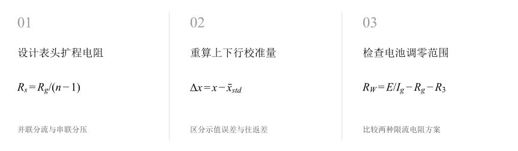
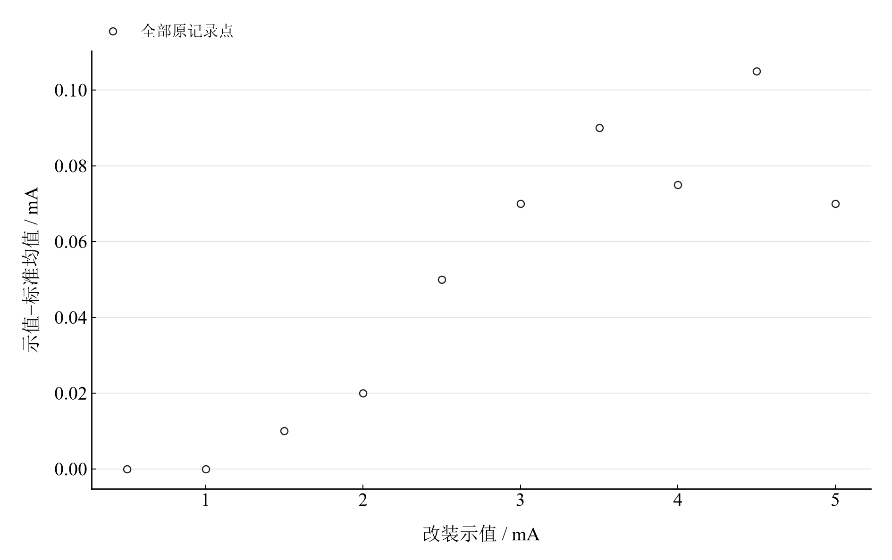
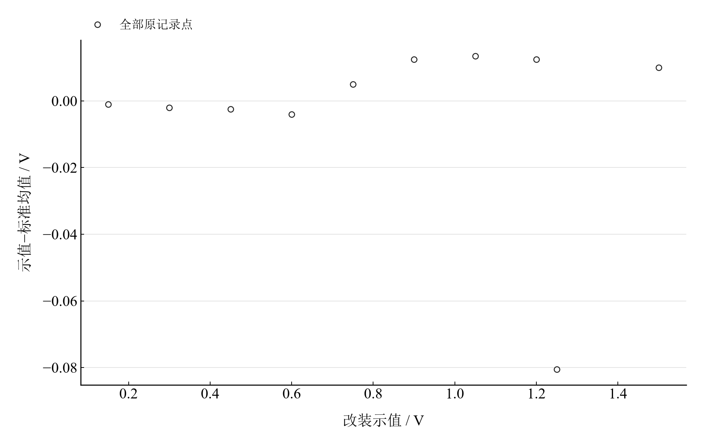
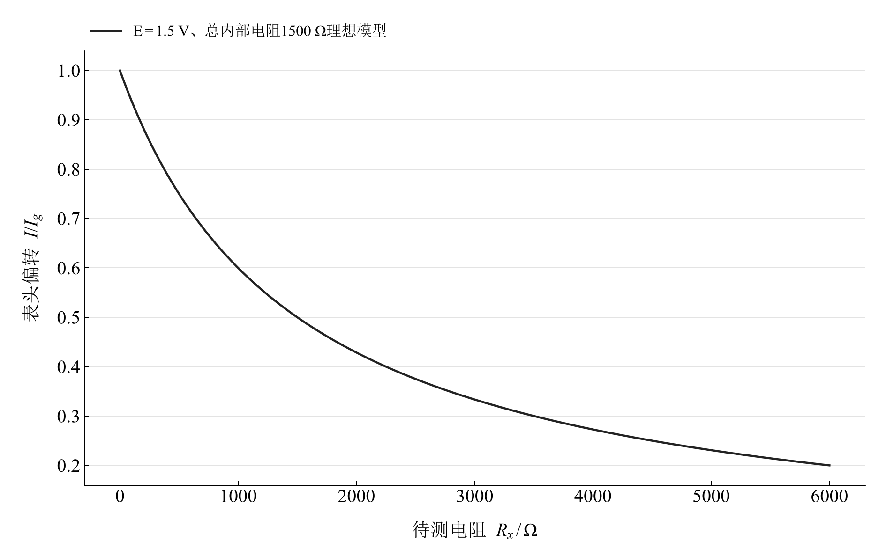

[普通物理实验 3](../README.md) · [项目首页](../../../README.md) · [使用指南](../../../docs/usage.md)

<!-- virtual-laboratory-entry -->
[在线虚拟实验](https://hnnuyuxuan.github.io/general-physics-lab/simulations/meter-calibration/) · [模型依据与参数来源](../../../docs/meter-calibration-model-evidence.md)

# 电表的改装与校准

**从表头扩程到多点校准，把误差曲线和调零范围一起看。**

将毫安表头扩为电流表与电压表，利用上下行标准读数计算示值误差。再设计串联欧姆表的调零电阻，观察电池电压变化如何约束可用调节范围。

[读实验报告](report/report.md) · [浏览器交互](https://hnnuyuxuan.github.io/general-physics-lab/experiments/course-03/meter-calibration/notebooks/analysis.html) · [Python 笔记本](notebooks/analysis.ipynb) · [Wolfram 笔记本](../../../notebook/paclets/MeterCalibrationLab/Notebooks/MeterCalibrationLab.nb)



图 1　设计表头扩程电阻 → 重算上下行校准量 → 检查电池调零范围

## 选择你的入口

|用途|入口|打开方式|
|---|---|---|
|阅读原理、记录与结论|[Markdown 实验报告](report/report.md) · [排版阅读版](https://hnnuyuxuan.github.io/general-physics-lab/experiments/course-03/meter-calibration/report/report.html)|GitHub、Markdown 阅读器或本地浏览器|
|改变参数、查看曲线响应|[HTML 交互阅读版](https://hnnuyuxuan.github.io/general-physics-lab/experiments/course-03/meter-calibration/notebooks/analysis.html)|直接在线打开，也可下载到本机|
|运行 Python 计算与探索|[Jupyter Notebook](notebooks/analysis.ipynb)|JupyterLab 或 VS Code|
|运行原生数学排版与交互计算|[Wolfram Notebook](../../../notebook/paclets/MeterCalibrationLab/Notebooks/MeterCalibrationLab.nb) · [Paclet 安装包](../../../notebook/paclets/MeterCalibrationLab/dist/MeterCalibrationLab-0.1.0.paclet)|Wolfram 前端|
|对照源实验记录|[源报告 PDF](../../../pdf/course-03/4电表的改装与校准/实验报告-电表的改装与校准.pdf)|GitHub 或 PDF 阅读器|

## 从记录到计算

电流表和电压表各有十个校准点，每点保留上下行标准读数。扩程设计采用表头 $I_g=1\ \mathrm{mA}$、$R_g=30\ \Omega$；欧姆设计考察电池 1.3–1.6 V 和 470 Ω 电位器。

校准先计算标准上下行均值，再计算“改装示值减标准均值”。往返差单独描述上下行读数的差异。扩程与调零设计则使用明确的表头参数。

$$
R_s=\frac{R_g}{n-1},\qquad R_M=\frac{U_{\mathrm{FS}}}{I_g}-R_g,\qquad R_W=\frac E{I_g}-R_g-R_3.
$$

表 1　关键计算结果

|计算量|数值|单位|
|---|---:|---|
|5 mA 扩程设计分流电阻|$7.5$|Ω|
|1.5 V 扩程设计串联电阻|$1470$|Ω|
|电流表最大示值误差绝对值|$0.105$|mA|
|电压表最大示值误差绝对值|$0.0805$|V|

电压 1.25 V 行对应标准均值 1.3305 V，是误差曲线上最明显的偏离，阅读时可直接返回该行核对。欧姆调零模型比较 1000 Ω 与 1100 Ω 两个限流电阻方案。

## 把校准偏离定位到具体读数



图 2　十个校准点重算的电流表示值误差

<table>
  <tr>
    <td width="50%" align="center" valign="top"><a href="assets/readme-voltage_error.svg"></a></td>
    <td width="50%" align="center" valign="top"><a href="assets/readme-ohm_model.svg"></a></td>
  </tr>
  <tr>
    <td align="center" valign="top"><strong>图 3</strong><br>十个校准点重算的电压表示值误差，包含 1.25 V 原记录行</td>
    <td align="center" valign="top"><strong>图 4</strong><br>中值电阻 1500 Ω、E=1.5 V 的理想欧姆刻度模型</td>
  </tr>
</table>

前两幅的纵轴是示值误差，零线表示与标准均值一致。第三幅给出欧姆档的理想偏转关系；观察校准读数与设计模型各自回答的问题。

## 在 Notebook 中探索

|操作|参数与范围|观察什么|
|---|---|---|
|切换欧姆限流电阻|选择 $R_3=1000,1100\ \Omega$|比较所需调零电阻随电池电压的变化与 0–470 Ω 范围|

[HTML 阅读版](https://hnnuyuxuan.github.io/general-physics-lab/experiments/course-03/meter-calibration/notebooks/analysis.html) 包含上述控件；[Jupyter](notebooks/analysis.ipynb) 与 [Wolfram Notebook](../../../notebook/paclets/MeterCalibrationLab/Notebooks/MeterCalibrationLab.nb) 沿报告章节展开公式、数据处理和模型计算。

建议按以下顺序阅读：

1. 先看上下行标准读数，区分示值误差和往返差。
2. 对照电压误差图中的明显偏离与 1.25 V 原记录行。
3. 切换限流电阻设计，检查整个 1.3–1.6 V 区间的调零可行性。

## 在本机打开

环境安装与字体设置见[使用指南](../../../docs/usage.md)。在仓库根目录启动本实验：

```powershell
.\.venv\Scripts\python.exe -m jupyterlab experiments/course-03/meter-calibration/notebooks/analysis.ipynb
```

安装 Paclet 后，通过包入口打开 Wolfram Notebook。将安装路径改为本机仓库所在位置：

```wolfram
PacletInstall["D:/general-physics-lab/notebook/paclets/MeterCalibrationLab/dist/MeterCalibrationLab-0.1.0.paclet"];
Needs["MeterCalibrationLab`"];
MeterCalibrationLab`OpenNotebook[]
```

## 数据与计算实现

|内容|入口|
|---|---|
|规范观测数据|[current.csv](data/current.csv) · [voltage.csv](data/voltage.csv)|
|单位、参数与模型条件|[experiment.json](experiment.json)|
|Python 计算模块|[meter_calibration.py](../../../src/physicslab/experiments/meter_calibration.py)|
|Wolfram 计算实现|[analysis.wl](../../../notebook/paclets/MeterCalibrationLab/Kernel/analysis.wl)|
|计算结果与数表|[python.json](results/python.json)|
|数据来源与整理记录|[provenance.json](data/provenance.json)|

[返回课程目录](../README.md) · [浏览全部实验](../../../README.md)
