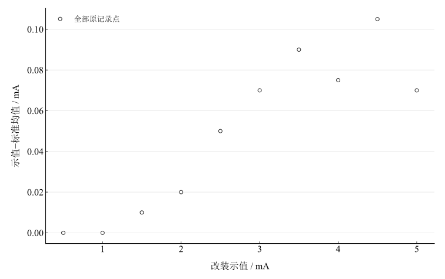
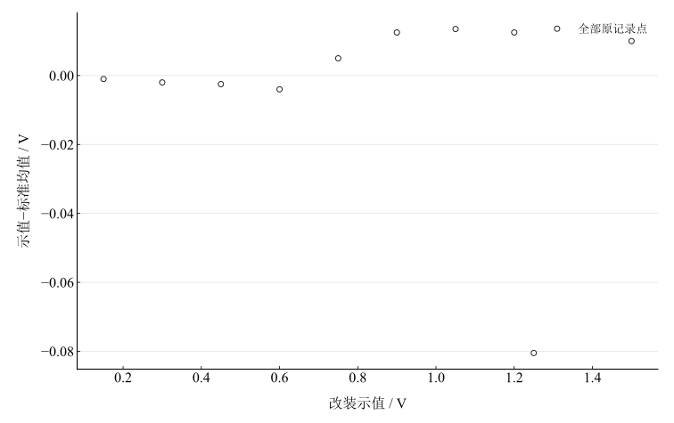
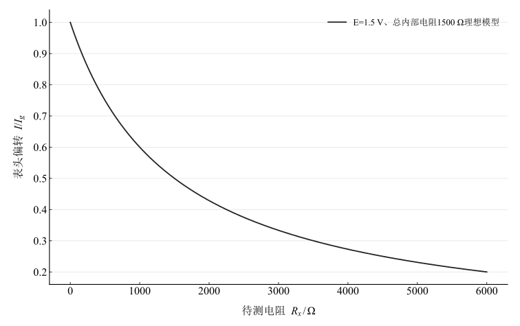

# 电表的改装与校准

淮南师范学院实验报告

学院：电子工程学院　专业：物理学　班级：24 物理 1 班

姓名：缪雨轩　学号：2414050120　实验日期：2025 年 10 月 11 日

## 一、实验名称

电表的改装与校准。

## 二、实验目的

1. 测量表头内阻与满度电流。
2. 将 $1\,\mathrm{mA}$ 表头改装为 $5\,\mathrm{mA}$ 电流表及 $1.5\,\mathrm{V}$ 电压表。
3. 设计中值电阻 $1500\,\Omega$、电源 $1.3$–$1.6\,\mathrm{V}$ 能调零的欧姆表。
4. 用标准电阻校准欧姆刻度，并用于未知电阻测量。

## 三、实验原理

### 1. 表头内阻

半电流法保持总电流不变，当并联分流电阻使表头电流减为原来的二分之一时，分流电阻等于表头内阻。替代法在电源和标准电流读数不变的条件下，以电阻箱代替表头，其等效阻值为表头内阻。两种方法均要求相应不变量实际得到保持。

### 2. 电流与电压扩程

表头满度电流 $I_g$、内阻 $R_g$，电流量程扩为 $nI_g$ 时并联分流电阻

$$
R_s=\frac{R_g}{n-1}.
$$

电压量程扩为 $U_{\mathrm{FS}}$ 时串联

$$
R_M=\frac{U_{\mathrm{FS}}}{I_g}-R_g.
$$

电流表串联接入，内阻应较小；电压表并联接入，内阻应较大。

### 3. 串联式欧姆表及调零

电源 $E$，限流电阻 $R_3$、调零电阻 $R_W$、待测电阻 $R_x$：

$$
I=\frac{E}{R_g+R_W+R_3+R_x}.
$$

短接表笔时调至满偏 $I_g$，欧姆零点位于满刻度；开路时电流为零，对应无穷大电阻。中值电阻为

$$
R_{\mathrm{mid}}=R_g+R_W+R_3=\frac{E}{I_g},\qquad R_x=R_{\mathrm{mid}}\Rightarrow I=\frac{I_g}{2}.
$$

刻度反向且非均匀。调零所需 $R_W=E/I_g-R_g-R_3$，设计必须检查整个电池电压区间。并联分流式还可通过表头分流调零，本次数值设计采用串联式。

### 4. 校准量定义

$$
\overline x_{\mathrm{std}}=\frac{x_{\uparrow}+x_{\downarrow}}2,\qquad\Delta x=x_{\mathrm{ind}}-\overline x_{\mathrm{std}},\qquad H=\vert x_{\uparrow}-x_{\downarrow}\vert .
$$

示值误差 $\Delta x$ 与往返差 $H$ 不同。以最大示值误差除以满量程得到的百分数是本次采样点的误差描述；标准表不确定度缺失时，不能据此完整认定准确度等级。

## 四、主要仪器设备

DH4508 型电表改装与校准实验仪，配套标准电流表、电压表、电阻箱与连接线。

## 五、实验步骤

1. 用半电流法或替代法测量表头内阻。
2. 按分流公式将 $1\,\mathrm{mA}$ 表头改装成 $5\,\mathrm{mA}$ 表；从小电源开始调节，上下行逐点记录标准表。限流电阻不得调至零。
3. 按串联扩程公式改装为 $1.5\,\mathrm{V}$ 电压表，以 $2\,\mathrm{V}$ 数显标准表上下行校准。
4. 欧姆表连接串联回路，短接表笔调满偏；用已知电阻记录偏转格数，检查电池电压范围内调零能力。

步骤计划的间隔与实际记录不完全一致，以下按实际表格点位复算。

## 六、原始数据记录

表 1　$5\,\mathrm{mA}$ 电流表校准记录

| 改装示值 / mA | 标准上行 / mA | 标准下行 / mA | 源表平均列 | 源表“误差”列 |
| --- | --- | --- | --- | --- |
| 0.5 | 0.5 | 0.5 | 0.5 | 0 |
| 1 | 1.01 | 0.99 | 1 | -0.02 |
| 1.5 | 1.49 | 1.49 | 1.49 | 0 |
| 2 | 1.97 | 1.99 | 1.98 | 0.02 |
| 2.5 | 2.45 | 2.45 | 2.45 | 0 |
| 3 | 2.93 | 2.93 | 2.93 | 0 |
| 3.5 | 3.41 | 3.41 | 3.41 | 0 |
| 4 | 3.93 | 3.92 | 3.93 | -0.01 |
| 4.5 | 4.41 | 4.38 | 4.4 | -0.03 |
| 5 | 4.93 | 4.93 | 4.93 | 0 |

表 2　$1.5\,\mathrm{V}$ 电压表校准记录

| 改装示值 / V | 标准上行 / V | 标准下行 / V | 源表平均列 | 源表“误差”列 |
| --- | --- | --- | --- | --- |
| 0.15 | 0.152 | 0.15 | 0.151 | -0.002 |
| 0.3 | 0.303 | 0.301 | 0.302 | -0.002 |
| 0.45 | 0.454 | 0.451 | 0.453 | -0.003 |
| 0.6 | 0.607 | 0.601 | 0.604 | -0.006 |
| 0.75 | 0.748 | 0.742 | 0.745 | -0.006 |
| 0.9 | 0.891 | 0.884 | 0.888 | -0.007 |
| 1.05 | 1.04 | 1.033 | 1.037 | -0.007 |
| 1.2 | 1.193 | 1.182 | 1.188 | -0.011 |
| 1.25 | 1.333 | 1.328 | 1.331 | -0.005 |
| 1.5 | 1.49 | 1.49 | 1.49 | 0 |

保留源表的平均列和“误差”列以便区分；正式示值误差在下一节独立重算。电压 $1.25\,\mathrm{V}$ 行的标准值为 $1.333,1.328\,\mathrm{V}$，存在录入或刻度疑点，未擅改成 $1.35\,\mathrm{V}$。

表 3　欧姆表偏转格数记录

| 记录列 | 表头不可辨识1 | 表头不可辨识2 | 表头不可辨识3 | 表头不可辨识4 | 原表标E=1.5 V | $2R_{\mathrm{mid}}$ | $3R_{\mathrm{mid}}$ | $4R_{\mathrm{mid}}$ | $5R_{\mathrm{mid}}$ |
| --- | --- | --- | --- | --- | --- | --- | --- | --- | --- |
| 偏转格数 | 33 | 30 | 24 | 16 | 0 | 16 | 30 | 33 | 33 |

前四个对应电阻表头不可辨识，且后列偏转不呈预期的随电阻增大而下降关系。现有记录不能可靠标定欧姆刻度，未据其反演未知电阻。

## 七、数据处理

### 1. 电流表示值误差与往返差

表 4　电流表重算校准结果

| 改装示值 / mA | 标准均值 / mA | 示值−标准均值 / mA | 往返差绝对值 / mA |
| --- | --- | --- | --- |
| 0.5 | 0.5 | 0 | 0 |
| 1 | 1 | 0 | 0.02 |
| 1.5 | 1.49 | 0.01 | 0 |
| 2 | 1.98 | 0.02 | 0.02 |
| 2.5 | 2.45 | 0.05 | 0 |
| 3 | 2.93 | 0.07 | 0 |
| 3.5 | 3.41 | 0.09 | 0 |
| 4 | 3.925 | 0.075 | 0.01 |
| 4.5 | 4.395 | 0.105 | 0.03 |
| 5 | 4.93 | 0.07 | 0 |

图 1　改装电流表的示值误差

### 2. 电压表示值误差与往返差

表 5　电压表重算校准结果

| 改装示值 / V | 标准均值 / V | 示值−标准均值 / V | 往返差绝对值 / V |
| --- | --- | --- | --- |
| 0.15 | 0.151 | -0.001 | 0.002 |
| 0.3 | 0.302 | -0.002 | 0.002 |
| 0.45 | 0.4525 | -0.0025 | 0.003 |
| 0.6 | 0.604 | -0.004 | 0.006 |
| 0.75 | 0.745 | 0.005 | 0.006 |
| 0.9 | 0.8875 | 0.0125 | 0.007 |
| 1.05 | 1.0365 | 0.0135 | 0.007 |
| 1.2 | 1.1875 | 0.0125 | 0.011 |
| 1.25 | 1.3305 | -0.0805 | 0.005 |
| 1.5 | 1.49 | 0.01 | 0 |

图 2　改装电压表的示值误差（保留待核的 $1.25\,\mathrm{V}$ 行）

最大误差绝对值分别为 $0.105\,\mathrm{mA}$、$0.0805\,\mathrm{V}$，相对满量程分别为 $2.1\%$、$5.366666667\%$。最大往返差分别为 $0.03\,\mathrm{mA}$、$0.011\,\mathrm{V}$。

### 3. 扩程电阻与欧姆调零设计

源设计给出 $R_s=7.5\,\Omega$、$R_M=1470\,\Omega$，结合 $I_g=1\,\mathrm{mA}$ 可反推设计采用 $R_g=30\,\Omega$。未提供其独立测量记录，以下只作该条件下的设计计算。

表 6　$R_g=30\,\Omega$、$I_g=1\,\mathrm{mA}$ 条件下的欧姆调零设计

| 限流电阻 / Ω | 电源1.3 V所需调零电阻 / Ω | 电源1.5 V所需调零电阻 / Ω | 电源1.6 V所需调零电阻 / Ω | 470 Ω电位器是否覆盖 |
| --- | --- | --- | --- | --- |
| 1000 | 270 | 470 | 570 | 否 |
| 1100 | 170 | 370 | 470 | 是（理想模型） |

原 $R_3=1000\,\Omega$、最大 $R_W=470\,\Omega$ 在 $1.6\,\mathrm{V}$ 需 $570\,\Omega$，不能覆盖全区间。若采用 $R_3=1100\,\Omega$，则 $1.3$–$1.6\,\mathrm{V}$ 所需 $R_W=170$–$470\,\Omega$，理想模型下可覆盖；这是改进设计建议，不是已改接的实验事实。$E=1.5\,\mathrm{V}$ 时总内阻为 $1500\,\Omega$，可满足设计中值。

图 3　中值电阻 $1500\,\Omega$ 的理想欧姆刻度模型

## 八、实验结果与讨论

1. 分流和串联扩程电阻在条件 $R_g=30\,\Omega$ 下分别为 $7.5\,\Omega$、$1470\,\Omega$。实际表头内阻需有独立记录才能验证设计输入。
2. 源表“误差”列反映上下行差，不能用于宣称 $0.6\%$、$0.73\%$ 准确度。按示值−标准均值重算，电流表采样点最大相对满量程误差约 $2.1\%$；电压表包含待核行的结果约 $5.367\%$，现有记录不支持两表均达到 1.0 级。
3. 电压待核点需回查原始读数，标准表的准确度和不确定度也未提供。不能以拟合或擅改该点消除异常再认定等级。
4. 欧姆表调零覆盖范围可用设计公式检查，但现有偏转标定数据不足，不能宣称已完成可靠的未知电阻直读。改善电阻表头记录、重复上下行校准及控制接触、温升、视差，是后续核验重点。
