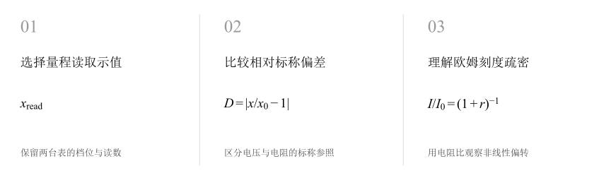
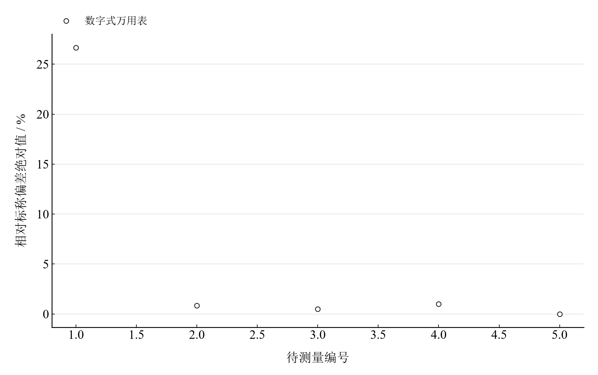
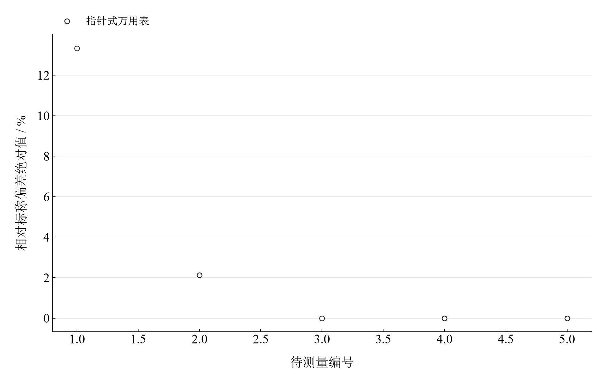
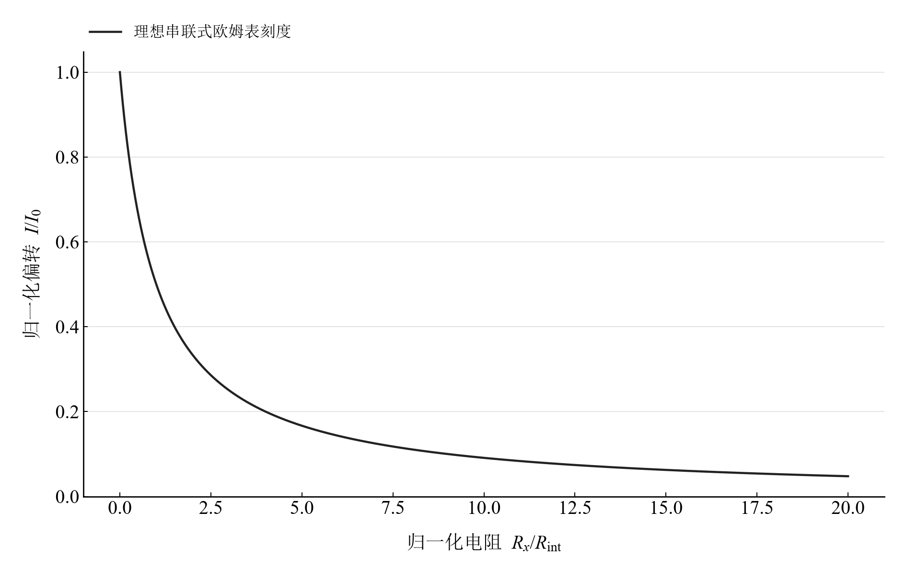

[普通物理实验 3](../README.md) · [项目首页](../../../README.md) · [使用指南](../../../docs/usage.md)

<!-- virtual-laboratory-entry -->
[在线虚拟实验](https://hnnuyuxuan.github.io/general-physics-lab/simulations/multimeter/) · [模型依据与参数来源](../../../docs/multimeter-model-evidence.md)

# 万用电表的使用

**从一根指针和一串数字，认识量程、分辨率与欧姆刻度。**

用数字式与指针式万用表测量五组电压、五个电阻，比较读数与标称值。再把欧姆档写成无量纲电路模型，理解为什么同一刻度盘不同位置的读数难度不同。

[读实验报告](report/report.md) · [浏览器交互](https://hnnuyuxuan.github.io/general-physics-lab/experiments/course-03/multimeter/notebooks/analysis.html) · [Python 笔记本](notebooks/analysis.ipynb) · [Wolfram 笔记本](../../../notebook/paclets/MultimeterLab/Notebooks/MultimeterLab.nb)



图 1　选择量程读取示值 → 比较相对标称偏差 → 理解欧姆刻度疏密

## 选择你的入口

|用途|入口|打开方式|
|---|---|---|
|阅读原理、记录与结论|[Markdown 实验报告](report/report.md) · [排版阅读版](https://hnnuyuxuan.github.io/general-physics-lab/experiments/course-03/multimeter/report/report.html)|GitHub、Markdown 阅读器或本地浏览器|
|改变参数、查看曲线响应|[HTML 交互阅读版](https://hnnuyuxuan.github.io/general-physics-lab/experiments/course-03/multimeter/notebooks/analysis.html)|直接在线打开，也可下载到本机|
|运行 Python 计算与探索|[Jupyter Notebook](notebooks/analysis.ipynb)|JupyterLab 或 VS Code|
|运行原生数学排版与交互计算|[Wolfram Notebook](../../../notebook/paclets/MultimeterLab/Notebooks/MultimeterLab.nb) · [Paclet 安装包](../../../notebook/paclets/MultimeterLab/dist/MultimeterLab-0.1.0.paclet)|Wolfram 前端|
|对照源实验记录|[源报告 PDF](../../../pdf/course-03/1万用电表的使用/实验报告-万用电表的使用.pdf)|GitHub 或 PDF 阅读器|

## 从记录到计算

数据包括五个电阻（3 Ω 至 20 kΩ）和照明电路、四种电池的电压读数。每种对象各保留两台表的量程与示值；下表选择两类有代表性的标称比较。

欧姆档采用内置电池、串联总内阻与待测电阻的理想模型。$R_x=R_{\mathrm{int}}$ 时指针半偏；标称值是读数比较的参照，仪表误差评价则需要校准标准。

$$
\frac{I_x}{I_0}=\frac{1}{1+R_x/R_{\mathrm{int}}},\qquad D=\left|\frac{x_{\mathrm{read}}-x_{\mathrm{nom}}}{x_{\mathrm{nom}}}\right|\times100\%.
$$

表 1　关键计算结果

|计算量|数值|单位|
|---|---:|---|
|3 Ω 电阻：数字表标称偏差|$26.6667$|%|
|47 Ω 电阻：数字表标称偏差|$0.851064$|%|
|七号电池：数字表标称偏差|$74.2$|%|

低阻读数对表笔、导线和接触更敏感；七号电池的端电压读数为数字表 0.387 V、指针表 0.25 V。将这些现象与量程、实际负载和电池状态联系起来阅读。

## 把标称比较与刻度模型放在一起



图 2　五个电阻的数字表读数相对标称偏差绝对值

<table>
  <tr>
    <td width="50%" align="center" valign="top"><a href="assets/readme-resistance_analog_deviation.svg"></a></td>
    <td width="50%" align="center" valign="top"><a href="assets/readme-ohm_scale.svg"></a></td>
  </tr>
  <tr>
    <td align="center" valign="top"><strong>图 3</strong><br>同五个电阻的指针表读数相对标称偏差绝对值</td>
    <td align="center" valign="top"><strong>图 4</strong><br>理想串联欧姆表的归一化刻度曲线</td>
  </tr>
</table>

电阻编号依次对应 3、47、200、2000、20000 Ω。前两幅展示观测读数的标称比较，第三幅是电路方程计算的刻度模型；将曲线斜率与指针位置对应，可理解中段读数的优势。

## 在 Notebook 中探索

|操作|参数与范围|观察什么|
|---|---|---|
|移动欧姆刻度滑块|选择电阻比 $R_x/R_{\mathrm{int}}=0.1,0.5,1,2,5,10,20$|观察标记点的归一化偏转与局部刻度疏密|

[HTML 阅读版](https://hnnuyuxuan.github.io/general-physics-lab/experiments/course-03/multimeter/notebooks/analysis.html) 包含上述控件；[Jupyter](notebooks/analysis.ipynb) 与 [Wolfram Notebook](../../../notebook/paclets/MultimeterLab/Notebooks/MultimeterLab.nb) 沿报告章节展开公式、数据处理和模型计算。

建议按以下顺序阅读：

1. 先从报告中的量程表读出各对象的示值，再比较两类万用表。
2. 在欧姆模型中选择电阻比 1 与 10，比较半偏位置和靠近零电流处的刻度。
3. 在 Notebook 中查看一分度半宽条件下的 B 类估计，结合读数界限的定义理解其数值。

## 在本机打开

环境安装与字体设置见[使用指南](../../../docs/usage.md)。在仓库根目录启动本实验：

```powershell
.\.venv\Scripts\python.exe -m jupyterlab experiments/course-03/multimeter/notebooks/analysis.ipynb
```

安装 Paclet 后，通过包入口打开 Wolfram Notebook。将安装路径改为本机仓库所在位置：

```wolfram
PacletInstall["D:/general-physics-lab/notebook/paclets/MultimeterLab/dist/MultimeterLab-0.1.0.paclet"];
Needs["MultimeterLab`"];
MultimeterLab`OpenNotebook[]
```

## 数据与计算实现

|内容|入口|
|---|---|
|规范观测数据|[resistance.csv](data/resistance.csv) · [voltage.csv](data/voltage.csv)|
|单位、参数与模型条件|[experiment.json](experiment.json)|
|Python 计算模块|[multimeter.py](../../../src/physicslab/experiments/multimeter.py)|
|Wolfram 计算实现|[analysis.wl](../../../notebook/paclets/MultimeterLab/Kernel/analysis.wl)|
|计算结果与数表|[python.json](results/python.json)|
|数据来源与整理记录|[provenance.json](data/provenance.json)|

[返回课程目录](../README.md) · [浏览全部实验](../../../README.md)
