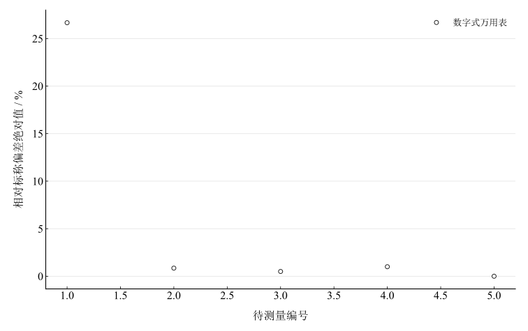
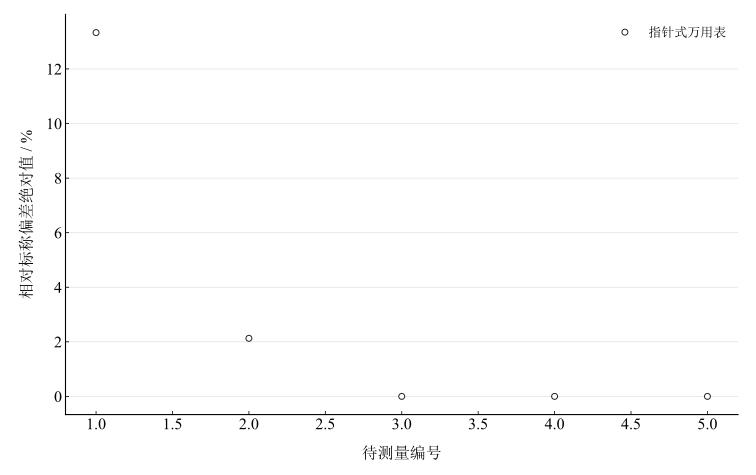

# 万用电表的使用

淮南师范学院实验报告

学院：电子工程学院　专业：物理学　班级：24 物理 1 班

姓名：缪雨轩　学号：2414050120　实验日期：2025 年 9 月 10 日

## 一、实验名称

万用电表的使用。

## 二、实验目的

1. 了解磁电式指针万用表的结构和工作原理。
2. 了解数字万用表的结构和工作原理。
3. 掌握电压、电阻、电流的测量方法；本次记录实际包含电压与电阻测量。

## 三、实验原理

指针式表头并联分流电阻扩展电流量程，串联分压电阻扩展电压量程；数字万用表以取样和模数转换形成显示读数。

指针式欧姆档由内置电池供电，短接表笔调零后，理想串联回路满足

$$
E=I_x(R_g+R+R_0+R_x),\qquad R_x=\frac{E}{I_x}-(R_g+R+R_0).
$$

令内部串联电阻合计为 $R_{\mathrm{int}}$，短接电流为 $I_0$，则

$$
\frac{I_x}{I_0}=\frac{1}{1+R_x/R_{\mathrm{int}}}.
$$

欧姆刻度非线性，量程选择应使指针落在便于读数的中段，换档后重新调零。

均匀分布、半宽为 $a$ 的读数界限对应标准不确定度 $u_B=a/\sqrt{3}$。本次沿用一最小分度作为半宽的保守估计；若只考虑以分度 $q$ 舍入，则应使用 $q/(2\sqrt{3})$，两种定义不能混同。

$$
u_B=\frac{a}{\sqrt{3}},\qquad \Delta_{\mathrm{FS}}=0.03\,FS.
$$

$3\%FS$ 是本次采用的示例限差条件，未获得本台仪表精度等级的校准依据。独立的标准不确定度按平方和合成后，扩展不确定度为 $U=k u_c$；本次单次读数不足以估计 A 类重复性，不将 $k=2$ 的 A 类项与未经同样扩展的 B 类项直接混合。

## 四、主要仪器设备

数字万用表、MF47 类指针万用表、电池（方块、1号、甲号、七号）、标准电阻或电阻箱及连接导线。

## 五、实验步骤

### 1. 数字式万用表

电压档正确插接表笔，选择档位及量程，并联于被测两端读数；电阻档接在断电的待测电阻两端读数。结束后复位至交流电压最大档并关机。

### 2. 指针式万用表

水平放置、机械调零，电压测量按并联方式接入并选择适当量程。欧姆档每次换档均短接表笔调零，再测电阻。读数后复位至交流电压最大档。

## 六、原始数据记录

表 1　两种万用表的电阻测量记录（电阻统一用欧姆表示）

| 待测量 | 标称值 / Ω | 数字表量程 | 数字表读数 / Ω | 指针表量程 | 指针表读数 / Ω |
| --- | --- | --- | --- | --- | --- |
| 3 Ω | 3 | 0–200 Ω | 3.8 | ×1 | 2.6 |
| 47 Ω | 47 | 0–200 Ω | 47.4 | ×1 | 46 |
| 200 Ω | 200 | 0–2 kΩ | 199 | ×10 | 200 |
| 2 kΩ | 2000 | 0–20 kΩ | 1980 | ×100 | 2000 |
| 20 kΩ | 20000 | 0–200 kΩ | 20000 | ×1000 | 20000 |

表 2　两种万用表的电压测量记录

| 待测量 | 标称值 / V | 数字表量程 | 数字表读数 / V | 指针表量程 | 指针表读数 / V |
| --- | --- | --- | --- | --- | --- |
| 照明电路 | 220 | 0–750 V | 179 | 250 | 240 |
| 方块电池 | 9 | 0–20 V | 9.68 | 10 | 9.6 |
| 1号电池 | 1.5 | 0–2 V | 1.585 | 2.5 | 1.55 |
| 甲号电池 | 1.5 | 0–2 V | 1.408 | 2.5 | 1.35 |
| 七号电池 | 1.5 | 0–2 V | 0.387 | 1 | 0.25 |

表中标称电压仅供比较；电池端电压随状态和负载变化，不能把标称值当成当时准确真值。

## 七、数据处理

### 1. 相对标称偏差

$$
D=\left\vert \frac{x_{\mathrm{read}}-x_{\mathrm{nom}}}{x_{\mathrm{nom}}}\right\vert \times100\%.
$$

### 2. B 类条件估计

电压的一分度界限依次采用 $5,0.2,0.05,0.05,0.02\,\mathrm{V}$，电阻依次采用 $0.2,0.2,2,20,200\,\Omega$，按 $u_B=a/\sqrt{3}$ 计算。这些参数为本次报告估计依据，并非仪表校准规格。

### 3. 电压计算

表 3　电压标称偏差及条件不确定度估计

| 待测量 | 数字表标称偏差 / % | 指针表标称偏差 / % | 一分度假定界限 / V | 条件标准不确定度 / V | 假定 $3\%\mathrm{FS}$ 界限 / V |
| --- | --- | --- | --- | --- | --- |
| 照明电路 | 18.636 | 9.091 | 5 | 2.886751 | 7.5 |
| 方块电池 | 7.556 | 6.667 | 0.2 | 0.11547 | 0.3 |
| 1号电池 | 5.667 | 3.333 | 0.05 | 0.028868 | 0.075 |
| 甲号电池 | 6.133 | 10 | 0.05 | 0.028868 | 0.075 |
| 七号电池 | 74.2 | 83.333 | 0.02 | 0.011547 | 0.03 |

例如照明电路数字表与 $220\,\mathrm{V}$ 的偏差为 $18.636\%$，指针表为 $9.091\%$；假定 $250\,\mathrm{V}$ 档满足 $3\%FS$，其界限为 $7.5\,\mathrm{V}$，而 $240-220=20\,\mathrm{V}$，不能据此称两值在该界限内一致。

### 4. 电阻计算

表 4　电阻标称偏差及条件不确定度估计

| 待测量 | 数字表标称偏差 / % | 指针表标称偏差 / % | 一分度假定界限 / Ω | 条件标准不确定度 / Ω |
| --- | --- | --- | --- | --- |
| 3 Ω | 26.667 | 13.333 | 0.2 | 0.11547 |
| 47 Ω | 0.851 | 2.128 | 0.2 | 0.11547 |
| 200 Ω | 0.5 | 0 | 2 | 1.154701 |
| 2 kΩ | 1 | 0 | 20 | 11.547005 |
| 20 kΩ | 0 | 0 | 200 | 115.47005 |

图 1　数字表电阻读数与标称值的相对偏差（编号依次为表 1 五个待测量）

图 2　指针表电阻读数与标称值的相对偏差（编号依次为表 1 五个待测量）

## 八、实验结果与讨论

1. 照明电路两仪表读数 $179\,\mathrm{V}$ 与 $240\,\mathrm{V}$ 差异较大。需核查测量是否同步、交流档位、接触及波形响应；不能由现有记录确定唯一原因，也不能用假定 $3\%FS$ 声称与 $220\,\mathrm{V}$ 一致。
2. 方块电池、1号及甲号电池读数与标称值相差约 $3\%$–$10\%$。七号电池读数 $0.387\,\mathrm{V}$、$0.25\,\mathrm{V}$ 明显较低，可判断测量时端电压偏低；剩余容量、极化和内阻仍需负载测试。
3. 数字表的 $47\,\Omega$ 至 $20\,\mathrm{k}\Omega$ 读数相对标称偏差不超过 $1\%$，$3\,\Omega$ 读数偏差为 $26.667\%$。低阻测量易受表笔、导线和接触电阻影响，但本次没有短路校正，不能量化各项贡献。
4. 指针欧姆档刻度非线性，高阻档所采用的一分度绝对界限较大。量程与指针位置影响读数分辨力，应避免把显示恰等于标称值解释为零不确定度。
5. 本次缺少重复测量和仪表检定信息，计算提供标称比较及明确假定下的 B 类估计，没有给出完整扩展不确定度。
