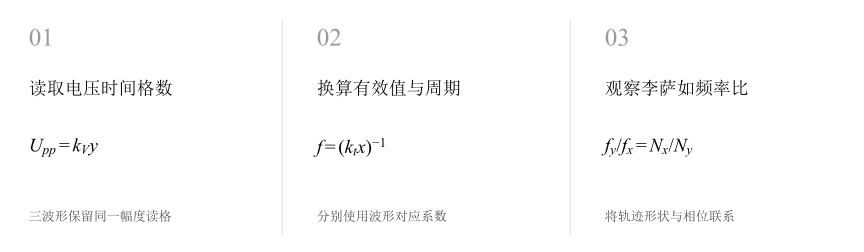
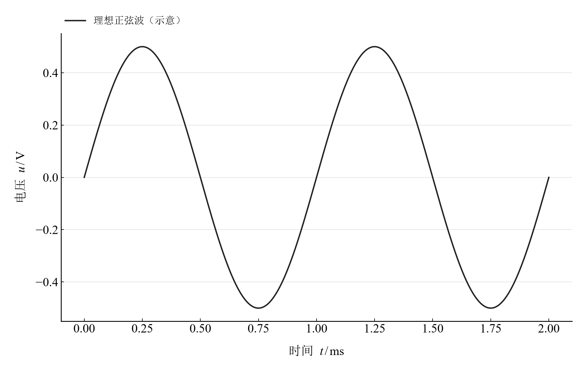
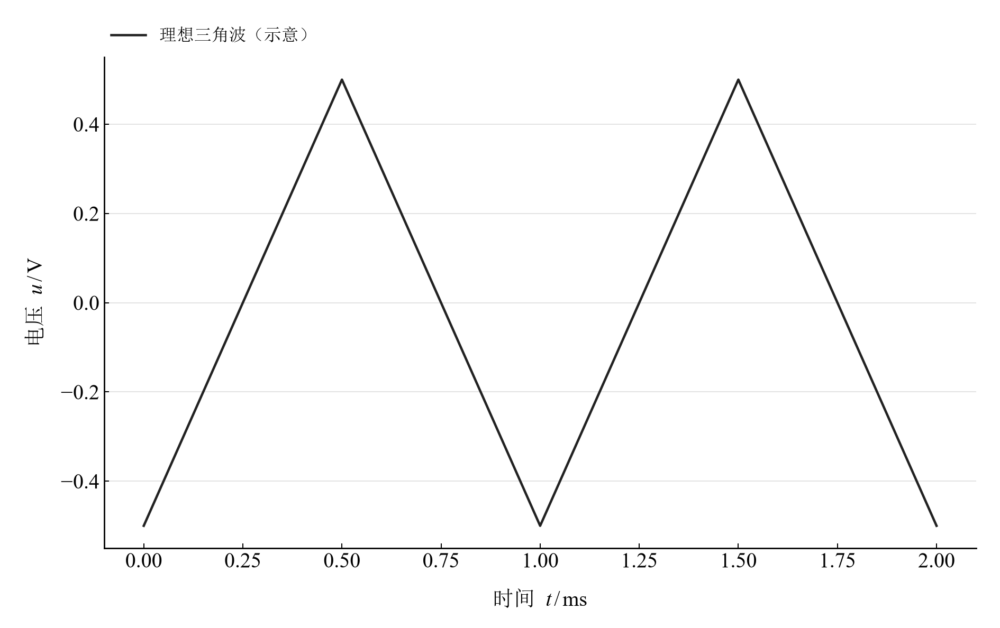
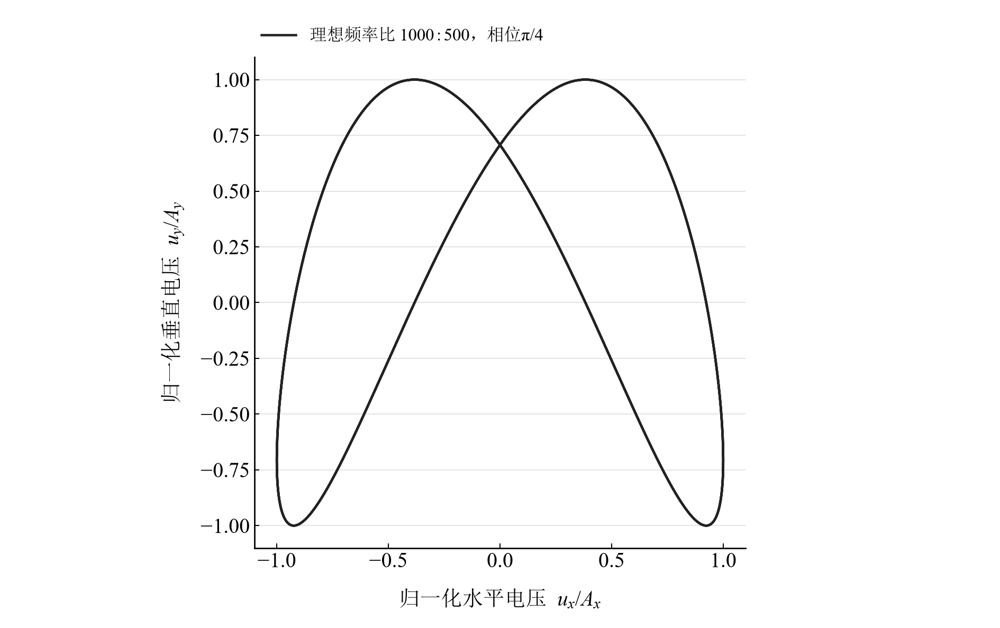

[普通物理实验 3](../README.md) · [项目首页](../../../README.md) · [使用指南](../../../docs/usage.md)

# 示波器的调节与使用

**把格数换成物理量，把闭合轨迹换成频率比。**

从正弦、三角和方波的屏幕读格计算幅度、有效值与周期，再用李萨如图形比较频率。相同峰峰值的不同波形具有不同有效值，频率比和相位也会共同改变轨迹形状。

[读实验报告](report/report.md) · [浏览器交互](notebooks/analysis.html) · [Python 笔记本](notebooks/analysis.ipynb) · [Wolfram 笔记本](../../../notebook/paclets/OscilloscopeLab/Notebooks/OscilloscopeLab.nb)



图 1　读取电压时间格数 → 换算有效值与周期 → 观察李萨如频率比

## 选择你的入口

|用途|入口|打开方式|
|---|---|---|
|阅读原理、记录与结论|[Markdown 实验报告](report/report.md) · [排版阅读版](report/report.html)|GitHub、Markdown 阅读器或本地浏览器|
|改变参数、查看曲线响应|[HTML 交互阅读版](notebooks/analysis.html)|下载后用浏览器打开|
|运行 Python 计算与探索|[Jupyter Notebook](notebooks/analysis.ipynb)|JupyterLab 或 VS Code|
|运行原生数学排版与交互计算|[Wolfram Notebook](../../../notebook/paclets/OscilloscopeLab/Notebooks/OscilloscopeLab.nb) · [Paclet 安装包](../../../notebook/paclets/OscilloscopeLab/dist/OscilloscopeLab-0.1.0.paclet)|Wolfram 前端|
|对照源实验记录|[源报告 PDF](../../../pdf/course-03/8示波器的调节与使用/实验报告-示波器的调节和使用实验.pdf)|GitHub 或 PDF 阅读器|

## 从记录到计算

三种波形均记录电压档 0.2 V/div、峰峰高度 5 div、时间档 0.2 ms/div、周期长度 5 div。李萨如记录使用五种标准频率，与约 1000 Hz 的待测信号比较。

对称、无直流分量、方波占空比 50% 的理想波形，其有效值分别为 $U_p/\sqrt2$、$U_p/\sqrt3$ 与 $U_p$。李萨如频率换算采用报告所定义的交点计数方向。

$$
U_{pp}=k_Vy,\qquad T=k_tx,\qquad f=1/T,\qquad f_y=f_x\frac{N_x}{N_y}.
$$

表 1　关键计算结果

|计算量|数值|单位|
|---|---:|---|
|正弦波读格换算有效值|$0.353553$|V|
|三角波读格换算有效值|$0.288675$|V|
|方波读格换算有效值|$0.5$|V|
|五组李萨如计数频率均值|$1000$|Hz|

三种波形的峰峰值同为 1 V，几何有效值却不同。正弦毫伏表读数 0.507 V 与读格换算值的偏差约为 43.4%，可结合测量档位、读格与仪表响应阅读原记录。

## 时间波形与 X–Y 轨迹的两种视角



图 2　峰值 0.5 V、频率 1000 Hz 的理想正弦波模型

<table>
  <tr>
    <td width="50%" align="center" valign="top"><a href="assets/readme-triangle_wave.svg"></a></td>
    <td width="50%" align="center" valign="top"><a href="assets/readme-lissajous_2.svg"></a></td>
  </tr>
  <tr>
    <td align="center" valign="top"><strong>图 3</strong><br>相同峰值与频率的理想三角波模型</td>
    <td align="center" valign="top"><strong>图 4</strong><br>频率比 fy:fx=1000:500、相位 π/4 的理想李萨如轨迹</td>
  </tr>
</table>

时间波形将横轴解释为毫秒；李萨如图将两轴解释为归一化电压。这里的曲线由相应理想方程生成，读格与交点计数保存在原记录表。

## 在 Notebook 中探索

|操作|参数与范围|观察什么|
|---|---|---|
|切换波形|在正弦、三角和方波之间选择|比较相同峰峰值下的形状与有效值关系|
|改变标准频率和相位|标准频率 250–2000 Hz 五档，相位 $0,\pi/4,\pi/2$|观察闭合轨迹、交点数和特殊相位的退化形状|

[HTML 阅读版](notebooks/analysis.html) 包含上述控件；[Jupyter](notebooks/analysis.ipynb) 与 [Wolfram Notebook](../../../notebook/paclets/OscilloscopeLab/Notebooks/OscilloscopeLab.nb) 沿报告章节展开公式、数据处理和模型计算。

建议按以下顺序阅读：

1. 先由电压档和格数复算峰峰值、峰值，再使用各波形对应的有效值系数。
2. 从时间档复算周期，比较周期法和李萨如计数法得到的频率。
3. 切换频率比与相位，观察哪些轨迹适合使用一般交点计数。

## 在本机打开

环境安装与字体设置见[使用指南](../../../docs/usage.md)。在仓库根目录启动本实验：

```powershell
.\.venv\Scripts\python.exe -m jupyterlab experiments/course-03/oscilloscope/notebooks/analysis.ipynb
```

安装 Paclet 后，通过包入口打开 Wolfram Notebook。将安装路径改为本机仓库所在位置：

```wolfram
PacletInstall["D:/general-physics-lab/notebook/paclets/OscilloscopeLab/dist/OscilloscopeLab-0.1.0.paclet"];
Needs["OscilloscopeLab`"];
OscilloscopeLab`OpenNotebook[]
```

## 数据与计算实现

|内容|入口|
|---|---|
|规范观测数据|[lissajous.csv](data/lissajous.csv) · [waveforms.csv](data/waveforms.csv)|
|单位、参数与模型条件|[experiment.json](experiment.json)|
|Python 计算模块|[oscilloscope.py](../../../src/physicslab/experiments/oscilloscope.py)|
|Wolfram 计算实现|[analysis.wl](../../../notebook/paclets/OscilloscopeLab/Kernel/analysis.wl)|
|计算结果与数表|[python.json](results/python.json)|
|数据来源与整理记录|[provenance.json](data/provenance.json)|

[返回课程目录](../README.md) · [浏览全部实验](../../../README.md)
