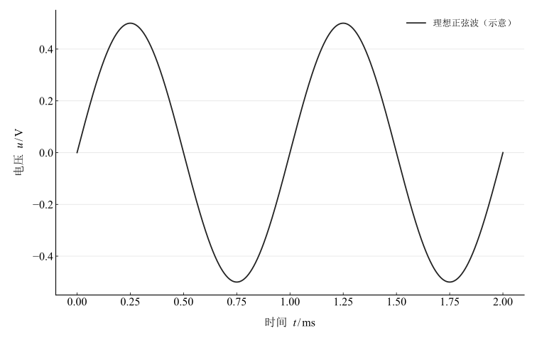
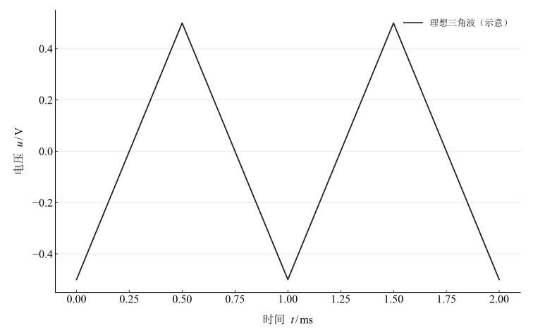
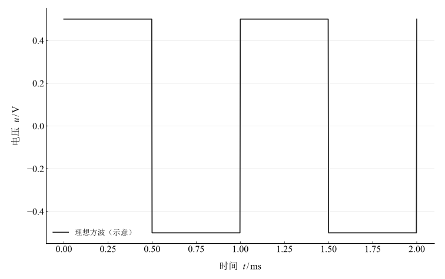
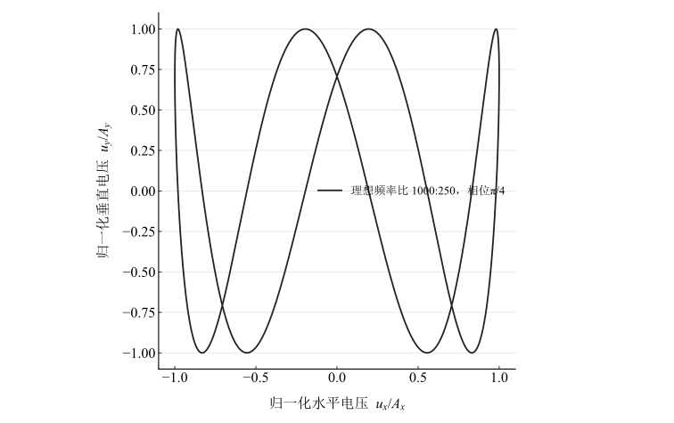
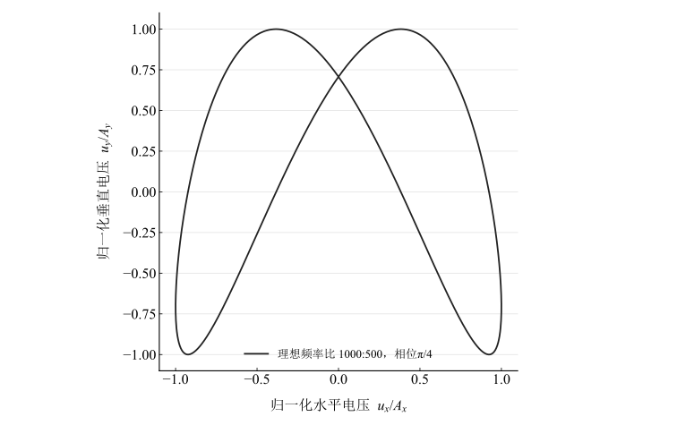
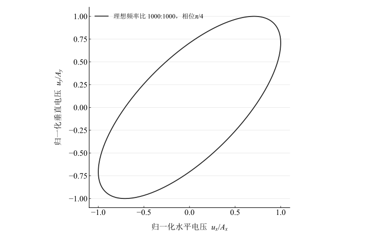
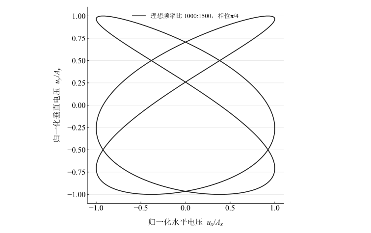
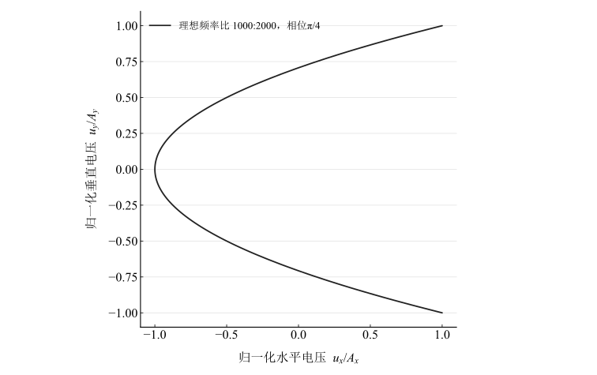

# 示波器的调节与使用

淮南师范学院实验报告

学院：电子工程学院　专业：物理学　班级：24 物理 1 班

姓名：缪雨轩　学号：2414050120　实验日期：2025 年 11 月 12 日

## 一、实验名称

示波器的调节与使用。

## 二、实验目的

1. 了解示波器基本结构及工作原理。
2. 掌握显示稳定波形的调节方法。
3. 测量交流信号峰峰值、峰值、有效值、周期和频率。
4. 使用 X–Y 模式李萨如图形比较频率。

## 三、实验原理

### 1. 基本显示

本实验的示波管式仪器由垂直放大与偏转显示输入电压，水平锯齿扫描将时间转为空间位置。触发使周期波形稳定，位移、辉度和聚焦用于清晰观察。

### 2. 电压测量

电压档 $k_V$、峰峰垂直长度 $y$ 给出

$$
U_{pp}=k_Vy,\qquad U_p=\frac{U_{pp}}2.
$$

对无直流分量的对称波形：

$$
U_{\mathrm{rms,sine}}=\frac{U_p}{\sqrt2},\qquad U_{\mathrm{rms,triangle}}=\frac{U_p}{\sqrt3},\qquad U_{\mathrm{rms,square}}=U_p.
$$

上述三角、方波关系采用对称占空比；波形失真、偏置及占空比改变时，应从 $U_{\mathrm{rms}}=\sqrt{T^{-1}\int_0^T u^2(t)\,\mathrm dt}$ 重新计算。

### 3. 周期换算法

扫描档 $k_t$ 与一个周期水平长度 $x$ 对应

$$
T=k_tx,\qquad f=\frac1T.
$$

### 4. 李萨如频率比较

X、Y 分别输入标准和待测正弦电压，满足

$$
u_x=A_x\sin(2\pi f_xt),\qquad u_y=A_y\sin(2\pi f_yt+\phi).
$$

采用表格中水平计数线交点数 $N_x$、垂直计数线交点数 $N_y$ 的约定，避开自交、重合及切点退化，可得

$$
\frac{f_y}{f_x}=\frac{N_x}{N_y},\qquad f_y=f_x\frac{N_x}{N_y}.
$$

频率为简单有理比、相位稳定时得到闭合图形。特殊相位可能使轨迹重合成线，不能照搬一般图形的可见交点计数。

## 四、主要仪器设备

双踪示波器、函数信号发生器、交流毫伏表及连接导线。

## 五、实验步骤

1. 选择自动触发和时间扫描，调辉度、聚焦、X/Y 位移至清晰居中。
2. 正弦信号接 Y 输入，选电压和扫描档，使屏幕显示约一至两个周期，记录峰峰格数并用交流毫伏表比较；再测三角与方波。
3. 记录完整周期水平格数，由扫描档换算周期和频率，与 $1000\,\mathrm{Hz}$ 设定比较。
4. 切换 X–Y 模式，Y 输入待测约 $1000\,\mathrm{Hz}$，X 输入 $250,500,1000,1500,2000\,\mathrm{Hz}$ 标准信号，记录稳定图形及交点数。

## 六、原始数据记录

### 1. 交流信号电压

表 1　原几何读数、已有处理值及独立有效值复算

{{tables.voltage}}

三波形都读得 $U_{pp}=1\,\mathrm{V}$，故峰值为 $0.5\,\mathrm{V}$。正弦有效值为 $0.353553\,\mathrm{V}$，源表的 $0.5\,\mathrm{V}$ 是处理错误；原格数与毫伏表读数保持不变。偏差以重算有效值为分母，带正负号。

图 1　峰值 $0.5\,\mathrm{V}$、频率 $1000\,\mathrm{Hz}$ 的理想正弦波

图 2　相同峰值与频率的理想三角波

图 3　相同峰值与频率、占空比 $50\%$ 的理想方波

### 2. 周期法频率

表 2　扫描读数及频率复算

{{tables.period}}

读数 $0.2\,\mathrm{ms/div}\times5\,\mathrm{div}=1\,\mathrm{ms}$ 对应 $1000\,\mathrm{Hz}$；数值与信号源设定一致，只表示现有读数精度下的吻合，不代表测得频率没有误差。

### 3. 李萨如图形计数

表 3　交点计数与待测频率

{{tables.lissajous}}

五组均算得 $1000\,\mathrm{Hz}$，算术均值为 ${{metrics.lissajous_mean_frequency}}\,\mathrm{Hz}$。下图用相位 $\pi/4$ 展示对应理想频率比，未把该相位当作截图测量。

图 4　理想李萨如图形：$f_y:f_x=1000:250$

图 5　理想李萨如图形：$f_y:f_x=1000:500$

图 6　理想李萨如图形：$f_y:f_x=1000:1000$

图 7　理想李萨如图形：$f_y:f_x=1000:1500$

图 8　理想李萨如图形：$f_y:f_x=1000:2000$

## 七、实验结果与讨论

1. 基本调节能够提供稳定波形，电压/时间档位与几何长度分别决定幅度和周期。
2. 正弦毫伏表 $0.507\,\mathrm{V}$ 相对重算有效值偏大约 $43.401\%$，需要核查波形档位、峰峰读格、毫伏表响应与输入设置。不能用错误的 $0.5\,\mathrm{V}$ 有效值掩盖差异。
3. 三角、方波毫伏表与理想有效值的偏差绝对值分别约 $3.698\%$、$1.8\%$。毫伏表对非正弦信号的校准方式未说明，故只作本次记录比较。
4. 周期法和李萨如计数法在所给读数下均得到 $1000\,\mathrm{Hz}$。交点计数应明确约定并避免特殊相位退化，不能由五次相同整数结果推出零不确定度。
5. 没有仪器限差、读格重复性和探头倍率的完整记录，未给出合成不确定度。模型插图用于解释对应理想波形，不替代实际观测截图。
