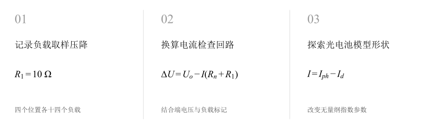
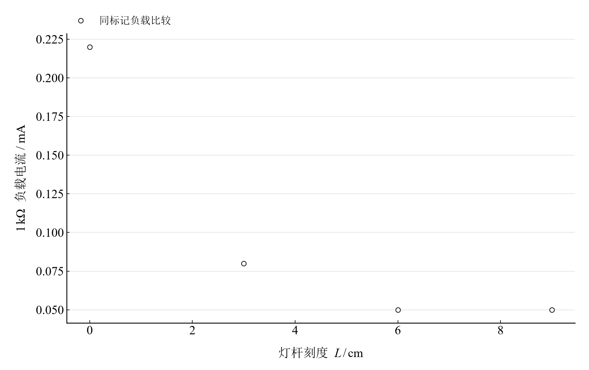
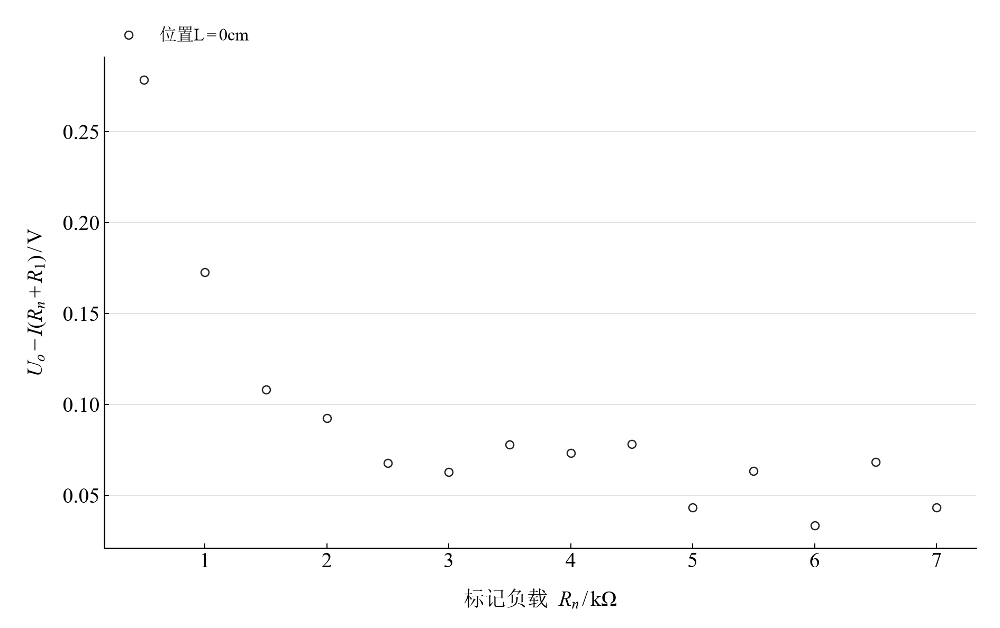
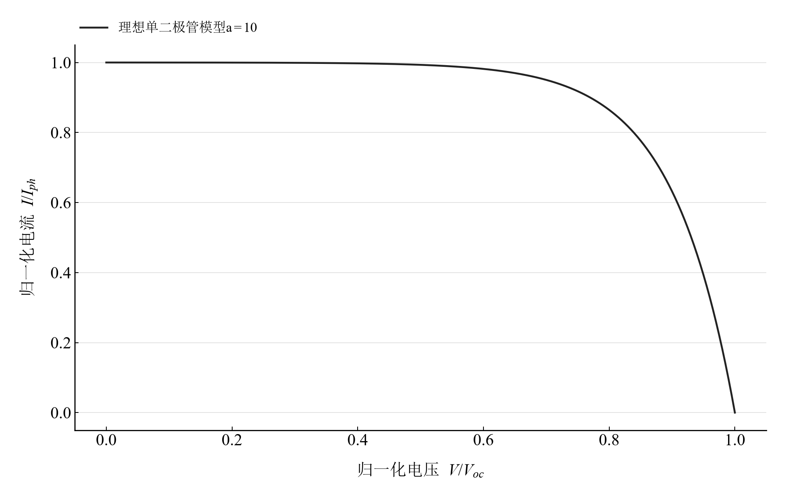

[普通物理实验 3](../README.md) · [项目首页](../../../README.md) · [使用指南](../../../docs/usage.md)

# 光敏传感器光电特性研究

**从微小取样压降出发，把光电响应和负载回路一起检查。**

改变灯杆位置与负载，记录硅光电池端电压及取样电阻压降。由取样电压换算电流，比较共同负载的位置响应，并借助归一化单二极管模型探索光电池曲线形状。

[读实验报告](report/report.md) · [浏览器交互](https://hnnuyuxuan.github.io/general-physics-lab/experiments/course-03/photosensor/notebooks/analysis.html) · [Python 笔记本](notebooks/analysis.ipynb) · [Wolfram 笔记本](../../../notebook/paclets/PhotosensorLab/Notebooks/PhotosensorLab.nb)



图 1　记录负载取样压降 → 换算电流检查回路 → 探索光电池模型形状

## 选择你的入口

|用途|入口|打开方式|
|---|---|---|
|阅读原理、记录与结论|[Markdown 实验报告](report/report.md) · [排版阅读版](https://hnnuyuxuan.github.io/general-physics-lab/experiments/course-03/photosensor/report/report.html)|GitHub、Markdown 阅读器或本地浏览器|
|改变参数、查看曲线响应|[HTML 交互阅读版](https://hnnuyuxuan.github.io/general-physics-lab/experiments/course-03/photosensor/notebooks/analysis.html)|直接在线打开，也可下载到本机|
|运行 Python 计算与探索|[Jupyter Notebook](notebooks/analysis.ipynb)|JupyterLab 或 VS Code|
|运行原生数学排版与交互计算|[Wolfram Notebook](../../../notebook/paclets/PhotosensorLab/Notebooks/PhotosensorLab.nb) · [Paclet 安装包](../../../notebook/paclets/PhotosensorLab/dist/PhotosensorLab-0.1.0.paclet)|Wolfram 前端|
|对照源实验记录|[源报告 PDF](../../../pdf/course-03/13光敏传感器光电特性研究/实验报告-光敏传感器光电特性研究.pdf)|GitHub 或 PDF 阅读器|

## 从记录到计算

四个灯杆刻度为 0、3、6、9 cm，每个位置记录十四种负载，共五十六组读数。取样电阻 $R_1=10\ \Omega$，灯杆 0 cm 对应实际距离约 2 cm。

回路差采用原接线图中的串联负载关系，并忽略电压表加载。理想单二极管模型定义 $v=V/V_{oc}$、$a=qV_{oc}/(nk_BT)$，以无量纲参数比较形状。

$$
I=\frac{U_{R1}}{R_1},\qquad \Delta U=U_o-I(R_n+R_1),\qquad \frac I{I_{ph}}=1-\frac{\exp(av)-1}{\exp(a)-1}.
$$

表 1　关键计算结果

|计算量|数值|单位|
|---|---:|---|
|近位置最大记录负载电流|$0.23$|mA|
|3 cm 刻度最大记录负载电流|$0.08$|mA|
|近位置回路相对差最大值|$70.378788$|%|

共同 1 kΩ 负载下，四个位置电流分别为 0.22、0.08、0.05、0.05 mA。端电压与图示串联回路预测存在明显差异，分析从负载电流和回路一致性展开；器件端点参数需要对应的开路、短路测量。

## 把负载响应与回路诊断放在同一视野



图 2　共同 1 kΩ 标记负载下的取样换算电流与灯杆刻度

<table>
  <tr>
    <td width="50%" align="center" valign="top"><a href="assets/readme-L0_circuit_difference.svg"></a></td>
    <td width="50%" align="center" valign="top"><a href="assets/readme-ideal_a10.svg"></a></td>
  </tr>
  <tr>
    <td align="center" valign="top"><strong>图 3</strong><br>近位置十四个负载的端电压记录减串联回路预测</td>
    <td align="center" valign="top"><strong>图 4</strong><br>a=10 的理想单二极管归一化电流–电压模型</td>
  </tr>
</table>

第一幅比较同负载读数，第二幅定位原记录的回路差，第三幅解释理想模型形状。灯杆刻度用于区分位置条件，照度关系需由照度测量建立。

## 在 Notebook 中探索

|操作|参数与范围|观察什么|
|---|---|---|
|切换灯杆位置|在 0、3、6、9 cm 记录之间选择|同时比较端电压–电流记录和负载回路差|
|改变理想模型参数|选择 $a=5,10,15$|观察归一化曲线弯曲程度与开路端附近的变化|

[HTML 阅读版](https://hnnuyuxuan.github.io/general-physics-lab/experiments/course-03/photosensor/notebooks/analysis.html) 包含上述控件；[Jupyter](notebooks/analysis.ipynb) 与 [Wolfram Notebook](../../../notebook/paclets/PhotosensorLab/Notebooks/PhotosensorLab.nb) 沿报告章节展开公式、数据处理和模型计算。

建议按以下顺序阅读：

1. 先由 10 Ω 取样电阻复算一组电流，注意 mV 与 mA 的对应。
2. 在不同灯杆位置之间切换，联合查看原记录和回路电压差。
3. 转到理想模型，用无量纲参数比较曲线形状，再阅读实测条件。

## 在本机打开

环境安装与字体设置见[使用指南](../../../docs/usage.md)。在仓库根目录启动本实验：

```powershell
.\.venv\Scripts\python.exe -m jupyterlab experiments/course-03/photosensor/notebooks/analysis.ipynb
```

安装 Paclet 后，通过包入口打开 Wolfram Notebook。将安装路径改为本机仓库所在位置：

```wolfram
PacletInstall["D:/general-physics-lab/notebook/paclets/PhotosensorLab/dist/PhotosensorLab-0.1.0.paclet"];
Needs["PhotosensorLab`"];
PhotosensorLab`OpenNotebook[]
```

## 数据与计算实现

|内容|入口|
|---|---|
|规范观测数据|[measurements.csv](data/measurements.csv)|
|单位、参数与模型条件|[experiment.json](experiment.json)|
|Python 计算模块|[photosensor.py](../../../src/physicslab/experiments/photosensor.py)|
|Wolfram 计算实现|[analysis.wl](../../../notebook/paclets/PhotosensorLab/Kernel/analysis.wl)|
|计算结果与数表|[python.json](results/python.json)|
|数据来源与整理记录|[provenance.json](data/provenance.json)|

[返回课程目录](../README.md) · [浏览全部实验](../../../README.md)
