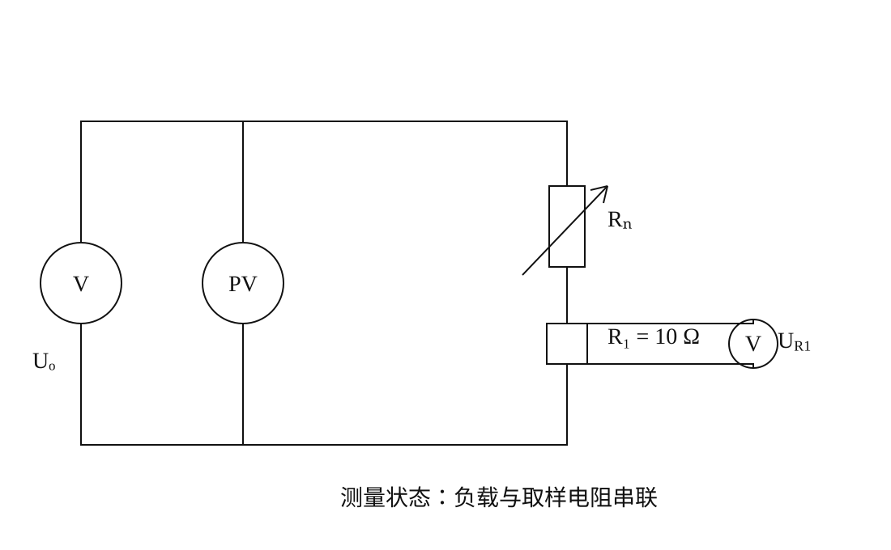
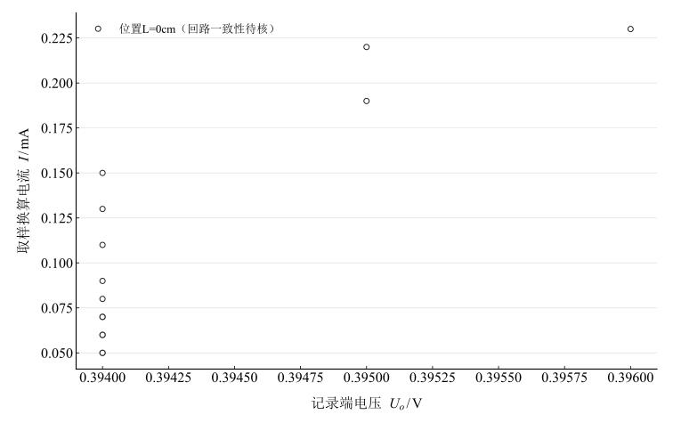
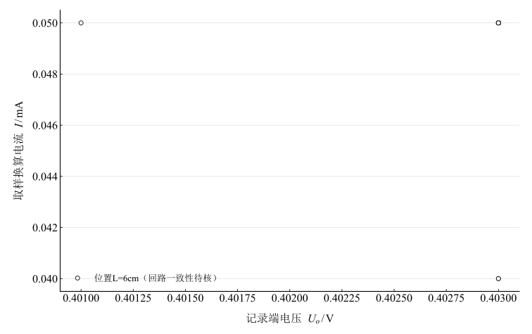
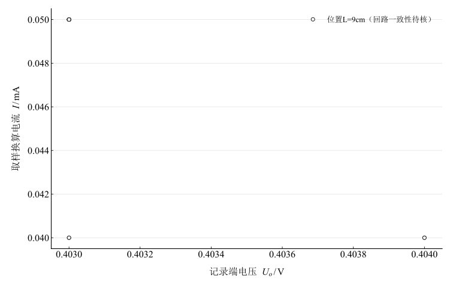
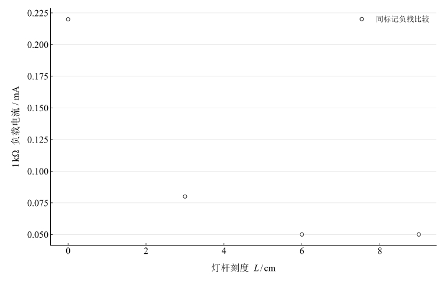

# 光敏传感器光电特性研究

淮南师范学院实验报告

学院：电子工程学院　专业：物理学　班级：24 物理 1 班

姓名：缪雨轩　学号：2414050120　实验日期：2025 年 11 月 19 日

## 一、实验名称

光敏传感器光电特性研究。

## 二、实验目的

1. 理解硅光电池结构、光生伏特效应与主要参数。
2. 学习伏安测试及取样电阻电流换算。
3. 比较不同灯杆位置的记录，区分负载、光照和数据一致性的影响。

## 三、实验原理

### 1. 光生伏特效应

光子产生电子空穴对，PN 结内建电场分离载流子，形成光生电动势。理想电池可用光生电流源并联二极管表示：

$$
I=I_{ph}-I_0\left[\exp\left(\frac{qV}{nk_BT}\right)-1\right].
$$

$I$ 是输出负载电流，$I_{ph}$ 是模型内的光生源电流，二者一般不同。理想短路时 $V=0,I_{sc}=I_{ph}$；理想开路时

$$
V_{oc}=\frac{nk_BT}{q}\ln\left(1+\frac{I_{ph}}{I_0}\right).
$$

短路电流随光生电流变化，开路电压呈对数关系；对数增长并非严格达到有限饱和值。这些模型关系需短路、开路及照度条件才能独立验证。

### 2. 测试回路

原测试图的负载与 $R_1=10\,\Omega$ 串联，输出电压跨电池，另测取样压降。

图 1　硅光电池的负载及取样电阻测量连接

$$
I(\mathrm{mA})=\frac{U_{R1}(\mathrm{mV})}{10},\qquad U_o\approx I(R_n+R_1).
$$

后式需电压表加载可忽略且接线、负载标记与图一致。它给出不依赖电池内部模型的回路一致性检查。未记录开路开关状态和零负载点，不能把有限负载的最大电流当成短路电流，或把最大负载电压直接当成开路电压。

## 四、主要仪器设备

FB716-Ⅲ 光电传感器实验装置，含暗筒、硅光电池、负载；JK-30 光电传感器实验电源及可调光源；数字万用表。

## 五、实验步骤

1. 接入光电池与测试回路，光源预热。
2. 灯杆刻度 $L=0\,\mathrm{cm}$ 时实际距离约 $2\,\mathrm{cm}$，作为近位置条件，固定光源设置。
3. 改变负载，记录端电压及采样压降。
4. 将灯杆移至 $3,6,9\,\mathrm{cm}$ 刻度，重复记录。
5. 用 $10\,\Omega$ 取样电阻换算负载电流，再检查回路关系。

灯杆刻度不等同照度，未进行可溯源照度定标。

## 六、原始数据记录

每个位置保留原表前后两个负载段；取样换算电流是处理值，电压和负载读数不变。

表 1　$L=0\,\mathrm{cm}$ 前段记录

{{tables.L0_a}}

表 2　$L=0\,\mathrm{cm}$ 后段记录

{{tables.L0_b}}

表 3　$L=3\,\mathrm{cm}$ 前段记录

{{tables.L3_a}}

表 4　$L=3\,\mathrm{cm}$ 后段记录

{{tables.L3_b}}

表 5　$L=6\,\mathrm{cm}$ 前段记录

{{tables.L6_a}}

表 6　$L=6\,\mathrm{cm}$ 后段记录

{{tables.L6_b}}

表 7　$L=9\,\mathrm{cm}$ 前段记录

{{tables.L9_a}}

表 8　$L=9\,\mathrm{cm}$ 后段记录

{{tables.L9_b}}

$L=9\,\mathrm{cm}$ 首个负载为 $0.6\,\mathrm{k}\Omega$，按原值保留，不改成其他组的 $0.5\,\mathrm{k}\Omega$。

## 七、数据处理

### 1. 取样电流和回路检查

表 9　四位置记录范围及回路相对差

{{tables.summary}}

以 $L=0\,\mathrm{cm},R_n=0.5\,\mathrm{k}\Omega$ 为例，$U_{R1}=2.3\,\mathrm{mV}$ 得 $I=0.23\,\mathrm{mA}$。串联回路预测 $U_o=0.00023\times510=0.1173\,\mathrm V$，而记录为 $0.396\,\mathrm V$。差异需要检查接线、电压端口、负载标记及仪表设置，不能仅解释为光电池内阻或稳压现象。

表 10　近位置全部负载的回路一致性

{{tables.L0_consistency}}

### 2. 电压–电流记录

图 2　$L=0\,\mathrm{cm}$ 端电压与取样换算电流（回路一致性待核）

图 3　$L=3\,\mathrm{cm}$ 端电压与取样换算电流（回路一致性待核）

图 4　$L=6\,\mathrm{cm}$ 端电压与取样换算电流（回路一致性待核）

图 5　$L=9\,\mathrm{cm}$ 端电压与取样换算电流（回路一致性待核）

### 3. 共同负载下的位置比较

表 11　共同 $1\,\mathrm{k}\Omega$ 负载的记录

{{tables.common_load}}

图 6　共同标记负载下的电流与灯杆位置

这组比较显示近位置电流较大、后两个位置读数相同，但回路冲突和分辨率限制使其不足以验证照度线性、反平方或开路电压对数关系。

## 八、实验结果与讨论

1. 已由 $56$ 个采样压降独立换算负载电流。记录最大值分别为 $0.23,0.08,0.05,0.05\,\mathrm{mA}$，这些是有限负载电流，不是实测短路电流。
2. 各组端电压约 $0.394$–$0.404\,\mathrm V$，但多数点不满足图示 $U_o\approx I(R_n+10\,\Omega)$。在解决接线和记录一致性之前，不能将其认定为可靠器件伏安特性，也不能以电压近似恒定宣称更接近理想电压源。
3. 未实际记录短路、开路或照度标定，故没有报告 $I_{sc}$、$V_{oc}$、效率或最大功率点，也未宣称已验证照度比例和对数关系。
4. 弱光采样只有 $0.4$–$0.5\,\mathrm{mV}$，易受分辨率与偏置影响。增大取样电阻会同时改变负载工作点，应在电路设计中评估后采用，不能只作为无影响的灵敏度改进。
5. 后续核验应同步记录开关状态、实际负载阻值、两个电压端口和仪器量程，增加重复测量及短路/开路项目；现有数据缺少限差，未给完整不确定度。
