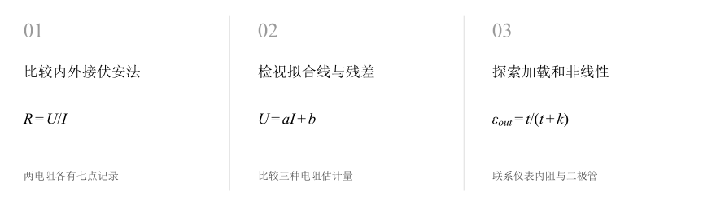
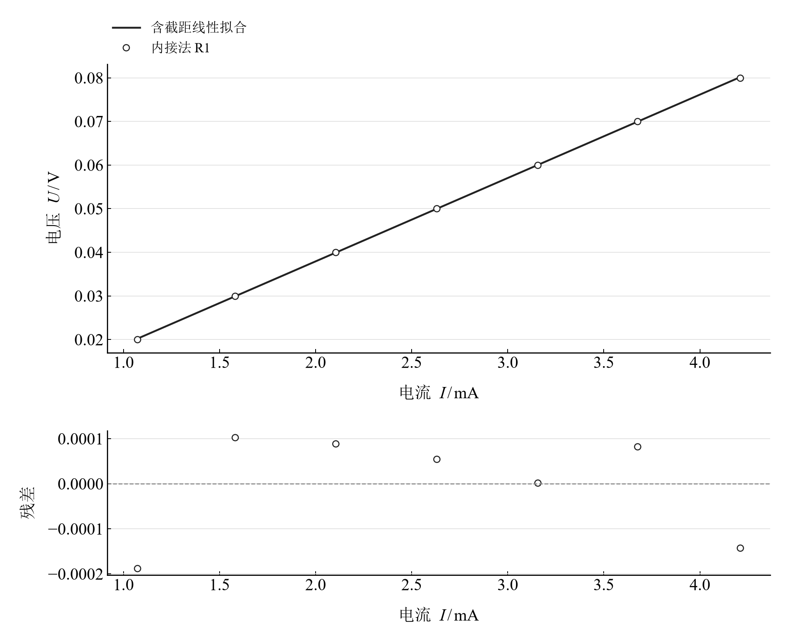
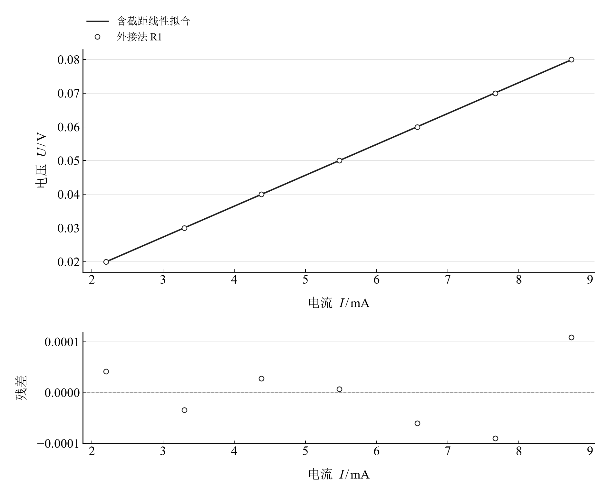
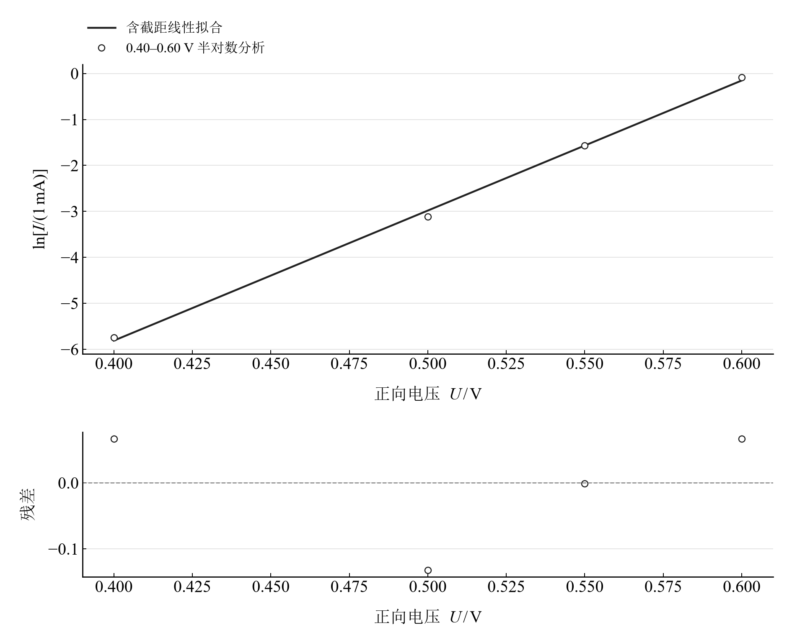

[普通物理实验 3](../README.md) · [项目首页](../../../README.md) · [使用指南](../../../docs/usage.md)

# 电阻伏安特性的测定

**直线、残差与二极管曲线，读懂接法如何影响伏安测量。**

对两个电阻分别使用电流表内接、外接法测量，再观察二极管正向电流。比较逐点比值、过原点拟合与含截距拟合，借助无量纲加载模型理解两种接法的适用范围。

[读实验报告](report/report.md) · [浏览器交互](notebooks/analysis.html) · [Python 笔记本](notebooks/analysis.ipynb) · [Wolfram 笔记本](../../../notebook/paclets/ResistorIVLab/Notebooks/ResistorIVLab.nb)



图 1　比较内外接伏安法 → 检视拟合线与残差 → 探索加载和非线性

## 选择你的入口

|用途|入口|打开方式|
|---|---|---|
|阅读原理、记录与结论|[Markdown 实验报告](report/report.md) · [排版阅读版](report/report.html)|GitHub、Markdown 阅读器或本地浏览器|
|改变参数、查看曲线响应|[HTML 交互阅读版](notebooks/analysis.html)|下载后用浏览器打开|
|运行 Python 计算与探索|[Jupyter Notebook](notebooks/analysis.ipynb)|JupyterLab 或 VS Code|
|运行原生数学排版与交互计算|[Wolfram Notebook](../../../notebook/paclets/ResistorIVLab/Notebooks/ResistorIVLab.nb) · [Paclet 安装包](../../../notebook/paclets/ResistorIVLab/dist/ResistorIVLab-0.1.0.paclet)|Wolfram 前端|
|对照源实验记录|[源报告 PDF](../../../pdf/course-03/6电阻伏安特性的测定/实验报告-电阻伏安特性的测定.pdf)|GitHub 或 PDF 阅读器|

## 从记录到计算

两个电阻、两种接法各记录七组电压和电流；二极管另有七个正向电压点。低电流的记录步进为 0.001 mA，拟合可在全部七点与高电压四点间切换。

加载模型中 $t=R_x/R_A$、$k=R_V/R_A$。电阻估计由不同回归假设得到；二极管半对数分析采用 0.40–0.60 V 的四点区间。

$$
U=aI+b,\qquad R_0=\frac{\sum I_iU_i}{\sum I_i^2},\qquad \varepsilon_{in}=\frac1t,\quad \varepsilon_{out}=\frac{t}{t+k}.
$$

表 1　关键计算结果

|计算量|数值|单位|
|---|---:|---|
|R₁ 内接逐点电阻均值|$18.964461$|Ω|
|R₁ 外接逐点电阻均值|$9.126030$|Ω|
|0.40–0.60 V 二极管电流增大倍数|$286.65625$|1|

小电阻的接法差异明显；大电阻的低电流量化使比值平均和拟合估计产生较大差异。二极管 0.65 V 行记录电流 4.511 mA，高于所标 2 mA 量程，半对数拟合采用其前面的区间。

## 让残差和器件非线性各自展开



图 2　R₁ 内接法的电压–电流观测、含截距拟合与残差

<table>
  <tr>
    <td width="50%" align="center" valign="top"><a href="assets/readme-external_R1.svg"></a></td>
    <td width="50%" align="center" valign="top"><a href="assets/readme-diode_log.svg"></a></td>
  </tr>
  <tr>
    <td align="center" valign="top"><strong>图 3</strong><br>R₁ 外接法的电压–电流观测、含截距拟合与残差</td>
    <td align="center" valign="top"><strong>图 4</strong><br>二极管 0.40–0.60 V 正向记录的半对数拟合与残差</td>
  </tr>
</table>

前两幅用相同物理量比较接法，读斜率时注意电流轴单位为 mA。第三幅对电流取对数，检查所选区间的近似指数形状。

## 在 Notebook 中探索

|操作|参数与范围|观察什么|
|---|---|---|
|切换拟合数据范围|选择 R₁/R₂、内接/外接、全部七点/高电压四点|同步比较拟合线与全部记录点的残差|
|切换仪表内阻比|选择 $R_V/R_A=10^3,10^4,10^6$|观察内外接相对加载误差和交叉范围|

[HTML 阅读版](notebooks/analysis.html) 包含上述控件；[Jupyter](notebooks/analysis.ipynb) 与 [Wolfram Notebook](../../../notebook/paclets/ResistorIVLab/Notebooks/ResistorIVLab.nb) 沿报告章节展开公式、数据处理和模型计算。

建议按以下顺序阅读：

1. 从四组电阻观测比较两种接法的读数标度。
2. 切换全部点与高电压点拟合，检查低电流记录对参数的影响。
3. 再转到无量纲加载模型和二极管半对数图，区分测量模型与器件模型。

## 在本机打开

环境安装与字体设置见[使用指南](../../../docs/usage.md)。在仓库根目录启动本实验：

```powershell
.\.venv\Scripts\python.exe -m jupyterlab experiments/course-03/resistor-iv/notebooks/analysis.ipynb
```

安装 Paclet 后，通过包入口打开 Wolfram Notebook。将安装路径改为本机仓库所在位置：

```wolfram
PacletInstall["D:/general-physics-lab/notebook/paclets/ResistorIVLab/dist/ResistorIVLab-0.1.0.paclet"];
Needs["ResistorIVLab`"];
ResistorIVLab`OpenNotebook[]
```

## 数据与计算实现

|内容|入口|
|---|---|
|规范观测数据|[diode.csv](data/diode.csv) · [resistors.csv](data/resistors.csv)|
|单位、参数与模型条件|[experiment.json](experiment.json)|
|Python 计算模块|[resistor_iv.py](../../../src/physicslab/experiments/resistor_iv.py)|
|Wolfram 计算实现|[analysis.wl](../../../notebook/paclets/ResistorIVLab/Kernel/analysis.wl)|
|计算结果与数表|[python.json](results/python.json)|
|数据来源与整理记录|[provenance.json](data/provenance.json)|

[返回课程目录](../README.md) · [浏览全部实验](../../../README.md)
