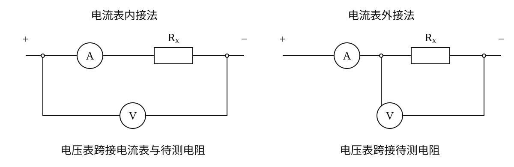
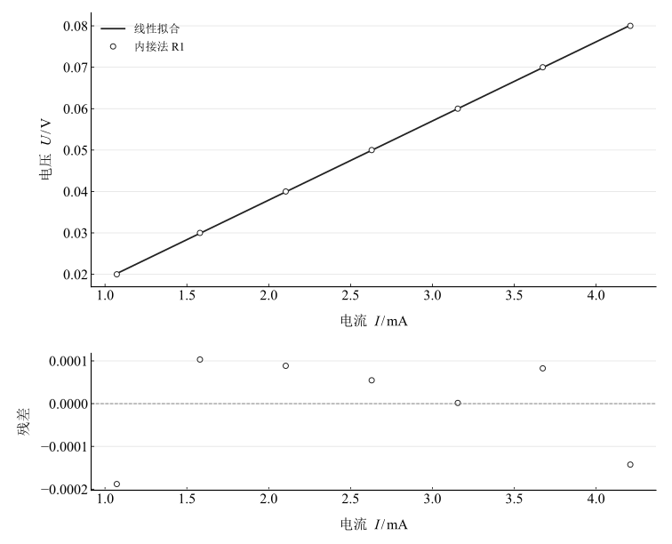
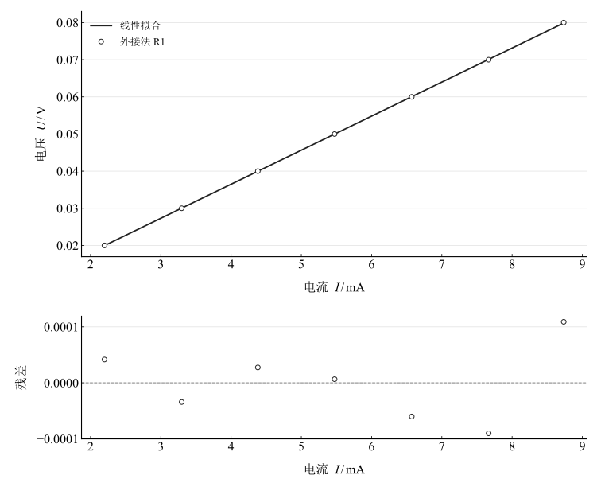
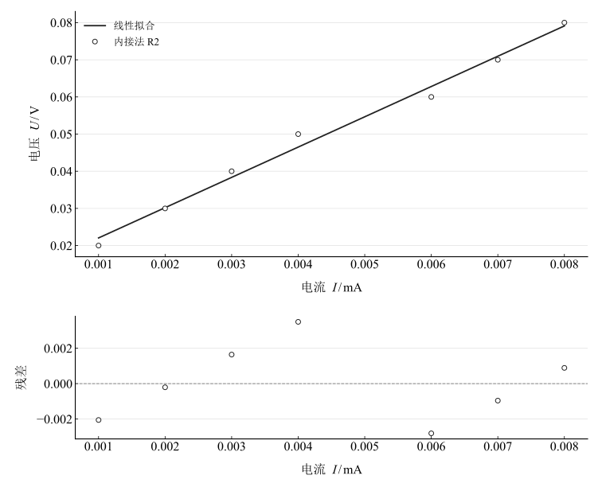
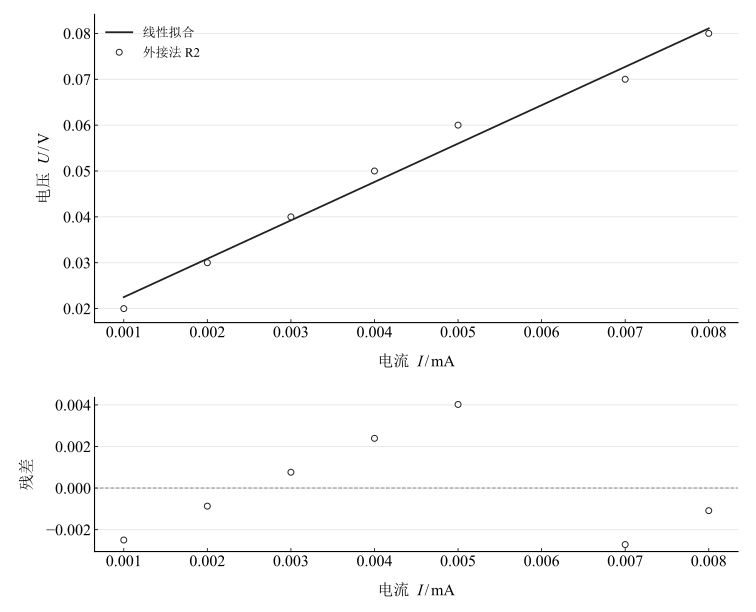
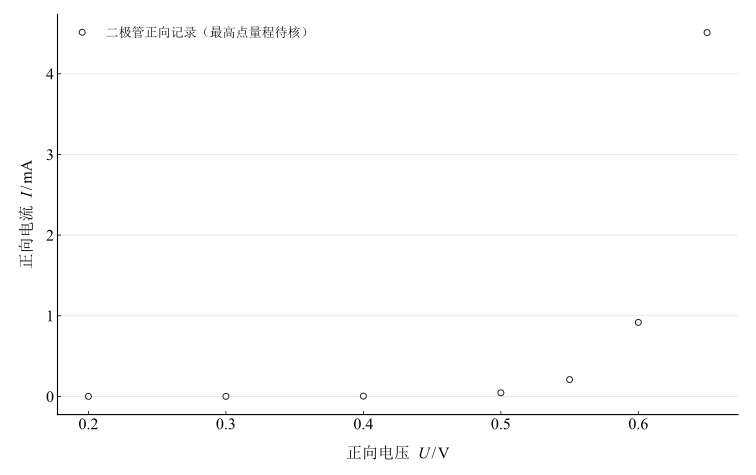
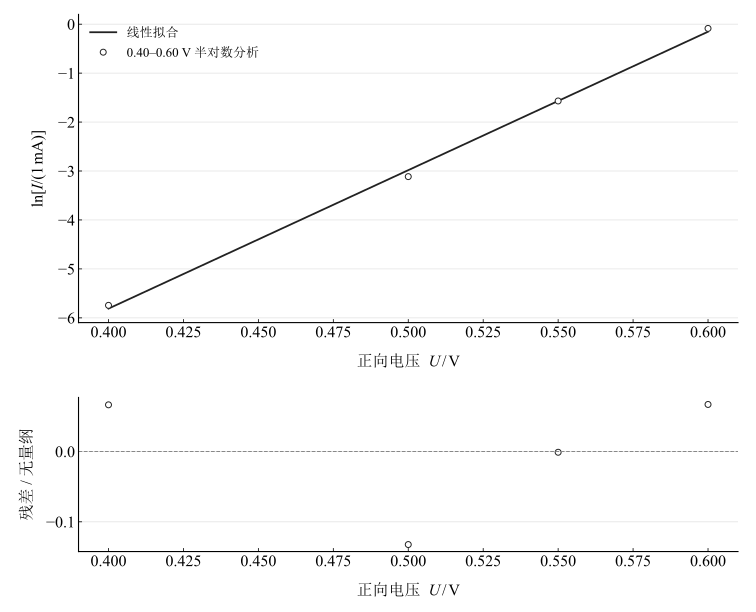

# 电阻伏安特性的测定

淮南师范学院实验报告

学院：电子工程学院　专业：物理学　班级：24 物理 1 班

姓名：缪雨轩　学号：2414050120　实验日期：2025 年 10 月 22 日

## 一、实验名称

电阻伏安特性的测定。

## 二、实验目的

1. 学会用伏安法测量电阻。
2. 学会选择电流表内接法和外接法，减小仪表加载引入的系统误差。
3. 绘制电阻和二极管的伏安特性曲线，比较线性元件与非线性元件。

## 三、实验原理

### 1. 伏安法测量线性电阻

欧姆定律给出 $R_x=U_x/I_x$。温度等条件保持不变的线性电阻，其电压与电流近似成正比。

### 2. 电流表接法与加载误差

令电流表内阻为 $R_A$，电压表内阻为 $R_V$。

图 1　内接法和外接法的仪表跨接关系（A 为电流表，V 为电压表）

内接法中，电压表测量待测电阻与电流表的总电压，电流表测量待测电阻的电流：

$$
U_V=U_x+U_A,\qquad I_A=I_x,\qquad R_{\mathrm{in}}=\frac{U_V}{I_A}=R_x+R_A.
$$

测得电阻偏大，当 $R_x\gg R_A$ 时相对影响较小。

外接法中，电压表直接跨接待测电阻，电流表读数包含电压表分流：

$$
U_V=U_x,\qquad I_A=I_x+I_V,\qquad R_{\mathrm{out}}=\frac{U_V}{I_A}=\frac{R_xR_V}{R_x+R_V}.
$$

测得电阻偏小，当 $R_x\ll R_V$ 时相对影响较小。相对误差绝对值分别为

$$
\varepsilon_{\mathrm{in}}=\frac{R_A}{R_x},\qquad\varepsilon_{\mathrm{out}}=\frac{R_x}{R_x+R_V}.
$$

比较二者可得准确分界

$$
R_x^*=\frac{\sqrt{R_A^2+4R_AR_V}+R_A}{2}.
$$

当 $R_A\ll R_V$ 时，近似为 $R_x^*\approx\sqrt{R_AR_V}$。通常大于分界值宜内接，小于分界值宜外接。实际仪表内阻未提供，本实验以接法比较为主，不进行数值内阻修正。

### 3. 二极管非线性伏安特性

二极管的静态比值 $U/I$ 随工作点变化，其 $I$–$U$ 曲线通常为非线性。在有限正向电压区间，可用 $\ln[I/(1\,\mathrm{mA})]=aU+b$ 描述指数增长趋势；此处为经验局部拟合，不由其推定温度、理想因子或反向电流。

## 四、主要仪器设备

FB321 电阻元件特性实验仪一台，配套测试元件及专用连接线。

## 五、实验步骤

### 1. 分压伏安法测电阻

1. 用滑动变阻器分压接法，使电压从零开始调节。
2. 分别用内接法和外接法测量 $R_1$，逐点调节电压，记录 7 组电压和电流。
3. 更换为 $R_2$，重复两种接法的记录。

### 2. 测量二极管正向特性

1. 将二极管正向接入分压电路，缓慢增加电压。
2. 记录 7 组电压与电流，在电流快速增长区更细致调节。
3. 为保护元件，本次未测量反向特性。

## 六、原始数据记录

表 1　伏安法测电阻原始记录

{{tables.observations}}

表 2　二极管伏安特性原始记录

{{tables.diode}}

二极管 $0.65\,\mathrm{V}$ 对应 $4.511\,\mathrm{mA}$，超过表内记载的 $2\,\mathrm{mA}$ 量程。该原始值予以保留，量程或读数有效性需核验，未用于后面的半对数拟合。

## 七、数据处理

### 1. 逐点电阻与均值

电流统一换算为安培，逐点计算并求平均：

$$
R_i=\frac{U_i}{I_i},\qquad\overline R=\frac{1}{7}\sum_{i=1}^{7}R_i.
$$

表 3　两种接法的逐点电阻及均值

{{tables.point_resistance}}

### 2. 电压–电流直线拟合

对 $U=aI+b$ 做最小二乘拟合，并与强制过原点的结果比较：

$$
R_0=\frac{\sum I_iU_i}{\sum I_i^2}.
$$

含截距拟合的斜率 $a$ 为该拟合模型的电阻估计；截距用于检查零点偏移或低电流量化的影响，不把非零截距直接解释为某个仪表内阻。

表 4　均值、过原点拟合与含截距拟合结果

{{tables.fits}}

图 2　$R_1$ 内接法的电压–电流拟合与残差

图 3　$R_1$ 外接法的电压–电流拟合与残差

图 4　$R_2$ 内接法的电压–电流拟合与残差

图 5　$R_2$ 外接法的电压–电流拟合与残差

$R_1$ 逐点比值均值：内接法 ${{metrics.internal_R1_R_mean}}\,\Omega$，外接法 ${{metrics.external_R1_R_mean}}\,\Omega$。外接法结果约为 $9.13\,\Omega$。内接法较大的差异符合小电阻易受电流表内阻影响的趋势，但实际内阻与电压表分流未校准，不能把两测量值之差直接当成精确的 $R_A$。

$R_2$ 逐点比值均值：内接法 ${{metrics.internal_R2_R_mean}}\,\Omega$，外接法 ${{metrics.external_R2_R_mean}}\,\Omega$。两个结果并不完全相等。由于低电流读数以 $0.001\,\mathrm{mA}$ 为步进，首个记录只有一个步进，逐点比值对量化十分敏感。均值与不同拟合估计的差异应结合完整记录评估，不能只给出一个无不确定度的精确阻值。

### 3. 二极管正向特性

图 6　二极管正向电流–电压记录（最高电压点量程待核）

在 $0.40$–$0.60\,\mathrm{V}$ 区间，电流从 $0.0032\,\mathrm{mA}$ 增大至 $0.9173\,\mathrm{mA}$，约增大 ${{metrics.diode_gain_04_06}}$ 倍。半对数拟合斜率为 ${{metrics.diode_log_slope_04_06}}\,\mathrm{V}^{-1}$。

图 7　二极管 $0.40$–$0.60\,\mathrm{V}$ 区间的半对数拟合及残差

## 八、实验结果与讨论

1. $R_1$ 外接法均值约 $9.13\,\Omega$，内接法均值约 $18.96\,\Omega$，接法影响明显。若电压表内阻远大于 $R_1$，外接法有较小的加载误差。
2. $R_2$ 为千欧量级，内接法电流表加载通常较弱；但仪表内阻、精度等级及重复测量缺失，不能宣称两接法在已知实验精度内完全一致。其低电流读数的分辨率影响需特别关注。
3. 两个电阻的记录总体呈线性关系；拟合和残差用于展示偏离程度，不预设观测曲线必须严格经过原点。
4. 二极管正向电流随电压迅速、非线性增长，显示非线性特征。本次未测反向特性，结论限于正向区间；最高点量程冲突需复核。
5. 误差来源包括仪表加载、读数分辨率、偶然误差、接触电阻和温度变化。缺少仪表精度等级及重复记录，未编造完整合成不确定度，也未宣称已完全消除系统误差。
