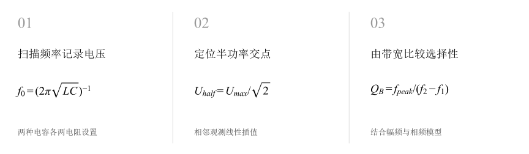
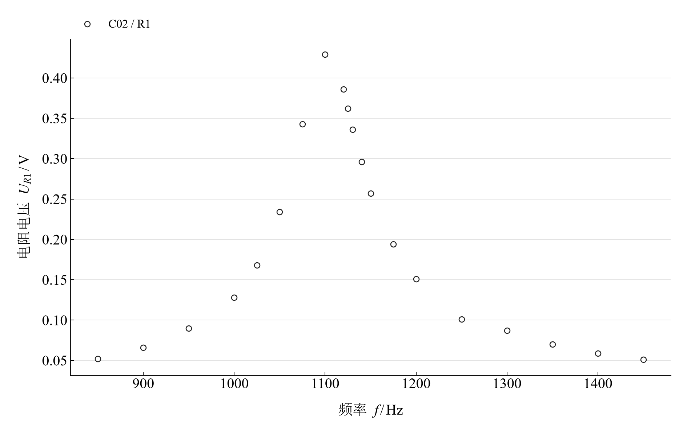
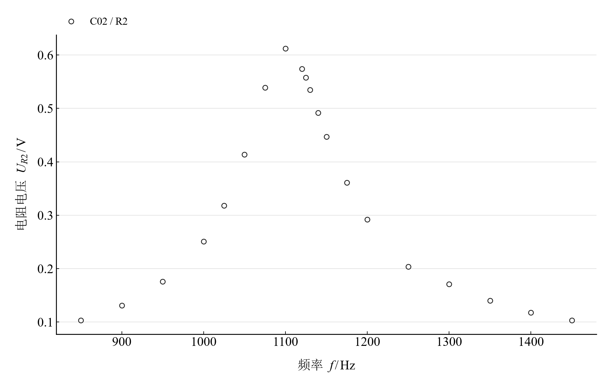
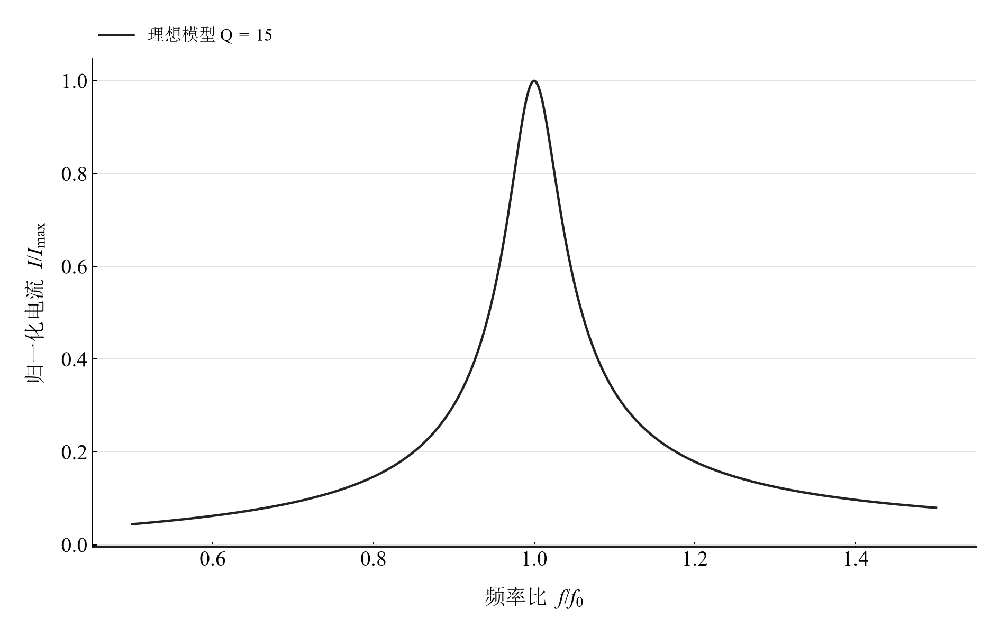

[普通物理实验 3](../README.md) · [项目首页](../../../README.md) · [使用指南](../../../docs/usage.md)

# RLC 串联电路谐振特性的研究

**从谐振峰到半功率带宽，看清电路的频率选择性。**

固定电感，使用两种电容与两个电阻设置扫描频率。由电阻电压观测定位峰值、插值半功率交点，再将带宽品质因数与谐振元件电压比放在一起比较。

[读实验报告](report/report.md) · [浏览器交互](https://hnnuyuxuan.github.io/general-physics-lab/experiments/course-03/rlc-resonance/notebooks/analysis.html) · [Python 笔记本](notebooks/analysis.ipynb) · [Wolfram 笔记本](../../../notebook/paclets/RLCResonanceLab/Notebooks/RLCResonanceLab.nb)



图 1　扫描频率记录电压 → 定位半功率交点 → 由带宽比较选择性

## 选择你的入口

|用途|入口|打开方式|
|---|---|---|
|阅读原理、记录与结论|[Markdown 实验报告](report/report.md) · [排版阅读版](https://hnnuyuxuan.github.io/general-physics-lab/experiments/course-03/rlc-resonance/report/report.html)|GitHub、Markdown 阅读器或本地浏览器|
|改变参数、查看曲线响应|[HTML 交互阅读版](https://hnnuyuxuan.github.io/general-physics-lab/experiments/course-03/rlc-resonance/notebooks/analysis.html)|直接在线打开，也可下载到本机|
|运行 Python 计算与探索|[Jupyter Notebook](notebooks/analysis.ipynb)|JupyterLab 或 VS Code|
|运行原生数学排版与交互计算|[Wolfram Notebook](../../../notebook/paclets/RLCResonanceLab/Notebooks/RLCResonanceLab.nb) · [Paclet 安装包](../../../notebook/paclets/RLCResonanceLab/dist/RLCResonanceLab-0.1.0.paclet)|Wolfram 前端|
|对照源实验记录|[源报告 PDF](../../../pdf/course-03/11RLC串联电路谐振特性的研究/实验报告-RLC串联电路谐振特性的研究实验报告.pdf)|GitHub 或 PDF 阅读器|

## 从记录到计算

电感 $L=100\ \mathrm{mH}$，电容分别为 0.2、0.1 μF；第一组有二十个频率点，第二组有十一个。每点同时保留两个电阻设置的电压，另有谐振点电感和电容电压。

半功率交点采用各曲线峰值电压的 $1/\sqrt2$ 阈值，以相邻观测线性插值。理想模型采用恒幅稳态串联 RLC，品质因数扫描改变模型的选择性。

$$
f_0=\frac1{2\pi\sqrt{LC}},\qquad B=f_2-f_1,\qquad Q_B=\frac{f_{peak}}B.
$$

表 1　关键计算结果

|计算量|数值|单位|
|---|---:|---|
|0.2 μF、R₁ 观测峰值频率|$1100$|Hz|
|0.1 μF、R₁ 观测峰值频率|$1580$|Hz|
|0.2 μF、R₁ 带宽品质因数|$15.223416$|1|
|0.2 μF、R₂ 带宽品质因数|$10.956965$|1|

电容减半时观测峰值移向高频；两组中 R₁ 的带宽更窄、品质因数更大。电压比法以约 1 V 源电压为条件，与带宽法分别呈现其估计。

## 并读谐振峰、带宽与理想选择性



图 2　0.2 μF、R₁ 设置下的电阻电压频响观测

<table>
  <tr>
    <td width="50%" align="center" valign="top"><a href="assets/readme-C02_R2.svg"></a></td>
    <td width="50%" align="center" valign="top"><a href="assets/readme-model_Q15.svg"></a></td>
  </tr>
  <tr>
    <td align="center" valign="top"><strong>图 3</strong><br>0.2 μF、R₂ 设置下的电阻电压频响观测</td>
    <td align="center" valign="top"><strong>图 4</strong><br>Q=15 的理想串联 RLC 归一化幅频模型</td>
  </tr>
</table>

前两幅采用同一电容比较观测峰形。第三幅以频率比为横轴，展示理想选择性；完整 Notebook 中同时计算左右半功率交点、幅频与相频响应。

## 在 Notebook 中探索

|操作|参数与范围|观察什么|
|---|---|---|
|切换电容与品质因数|电容 0.1/0.2 μF，品质因数 2、5、8、15、25|同步观察模型幅频峰宽与相频变化|

[HTML 阅读版](https://hnnuyuxuan.github.io/general-physics-lab/experiments/course-03/rlc-resonance/notebooks/analysis.html) 包含上述控件；[Jupyter](notebooks/analysis.ipynb) 与 [Wolfram Notebook](../../../notebook/paclets/RLCResonanceLab/Notebooks/RLCResonanceLab.nb) 沿报告章节展开公式、数据处理和模型计算。

建议按以下顺序阅读：

1. 先从原记录定位两组峰值，比较其与标称 LC 理论频率的偏差。
2. 复算半功率交点与带宽，再对照谐振点电压比结果。
3. 切换模型电容与品质因数，连接峰位、峰宽和相位转折。

## 在本机打开

环境安装与字体设置见[使用指南](../../../docs/usage.md)。在仓库根目录启动本实验：

```powershell
.\.venv\Scripts\python.exe -m jupyterlab experiments/course-03/rlc-resonance/notebooks/analysis.ipynb
```

安装 Paclet 后，通过包入口打开 Wolfram Notebook。将安装路径改为本机仓库所在位置：

```wolfram
PacletInstall["D:/general-physics-lab/notebook/paclets/RLCResonanceLab/dist/RLCResonanceLab-0.1.0.paclet"];
Needs["RLCResonanceLab`"];
RLCResonanceLab`OpenNotebook[]
```

## 数据与计算实现

|内容|入口|
|---|---|
|规范观测数据|[resonance_voltages.csv](data/resonance_voltages.csv) · [response.csv](data/response.csv)|
|单位、参数与模型条件|[experiment.json](experiment.json)|
|Python 计算模块|[rlc_resonance.py](../../../src/physicslab/experiments/rlc_resonance.py)|
|Wolfram 计算实现|[analysis.wl](../../../notebook/paclets/RLCResonanceLab/Kernel/analysis.wl)|
|计算结果与数表|[python.json](results/python.json)|
|数据来源与整理记录|[provenance.json](data/provenance.json)|

[返回课程目录](../README.md) · [浏览全部实验](../../../README.md)
