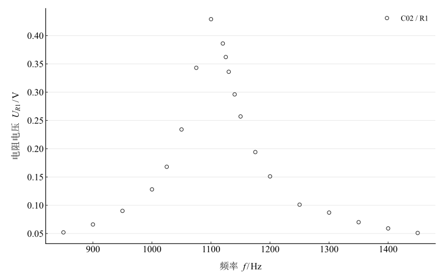
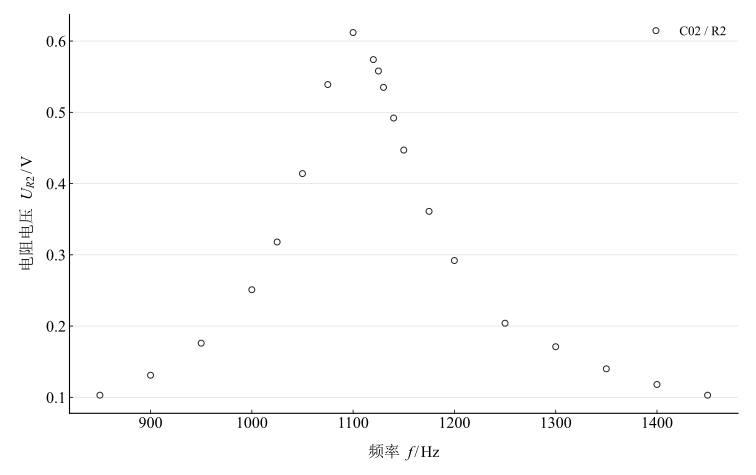
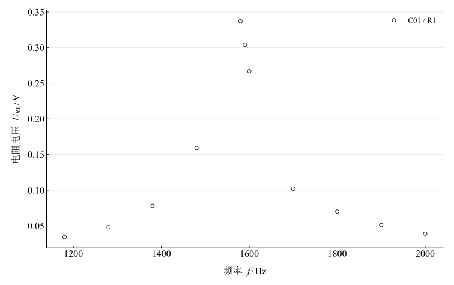
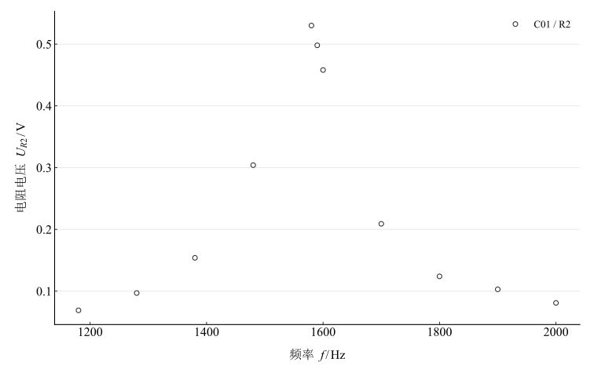

# RLC 串联电路谐振特性的研究

淮南师范学院实验报告

学院：电子工程学院　专业：物理学　班级：24 物理 1 班

姓名：缪雨轩　学号：2406010128　实验日期：2025 年 11 月 26 日

## 一、实验名称

RLC 串联电路谐振特性的研究。

## 二、实验目的

1. 研究交流电路的谐振现象，认识 RLC 串联电路的谐振特性。
2. 学习测绘 RLC 串联电路谐振曲线的方法。
3. 掌握电路品质因数 $Q$ 的物理意义及其测量方法。

## 三、实验原理

### 1. RLC 串联谐振

在电阻 $R$、电感 $L$ 和电容 $C$ 组成的线性串联电路中，令 $j^2=-1$，角频率为 $\omega=2\pi f$，总阻抗为

$$
Z=R+j(X_L-X_C)=R+j\left(\omega L-\frac{1}{\omega C}\right).
$$

当 $\omega L=1/(\omega C)$ 时，电路呈纯电阻性，阻抗最小，电流最大，发生串联谐振。理想模型的谐振频率为

$$
\omega_0=\frac{1}{\sqrt{LC}},\qquad f_0=\frac{1}{2\pi\sqrt{LC}},\qquad I_{\max}=\frac{U}{R}.
$$

存在信号源内阻、线圈电阻等损耗时，计算电流与品质因数所用 $R$ 应理解为总串联电阻；测量电阻两端电压为 $U_R=IR_{\mathrm{ext}}$。同一曲线中测量电阻保持不变，因此归一化电阻电压与归一化电流相同。

### 2. 频响特性与品质因数

谐振曲线描述电流随频率的变化。在线性、恒幅激励的串联 RLC 模型中，令 $x=f/f_0$，则

$$
\frac{I}{I_{\max}}=\frac{1}{\sqrt{1+Q^2(x-x^{-1})^2}},\qquad Q=\frac{1}{R}\sqrt{\frac{L}{C}}.
$$

谐振时理想电感、电容的电压幅值相等，并满足

$$
Q=\frac{U_L}{U}=\frac{U_C}{U}.
$$

$Q$ 越大，归一化谐振曲线越尖锐，选择性越好。电流下降至峰值的 $1/\sqrt{2}$ 时，两侧频率为 $f_1,f_2$，通频带及带宽法品质因数为

$$
B=f_2-f_1,\qquad Q_B=\frac{f_0}{B}.
$$

理想串联模型中上述带宽关系成立；本实验以采样峰值频率代替连续曲线的谐振频率，并在邻接点间线性插值，所得 $Q_B$ 是采样曲线估计值。电压比法采用

$$
Q_U=\frac{U_L+U_C}{2U}.
$$

由于电源电压只记为约 $1\,\mathrm{V}$，$Q_U$ 是在该条件下计算的值，不能视作经过电源幅度校准的独立精确测量。

## 四、主要仪器设备

DH4503 型 RLC 电路实验仪，包含信号源、频率计、电阻箱、电感箱、电容箱；双踪示波器或交流毫伏表；连接导线。

## 五、实验步骤

1. 连接串联电阻、电感和电容，测量电阻两端电压。
2. 两组均取 $L=100\,\mathrm{mH}$，分别取 $C=0.2\,\mu\mathrm{F}$ 和 $C=0.1\,\mu\mathrm{F}$，每组比较 $R_1$、$R_2$ 两个电阻设置。
3. 保持信号源输出电压约 $1\,\mathrm{V}$，改变频率，搜索 $U_R$ 的最大值。
4. 在谐振点附近逐点改变频率，记录 $U_R$；在谐振频率处测量 $U_L$ 与 $U_C$。

两电阻的具体阻值及信号源逐点输出电压未记录，分析使用电阻设置标识，不推定其数值。

## 六、原始数据记录

### 1. 第一组：$L=100\,\mathrm{mH}$，$C=0.2\,\mu\mathrm{F}$

理论代入采用 $L=0.1\,\mathrm{H}$、$C=0.2\times10^{-6}\,\mathrm{F}$：

$$
f_{0,\mathrm{th}}=\frac{1}{2\pi\sqrt{0.1\times0.2\times10^{-6}}}.
$$

观测峰值频率为 $1100\,\mathrm{Hz}$。记录表按原先前后两段排列。

表 1　第一组电阻电压与频率记录（前段）

| 物理量 | 1 | 2 | 3 | 4 | 5 | 6 | 7 | 8 | 9 | 10 |
| --- | --- | --- | --- | --- | --- | --- | --- | --- | --- | --- |
| $f/\mathrm{Hz}$ | 850 | 900 | 950 | 1000 | 1025 | 1050 | 1075 | 1100 | 1120 | 1125 |
| $U_{R1}/\mathrm{V}$ | 0.052 | 0.066 | 0.09 | 0.128 | 0.168 | 0.234 | 0.343 | 0.429 | 0.386 | 0.362 |
| $U_{R2}/\mathrm{V}$ | 0.103 | 0.131 | 0.176 | 0.251 | 0.318 | 0.414 | 0.539 | 0.612 | 0.574 | 0.558 |

表 2　第一组电阻电压与频率记录（后段）

| 物理量 | 11 | 12 | 13 | 14 | 15 | 16 | 17 | 18 | 19 | 20 |
| --- | --- | --- | --- | --- | --- | --- | --- | --- | --- | --- |
| $f/\mathrm{Hz}$ | 1130 | 1140 | 1150 | 1175 | 1200 | 1250 | 1300 | 1350 | 1400 | 1450 |
| $U_{R1}/\mathrm{V}$ | 0.336 | 0.296 | 0.257 | 0.194 | 0.151 | 0.101 | 0.087 | 0.07 | 0.059 | 0.051 |
| $U_{R2}/\mathrm{V}$ | 0.535 | 0.492 | 0.447 | 0.361 | 0.292 | 0.204 | 0.171 | 0.14 | 0.118 | 0.103 |

### 2. 第二组：$L=100\,\mathrm{mH}$，$C=0.1\,\mu\mathrm{F}$

理论代入采用 $C=0.1\times10^{-6}\,\mathrm{F}$：

$$
f_{0,\mathrm{th}}=\frac{1}{2\pi\sqrt{0.1\times0.1\times10^{-6}}}.
$$

观测峰值频率为 $1580\,\mathrm{Hz}$。

表 3　第二组电阻电压与频率记录

| 物理量 | 1 | 2 | 3 | 4 | 5 | 6 | 7 | 8 | 9 | 10 | 11 |
| --- | --- | --- | --- | --- | --- | --- | --- | --- | --- | --- | --- |
| $f/\mathrm{Hz}$ | 1180 | 1280 | 1380 | 1480 | 1580 | 1590 | 1600 | 1700 | 1800 | 1900 | 2000 |
| $U_{R1}/\mathrm{V}$ | 0.034 | 0.048 | 0.078 | 0.159 | 0.337 | 0.304 | 0.267 | 0.102 | 0.07 | 0.051 | 0.039 |
| $U_{R2}/\mathrm{V}$ | 0.069 | 0.097 | 0.154 | 0.304 | 0.53 | 0.498 | 0.458 | 0.209 | 0.124 | 0.103 | 0.081 |

## 七、数据处理

### 1. 谐振频率

相对偏差按 $(f_{\mathrm{peak}}-f_{0,\mathrm{th}})/f_{0,\mathrm{th}}\times100\%$ 计算，保留正负号。

表 4　观测峰值频率与理论频率比较

| 组别 | $C/\mu\mathrm{F}$ | $f_{0,\mathrm{th}}/\mathrm{Hz}$ | $f_{\mathrm{peak}}/\mathrm{Hz}$ | 相对偏差 / % |
| --- | --- | --- | --- | --- |
| C02 | 0.2 | 1125.395 | 1100 | -2.257 |
| C01 | 0.1 | 1591.549 | 1580 | -0.726 |

### 2. 谐振曲线及带宽

每条曲线取 $U_{\mathrm{half}}=U_{R,\max}/\sqrt{2}$，在左右两侧相邻数据点间分别插值：

$$
f_{\mathrm{cross}}=f_a+\frac{U_{\mathrm{half}}-U_a}{U_b-U_a}(f_b-f_a).
$$

该式只用于阈值定位，不把插值点列为原始观测。

图 1　第一组 $R_1$ 设置下的电阻电压频响曲线

图 2　第一组 $R_2$ 设置下的电阻电压频响曲线

图 3　第二组 $R_1$ 设置下的电阻电压频响曲线

图 4　第二组 $R_2$ 设置下的电阻电压频响曲线

表 5　半功率频率、带宽及带宽法品质因数

| 组别 | 电阻设置 | $f_{\mathrm{peak}}/\mathrm{Hz}$ | $U_{R,\max}/\mathrm{V}$ | $f_1/\mathrm{Hz}$ | $f_2/\mathrm{Hz}$ | $B/\mathrm{Hz}$ | $Q_B$ |
| --- | --- | --- | --- | --- | --- | --- | --- |
| C02 | R1 | 1100 | 0.429 | 1065.906 | 1138.163 | 72.257 | 15.223 |
| C02 | R2 | 1100 | 0.612 | 1053.75 | 1154.143 | 100.393 | 10.957 |
| C01 | R1 | 1580 | 0.337 | 1524.548 | 1617.397 | 92.849 | 17.017 |
| C01 | R2 | 1580 | 0.53 | 1511.313 | 1633.427 | 122.114 | 12.939 |

带宽法的数值依赖峰值附近的采样间距。第二组低频侧只有较疏的测量点，其线性插值估计尤其需要更密集的数据核验。表中小数位用于复算，不代表同等测量精度。

### 3. 谐振点电压与电压比法品质因数

表 6　谐振点电感、电容电压及条件品质因数（$U\approx1\,\mathrm{V}$）

| 组别 | 电阻设置 | $U_L/\mathrm{V}$ | $U_C/\mathrm{V}$ | $Q_U$ | 两电压相对差 / % |
| --- | --- | --- | --- | --- | --- |
| C02 | R1 | 15.56 | 15.61 | 15.585 | 0.321 |
| C02 | R2 | 11.04 | 11.06 | 11.05 | 0.181 |
| C01 | R1 | 18.16 | 17.63 | 17.895 | 2.962 |
| C01 | R2 | 14.01 | 13.64 | 13.825 | 2.676 |

第一组谐振点为 $1100\,\mathrm{Hz}$，第二组为 $1580\,\mathrm{Hz}$。两电压相对差取 $\vert U_L-U_C\vert /[(U_L+U_C)/2]\times100\%$，用来描述记录内部的一致程度。

## 八、实验结果与讨论

### 1. 谐振频率验证

两组理论频率分别为 $1125.395\,\mathrm{Hz}$ 和 $1591.549\,\mathrm{Hz}$；观测峰值分别为 $1100\,\mathrm{Hz}$ 和 $1580\,\mathrm{Hz}$，相对偏差分别为 $-2.257\%$ 和 $-0.726\%$。电容减半使谐振频率升高，变化趋势符合 $f_0\propto C^{-1/2}$。元件标称误差、仪表读数和采样频率间隔均可能影响比较；缺少仪器限差和元件校准记录，不能据此判定是否落在某个指定允许误差内。

### 2. 电阻设置对谐振特性的影响

两组中 $R_1$ 曲线均比 $R_2$ 更窄，带宽法得到的 $Q_B$ 更大。电压比法也给出同方向的比较：第一组 $Q_U=15.585$、$11.050$，第二组 $Q_U=17.895$、$13.825$。因此两种描述都支持 $R_1$ 对应较强选择性。在其他损耗相同时，这与较小总串联电阻的模型趋势一致。

$R_2$ 的电阻电压峰值反而更高，这不等于电流峰值更高，因为 $U_R=IR_{\mathrm{ext}}$ 中的外接电阻不同。源内阻分压是可能的解释，但没有测量电阻与源内阻数据，不能据此确认具体分压机制。

带宽法结果相对条件电压比法结果低约 $0.84\%$–$6.41\%$。应在更密集频率扫描和逐点恒幅监测的基础上核查源电压定义、测量端口、线圈损耗和仪表频响，而不把二者直接平均为最终 $Q$。

### 3. 电压谐振现象

谐振附近记录的电感和电容电压约为 $11$–$18\,\mathrm{V}$，高于约 $1\,\mathrm{V}$ 的信号源电压，体现串联谐振时的电压放大现象。两端反相的无功电压可以相互抵消，元件局部电压仍然较高，实际应用需考虑耐压。

本组记录未提供重复测量、仪器限差及逐点源电压，故未给出完整的合成不确定度。上述结论限定于记录的两组电容和两个电阻设置。
