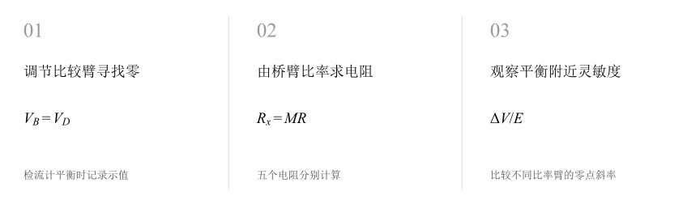
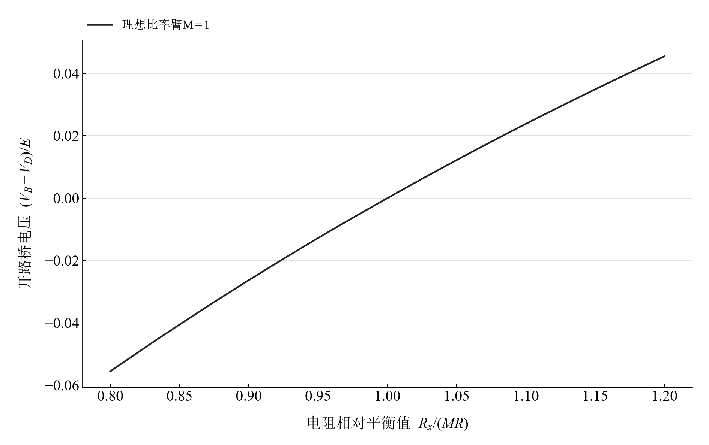
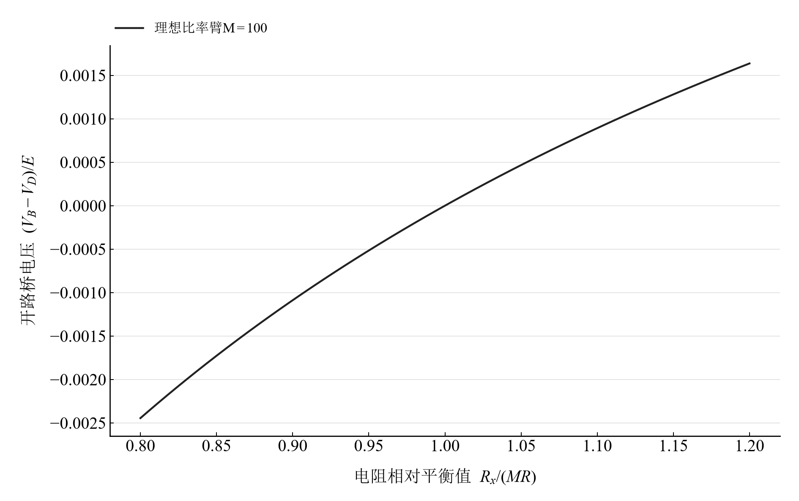

[普通物理实验 3](../README.md) · [项目首页](../../../README.md) · [使用指南](../../../docs/usage.md)

# 单臂电桥测电阻

**以零点作比较，用桥臂比率读出未知电阻。**

调节惠斯通电桥至平衡，通过比率臂和比较臂测量五个电阻。再观察平衡附近的桥电压，理解比率选择如何改变零点灵敏度，并将读数放回仪器的适用量程。

[读实验报告](report/report.md) · [浏览器交互](https://hnnuyuxuan.github.io/general-physics-lab/experiments/course-03/wheatstone-bridge/notebooks/analysis.html) · [Python 笔记本](notebooks/analysis.ipynb) · [Wolfram 笔记本](../../../notebook/paclets/WheatstoneBridgeLab/Notebooks/WheatstoneBridgeLab.nb)



图 1　调节比较臂寻找零 → 由桥臂比率求电阻 → 观察平衡附近灵敏度

## 选择你的入口

|用途|入口|打开方式|
|---|---|---|
|阅读原理、记录与结论|[Markdown 实验报告](report/report.md) · [排版阅读版](https://hnnuyuxuan.github.io/general-physics-lab/experiments/course-03/wheatstone-bridge/report/report.html)|GitHub、Markdown 阅读器或本地浏览器|
|改变参数、查看曲线响应|[HTML 交互阅读版](https://hnnuyuxuan.github.io/general-physics-lab/experiments/course-03/wheatstone-bridge/notebooks/analysis.html)|直接在线打开，也可下载到本机|
|运行 Python 计算与探索|[Jupyter Notebook](notebooks/analysis.ipynb)|JupyterLab 或 VS Code|
|运行原生数学排版与交互计算|[Wolfram Notebook](../../../notebook/paclets/WheatstoneBridgeLab/Notebooks/WheatstoneBridgeLab.nb) · [Paclet 安装包](../../../notebook/paclets/WheatstoneBridgeLab/dist/WheatstoneBridgeLab-0.1.0.paclet)|Wolfram 前端|
|对照源实验记录|[源报告 PDF](../../../pdf/course-03/9单臂电桥测电阻/实验报告-单臂电桥测电阻.pdf)|GitHub 或 PDF 阅读器|

## 从记录到计算

五个标称电阻为 3、47、200、2000、20000 Ω，各保留比率设置与比较臂示值。面板“100/100”对应无量纲比率 1；QJ47 单桥有效范围从 10 Ω 起。

平衡条件为检流计两端等电位。桥电压探索采用理想电源和开路检流端，比较不同无量纲比率臂；标称偏差由平衡结果与元件标称值计算。

$$
M=\frac{R_a}{R_b},\qquad R_x=MR,\qquad \frac{V_B-V_D}{E}=\frac{R_b}{R_a+R_b}-\frac R{R_x+R}.
$$

表 1　关键计算结果

|计算量|数值|单位|
|---|---:|---|
|标称 47 Ω 的平衡结果|$46.594$|Ω|
|标称 200 Ω 的平衡结果|$200.2$|Ω|
|标称 2000 Ω 的平衡结果|$1979.7$|Ω|
|标称 20000 Ω 的平衡结果|$20421$|Ω|

结果覆盖几十欧至几十千欧。原记录还包含标称 3 Ω 对应的 3.066 Ω 算术平衡值，该点处在单桥有效范围以下，量程条件随其结果在报告中一起讨论。

## 从平衡零点理解桥的灵敏度

<table>
  <tr>
    <td width="50%" align="center" valign="top">
      <a href="assets/readme-balance_M1.svg"></a>
    </td>
    <td width="50%" align="center" valign="top">
      <a href="assets/readme-balance_M100.svg"></a>
    </td>
  </tr>
  <tr>
    <td align="center" valign="top">
      <strong>图 2</strong><br>M=1 时理想开路桥电压随待测电阻偏离平衡值的变化
    </td>
    <td align="center" valign="top">
      <strong>图 3</strong><br>M=100 时同一归一化电阻范围内的理想桥电压
    </td>
  </tr>
</table>

两图都在 $R_x/(MR)=1$ 处通过零点，但零点附近斜率不同。它们是用于解释灵敏度的电路模型，五个实际平衡记录集中在报告表中。

## 在 Notebook 中探索

|操作|参数与范围|观察什么|
|---|---|---|
|切换比率臂 M|选择 $M=0.1,1,10,100$|比较同一相对失衡范围内的归一化桥电压和零点斜率|

[HTML 阅读版](https://hnnuyuxuan.github.io/general-physics-lab/experiments/course-03/wheatstone-bridge/notebooks/analysis.html) 包含上述控件；[Jupyter](notebooks/analysis.ipynb) 与 [Wolfram Notebook](../../../notebook/paclets/WheatstoneBridgeLab/Notebooks/WheatstoneBridgeLab.nb) 沿报告章节展开公式、数据处理和模型计算。

建议按以下顺序阅读：

1. 先从比率盘与比较臂示值复算五个平衡结果。
2. 查看各阻值对应的说明书范围、等级和参考温度。
3. 切换比率臂，比较平衡附近的电压变化与指零灵敏度。

## 在本机打开

环境安装与字体设置见[使用指南](../../../docs/usage.md)。在仓库根目录启动本实验：

```powershell
.\.venv\Scripts\python.exe -m jupyterlab experiments/course-03/wheatstone-bridge/notebooks/analysis.ipynb
```

安装 Paclet 后，通过包入口打开 Wolfram Notebook。将安装路径改为本机仓库所在位置：

```wolfram
PacletInstall["D:/general-physics-lab/notebook/paclets/WheatstoneBridgeLab/dist/WheatstoneBridgeLab-0.1.0.paclet"];
Needs["WheatstoneBridgeLab`"];
WheatstoneBridgeLab`OpenNotebook[]
```

## 数据与计算实现

|内容|入口|
|---|---|
|规范观测数据|[balance.csv](data/balance.csv)|
|单位、参数与模型条件|[experiment.json](experiment.json)|
|Python 计算模块|[wheatstone_bridge.py](../../../src/physicslab/experiments/wheatstone_bridge.py)|
|Wolfram 计算实现|[analysis.wl](../../../notebook/paclets/WheatstoneBridgeLab/Kernel/analysis.wl)|
|计算结果与数表|[python.json](results/python.json)|
|数据来源与整理记录|[provenance.json](data/provenance.json)|

[返回课程目录](../README.md) · [浏览全部实验](../../../README.md)
