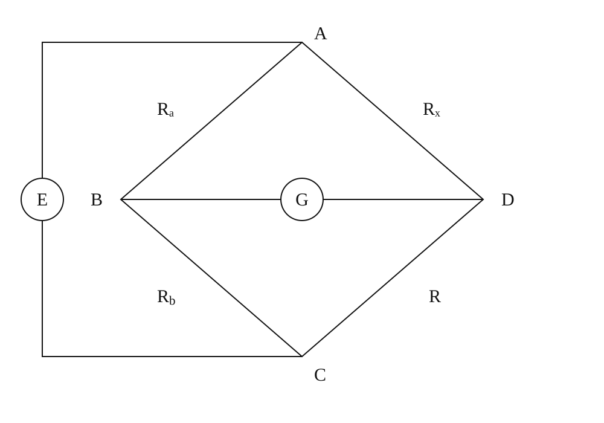

# 单臂电桥测电阻

淮南师范学院实验报告

学院：电子工程学院　专业：物理学　班级：24 物理 1 班

姓名：缪雨轩　学号：2414050120　实验日期：2025 年 11 月 5 日

## 一、实验名称

单臂电桥测电阻。

## 二、实验目的

1. 理解惠斯通电桥比较法测量电阻的原理。
2. 掌握 QJ47 型直流单臂电桥的使用。
3. 计算平衡电阻并依据适用量程和仪器规格分析结果。

## 三、实验原理

四臂为 $R_a,R_b,R_x,R$，电源接 A、C，检流计接 B、D。

图 1　惠斯通电桥节点与四臂连接示意

平衡时 $V_B=V_D$、检流计电流为零，左右支路电流分别为 $I_1,I_2$，有

$$
I_1R_a=I_2R_x,\qquad I_1R_b=I_2R.
$$

消去电流：

$$
\frac{R_a}{R_b}=\frac{R_x}{R},\qquad M=\frac{R_a}{R_b},\qquad R_x=MR.
$$

不平衡时，在开路检流端、理想电源模型下

$$
\frac{V_B-V_D}{E}=\frac{R_b}{R_a+R_b}-\frac{R}{R_x+R}.
$$

该电压可解释调节比较臂寻找零点的过程，实际检流计加载会改变不平衡电压，平衡条件保持不变。

## 四、主要仪器设备

QJ47 型直流单双臂电桥、五个待测电阻（标称 $3,47,200,2000,20000\,\Omega$）及导线。仪器总体标称 0.05 级，但说明书按测量区间另有等级条件，不可对所有结果统一应用。

## 五、实验步骤

1. 熟悉比率盘、比较臂十进盘、粗调/细调、电源和指零仪开关。
2. 指零仪内接并调零，按估计阻值选比率 $M$，尽量使用比较臂高位。
3. 待测电阻接入，先粗调再细调，从高位到低位寻找平衡。
4. 松开按钮后读取 $M$ 和比较臂总示值 $R$，计算 $R_x=MR$。
5. 更换电阻重复，核查说明书有效范围、基准值及环境条件后再评价允许误差。

## 六、原始数据记录

表 1　比率设定、比较臂与源处理结果

{{tables.balance}}

$100/100$ 是比率盘设定标识，实际乘数为 1；没有将其作为两次独立读数。

## 七、数据处理

### 1. 平衡值及标称比较

$$
D=\frac{R_x-R_{\mathrm{nom}}}{R_{\mathrm{nom}}}\times100\%.
$$

表 2　平衡电阻复算及量程条件

{{tables.results}}

标称偏差只比较标称与读数，不等于仪器校准误差。

### 2. 允许误差与适用性

说明书单电桥有效范围下限为 $10\,\Omega$；$10$–$10^4\,\Omega$ 的等级指数为 $0.05\%$，$10^4$–$10^5\,\Omega$ 为 $0.1\%$，更高区间另有规定，参考温度为 $20\pm2\,^{\circ}\mathrm C$。

其允许误差表达采用

$$
E_{\mathrm{lim}}=\pm c\left(\frac{R_N}{10}+X\right),
$$

$c$ 为等级指数的无量纲数值，$R_N$ 为基准，$X$ 在说明书中定义为标度盘示值。源示例将 $c=0.0005,R_N=100,X=3.066$ 代入得 $0.006533\,\Omega$，算术可复算，但不能据此确认 $3\,\Omega$ 结果适用该单桥规格。

表 3　源报告给出的限差表达（适用条件待核，非新认定结果）

{{tables.source_limits}}

本次各档基准和温度条件未完整记录，且 $3\,\Omega$ 在有效范围以下，故不将这些允许误差极限改称标准不确定度。若未来确认半宽为 $a$ 的均匀误差模型，才可据模型取 $u_B=a/\sqrt3$ 并与其他分量合成。

## 八、实验结果与讨论

1. 五个平衡结果为 $3.066,46.594,200.20,1979.7,20421\,\Omega$，由实际比率和比较臂示值计算，保留未修约值用于复算。
2. $3\,\Omega$ 低于说明书单桥有效范围下限，比较臂 $30.66\,\Omega$ 也未充分使用建议高位，不能按标称 0.05 级保证其准确度；低阻宜选择适用量程或四端测量。
3. $20\,\mathrm{k}\Omega$ 属于 $0.1\%$ 等级区间，不可统一套用 $0.05\%$。各档基准、环境条件及重复性缺失，未给出已经核定的完整不确定度。
4. 比较法减少了对电源幅度和检流计绝对标定的依赖，但仍受比较臂、比率臂、接触和零点灵敏度影响。按平衡公式计算本身不构成对该公式的独立实验验证。
