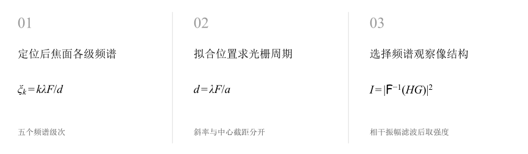
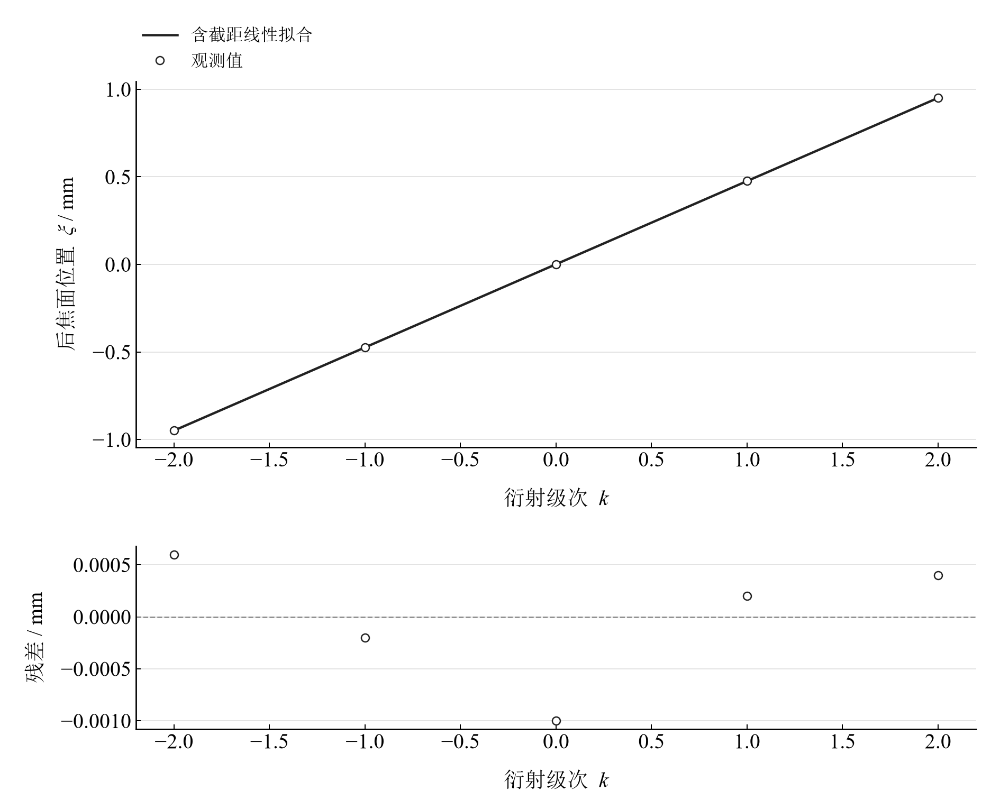
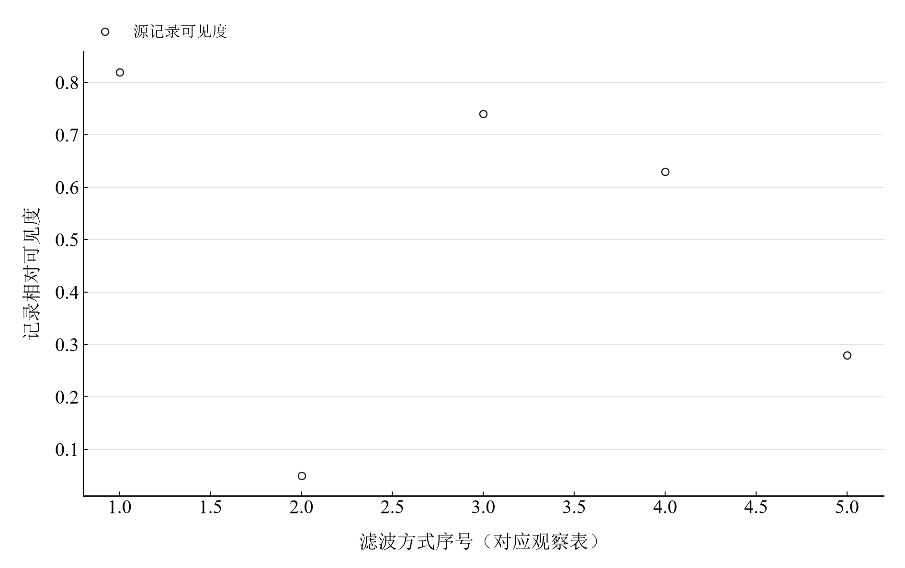

[普通物理实验 4](../README.md) · [项目首页](../../../README.md) · [使用指南](../../../docs/usage.md)

# 阿贝成像原理和空间滤波

**把频谱点的位置与像的细节联系起来。**

阿贝成像以“分频再合成”解释光栅成像。后焦面的衍射级次位置给出光栅周期，空间滤波观察则展示零级、低频与高频成分对像结构的作用。

[读实验报告](report/report.md) · [HTML 阅读版](https://hnnuyuxuan.github.io/general-physics-lab/experiments/course-04/abbe-imaging/notebooks/analysis.html) · [Python 笔记本](notebooks/analysis.ipynb) · [Wolfram 笔记本](../../../notebook/paclets/AbbeImagingLab/Notebooks/AbbeImagingLab.nb)



图 1　阿贝成像的观测链：频谱定位、周期计算与空间滤波

## 选择你的入口

|用途|入口|打开方式|
|---|---|---|
|阅读原理、测量记录和实验结论|[Markdown 实验报告](report/report.md) · [排版阅读版](https://hnnuyuxuan.github.io/general-physics-lab/experiments/course-04/abbe-imaging/report/report.html)|GitHub、Markdown 阅读器或本地浏览器|
|浏览逐次计算表与静态图表|[HTML 阅读版](https://hnnuyuxuan.github.io/general-physics-lab/experiments/course-04/abbe-imaging/notebooks/analysis.html)|直接在线打开，也可下载到本机|
|逐步运行和修改 Python 计算|[Jupyter Notebook](notebooks/analysis.ipynb)|JupyterLab 或 VS Code|
|运行原生公式与计算图表|[Wolfram Notebook](../../../notebook/paclets/AbbeImagingLab/Notebooks/AbbeImagingLab.nb) · [Paclet 安装包](../../../notebook/paclets/AbbeImagingLab/dist/AbbeImagingLab-0.1.0.paclet)|Wolfram 前端|
|对照原始实验报告|[源报告 PDF](../../../pdf/course-04/13_实验十三_阿贝成像原理和空间滤波.pdf)|GitHub 或 PDF 阅读器|

## 从读数到物理量

记录包含 **5 个后焦面频谱级次位置**及不同滤波方式下的成像描述和相对可见度。采用 $\lambda=632.8\ \mathrm{nm}$、傅里叶透镜焦距 $F=150.0\ \mathrm{mm}$。

核心计算关系为

$$
\xi_k=\frac{k\lambda F}{d}=ak+b,\qquad g_{\mathrm{out}}=\mathcal F^{-1}[HG],\qquad I=|g_{\mathrm{out}}|^2.
$$

位置拟合保留截距，用于检查频谱中心定位。相干成像的滤波对象是复振幅频谱，探测器最终记录模平方强度。

表 1　两种光栅周期估计与滤波观察值

|物理量或指标|计算结果|
|---|---:|
|一级位置光栅周期|$0.19983158\ \mathrm{mm}$|
|全级次位置拟合光栅周期|$0.19991575\ \mathrm{mm}$|
|仅零级记录可见度|$0.05$|
|未滤波记录可见度|$0.82$|

图中可见度采用观察表记录值。频谱位置法使用共同波长、焦距和定位基准，各级次属于不同衍射位置。

## 频谱的位置与滤波后的可见度

<table>
  <tr>
    <td width="50%" align="center" valign="top"><a href="assets/readme-spectrum-fit.png"></a></td>
    <td width="50%" align="center" valign="top"><a href="assets/readme-filter-visibility.png"></a></td>
  </tr>
  <tr>
    <td align="center" valign="top"><strong>图 2</strong><br>五级后焦面频谱位置的拟合及残差，斜率换算光栅周期</td>
    <td align="center" valign="top"><strong>图 3</strong><br>不同滤波方式的记录相对可见度，序号对应报告观察表</td>
  </tr>
</table>

仅通过零级时主要保留平均照明，周期条纹明显减弱；加入低级频谱恢复基本结构，高频成分影响细节。成像明暗还取决于复振幅相位与取强度过程。

## 从频谱读数到成像解释

|操作或计算|观察什么|
|---|---|
|比较一级位置与全级拟合|检查两种光栅周期估计及中心截距|
|按观察表查看滤波方式|将可见度记录与所通过的级次对应|
|阅读相干滤波关系|沿频谱乘法、逆变换和模平方三步理解成像|

Notebook 以实际频谱位置、记录可见度和静态计算解释空间滤波。光阑形状、物体复透过率与相位共同决定具体成像。

在 [Jupyter](notebooks/analysis.ipynb) 或 [Wolfram](../../../notebook/paclets/AbbeImagingLab/Notebooks/AbbeImagingLab.nb) 中从头运行，可沿报告章节查看数据读取、公式代入、计算输出与结果讨论。

## 在本机打开

环境安装见[使用指南](../../../docs/usage.md)。在仓库根目录启动本实验的 Jupyter Notebook：

```powershell
.\.venv\Scripts\python.exe -m jupyterlab experiments/course-04/abbe-imaging/notebooks/analysis.ipynb
```

Wolfram 安装包包含数据与 Notebook。将仓库路径改为本机路径后运行：

```wolfram
PacletInstall["D:/general-physics-lab/notebook/paclets/AbbeImagingLab/dist/AbbeImagingLab-0.1.0.paclet"];
Needs["AbbeImagingLab`"];
AbbeImagingLab`OpenNotebook[]
```

## 数据与计算实现

|内容|文件|
|---|---|
|规范观测数据|[observations-01.csv](data/observations-01.csv) · [observations-02.csv](data/observations-02.csv)|
|单位、参数与模型条件|[experiment.json](experiment.json)|
|Python 计算模块|[abbe_imaging.py](../../../src/physicslab/experiments/abbe_imaging.py)|
|Wolfram 包实现|[AbbeImagingLab.wl](../../../notebook/paclets/AbbeImagingLab/Kernel/AbbeImagingLab.wl)|
|完整计算结果|[python.json](results/python.json)|

[数据来源](data/provenance.json) · [返回课程目录](../README.md)
