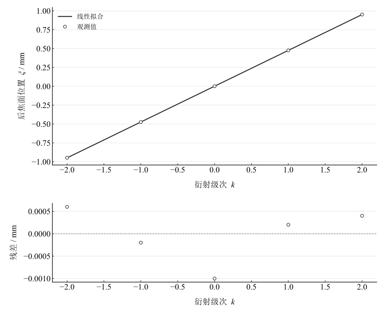
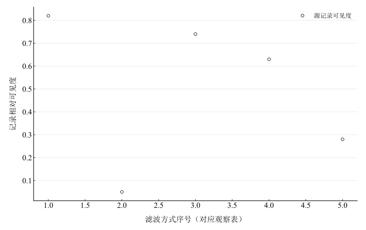

# 阿贝成像原理和空间滤波

## 实验名称

实验十三 阿贝成像原理和空间滤波

## 实验目的

1.  理解阿贝成像的“频谱形成—频谱合成”两步过程。
2.  掌握相干光条件下多透镜系统的共轴调节。
3.  观察和分析不同空间滤波方式对像面结构的影响。

## 实验原理

阿贝成像理论认为，物体经相干平行光照明后，透镜在后焦面形成物的空间频谱；各空间频率分量再传播到像面并相干叠加，形成物像。对二维物体 $g(x,y)$，频谱为其傅里叶变换

$$G\left( f_{x},f_{y} \right) = \iint g(x,y)e^{- i2\pi\left( f_{x}x + f_{y}y \right)}\, dx\, dy.$$

一维光栅常数为 $d$，空间频率 $f_{0} = 1/d$。透镜焦距为 $F$ 时，第 $k$ 级频谱点在后焦面的位置为

$$\xi_{k} = \frac{k\lambda F}{d}.$$

在频谱面放置光阑可选择性通过或阻断某些空间频率：仅通零级时像面只剩平均照明；通过零级和一级可恢复基本周期；高频分量越充分，边缘和细节越清晰。

## 主要仪器设备

氦氖激光器、扩束与准直系统、一维光栅、傅里叶透镜、成像透镜、屏、光阑和空间滤波片。

## 实验步骤

1.  调整激光器、扩束镜、准直透镜、光栅、傅里叶透镜和屏共轴。
2.  将屏置于傅里叶透镜后焦面，观察离散的 $0, \pm 1, \pm 2$ 级频谱点并测量其位置。
3.  将成像屏移到像面，观察未滤波时的光栅像。
4.  在频谱面依次放置小孔、竖缝和挡板，分别实现仅通零级、通零级和一级、挡去零级等滤波。
5.  记录像面条纹、背景和清晰度的变化，比较各空间频率分量的作用。
6.  全程保持滤波片处于后焦面，避免触碰光具座造成失调。

## 原始数据记录

本实验以一维光栅为物，用透镜在后焦面形成空间频谱，并在频谱面加入不同滤波片观察像面变化。激光波长取 $\lambda=632.8\,\mathrm{nm}$，透镜焦距 $F=150.0\,\mathrm{mm}$。

表 1　频谱面衍射级次位置

{{tables.table1}}

表 2　空间滤波观察记录

{{tables.table2}}

## 数据处理

采用 $\lambda=632.8\,\mathrm{nm}$、$F=150.0\,\mathrm{mm}$。由正负一级位置的平均绝对值 $|\xi_1|=0.475000\,\mathrm{mm}$，得到

$$
d=\frac{\lambda F}{|\xi_1|}=0.19983158\,\mathrm{mm},\qquad f_0=\frac1d=5.004214\,\mathrm{mm}^{-1}.
$$

对全部五级位置作带截距线性拟合 $\xi_k=ak+b$，得到 $a=0.4748000\,\mathrm{mm}$、$b=0.0010000\,\mathrm{mm}$，相应 $d_{\mathrm{fit}}=0.19991575\,\mathrm{mm}$。拟合保留截距以检查频谱中心定位，不强制零点完美。

图 1　后焦面频谱位置与级次的拟合及残差

图 2　按观察表顺序列出的相对可见度

相干滤波对复振幅频谱作乘法，$g_{\mathrm{out}}=\mathcal F^{-1}[H G]$，实际探测强度为 $|g_{\mathrm{out}}|^2$。仅通直流分量时形成平均照明；通过零级及正负一级可恢复基频结构，更多高频分量能够贡献细节。观察表中的可见度是记录值，未附最大最小光强，不能重新核算。

## 实验结果与讨论

一级位置法测得光栅周期约 $0.1998\,\mathrm{mm}$，全级次拟合得到近似一致的周期。仅通零级时条纹显著减弱，符合直流分量不能恢复周期结构的判断；加入低级频谱可恢复基本条纹，去除高频会损失边缘细节。

“挡去零级后出现反相条纹”为原始观察描述。仅凭通过正负一级不能普遍断言成像必然反相：相干叠加的相位及像面取强度都会影响周期与对比度，例如只剩等幅正负基频时强度可含二倍空间频率。当前缺少复振幅、物体透过率及光阑尺寸，不重建实际物像或给出未测的滤波参数。

误差主要来自频谱点定位、后焦面光阑位置、光栅倾斜与像差。频谱级次共享波长、焦距和定位误差，未提供这些分量，不能将五个不同级次当独立重复测量合成完整不确定度。
