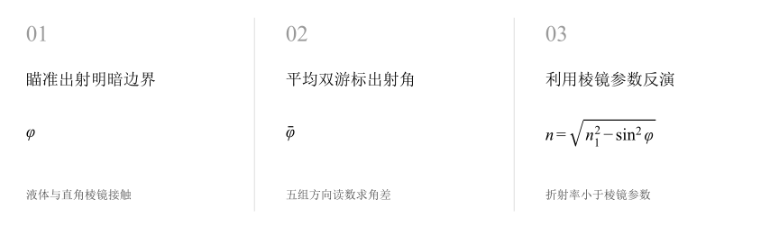
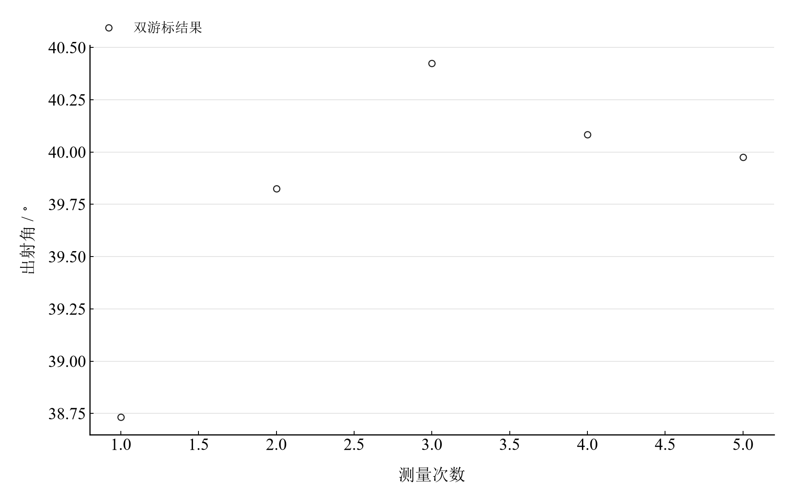

[普通物理实验 4](../README.md) · [项目首页](../../../README.md) · [使用指南](../../../docs/usage.md)

<!-- virtual-laboratory-entry -->
[在线虚拟实验](https://hnnuyuxuan.github.io/general-physics-lab/simulations/grazing-refraction/) · [模型依据与参数来源](../../../docs/grazing-refraction-model-evidence.md)

# 用掠射法测定透明介质的折射率

**用掠入射的明暗分界线，测量透明液体的折射率。**

液体与直角棱镜接触形成测量界面，掠入射光在出射侧形成可瞄准的明暗边界。记录边界方向与参考方向，用已知棱镜折射率求出液体折射率。

[读实验报告](report/report.md) · [HTML 阅读版](https://hnnuyuxuan.github.io/general-physics-lab/experiments/course-04/grazing-refraction/notebooks/analysis.html) · [Python 笔记本](notebooks/analysis.ipynb) · [Wolfram 笔记本](../../../notebook/paclets/GrazingRefractionLab/Notebooks/GrazingRefractionLab.nb)



图 1　直角棱镜掠射法：从边界出射角反演透明液体折射率

## 选择你的入口

|用途|入口|打开方式|
|---|---|---|
|阅读原理、测量记录和实验结论|[Markdown 实验报告](report/report.md) · [排版阅读版](https://hnnuyuxuan.github.io/general-physics-lab/experiments/course-04/grazing-refraction/report/report.html)|GitHub、Markdown 阅读器或本地浏览器|
|浏览逐次计算表与静态图表|[HTML 阅读版](https://hnnuyuxuan.github.io/general-physics-lab/experiments/course-04/grazing-refraction/notebooks/analysis.html)|直接在线打开，也可下载到本机|
|逐步运行和修改 Python 计算|[Jupyter Notebook](notebooks/analysis.ipynb)|JupyterLab 或 VS Code|
|运行原生公式与计算图表|[Wolfram Notebook](../../../notebook/paclets/GrazingRefractionLab/Notebooks/GrazingRefractionLab.nb) · [Paclet 安装包](../../../notebook/paclets/GrazingRefractionLab/dist/GrazingRefractionLab-0.1.0.paclet)|Wolfram 前端|
|对照原始实验报告|[源报告 PDF](../../../pdf/course-04/04_实验四_用掠射法测定透明介质的折射率_实验报告.pdf)|GitHub 或 PDF 阅读器|

## 从读数到物理量

记录包含 **5 组出射角测量**。采用直角棱镜参数 $n_1=1.5425$、标准分量 $u(n_1)=0.0006$；每组从四个游标方向读数计算出射角。

核心计算关系为

$$
n=\sqrt{n_1^2-\sin^2\bar\varphi},\qquad \frac{\partial n}{\partial\varphi}=-\frac{\sin\varphi\cos\varphi}{n}.
$$

模型对应空气、直角棱镜与透明液体界面，满足 $n<n_1$。角度传播按弧度求导，圆周最短差处理游标跨零。

表 1　掠射法出射角与透明液体折射率

|物理量或指标|计算结果|
|---|---:|
|出射角均值|$39.808333^\circ$|
|透明液体折射率|$1.4033612$|
|指定分量传播不确定度|$0.0018723$|

标准分量由指定棱镜参数与角度分量独立传播。结果对应所用棱镜输入和记录条件；液体名称及温度另需由样品记录确定。

## 明暗边界的判断如何进入结果



图 2　五次明暗分界线出射角；第 1 组与其余记录的差异进入重复性统计

五组角度分布约在 $38.73^\circ$ 至 $40.43^\circ$ 之间，其离散大于角分量级的读数误差限。边界锐度、界面气泡与掠入射方向是解释这些差异的主要操作线索。

## 复算角差与折射率分量

|操作或计算|观察什么|
|---|---|
|逐组求出射角|对比左右游标并检查第 4 组右游标跨零读数|
|计算液体折射率|将未修约出射角均值代入直角棱镜关系|
|查看传播灵敏度|分别检查棱镜参数和角度分量的贡献|

Notebook 提供静态计算表、参数代入与误差传播。修改实验参数后顺序运行，可比较折射率对棱镜输入和边界角的响应。

在 [Jupyter](notebooks/analysis.ipynb) 或 [Wolfram](../../../notebook/paclets/GrazingRefractionLab/Notebooks/GrazingRefractionLab.nb) 中从头运行，可沿报告章节查看数据读取、公式代入、计算输出与结果讨论。

## 在本机打开

环境安装见[使用指南](../../../docs/usage.md)。在仓库根目录启动本实验的 Jupyter Notebook：

```powershell
.\.venv\Scripts\python.exe -m jupyterlab experiments/course-04/grazing-refraction/notebooks/analysis.ipynb
```

Wolfram 安装包包含数据与 Notebook。将仓库路径改为本机路径后运行：

```wolfram
PacletInstall["D:/general-physics-lab/notebook/paclets/GrazingRefractionLab/dist/GrazingRefractionLab-0.1.0.paclet"];
Needs["GrazingRefractionLab`"];
GrazingRefractionLab`OpenNotebook[]
```

## 数据与计算实现

|内容|文件|
|---|---|
|规范观测数据|[observations-01.csv](data/observations-01.csv)|
|单位、参数与模型条件|[experiment.json](experiment.json)|
|Python 计算模块|[grazing_refraction.py](../../../src/physicslab/experiments/grazing_refraction.py)|
|Wolfram 包实现|[GrazingRefractionLab.wl](../../../notebook/paclets/GrazingRefractionLab/Kernel/GrazingRefractionLab.wl)|
|完整计算结果|[python.json](results/python.json)|

[数据来源](data/provenance.json) · [返回课程目录](../README.md)
