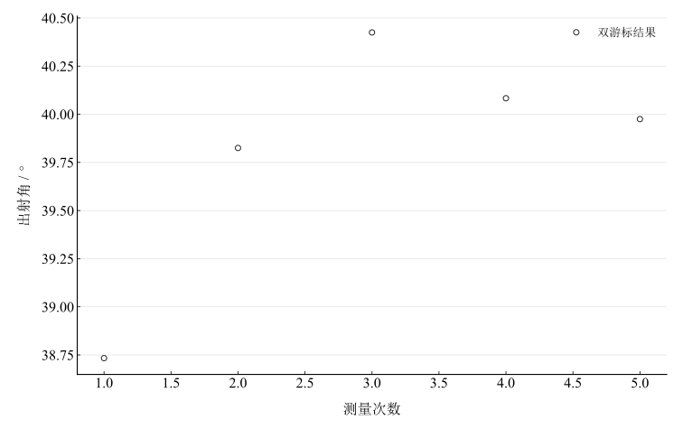

# 用掠射法测定透明介质的折射率

## 实验名称

实验四 用掠射法测定透明介质的折射率

## 实验目的

1.  掌握掠射法测定透明液体折射率的基本原理。
2.  学习利用分光计判断明暗半视场分界线并测量出射方向。
3.  理解临界角、棱镜几何关系和折射定律在折射率测量中的应用。

## 实验原理

设待测液体折射率为 $n$，直角棱镜折射率为 $n_{1}$，且 $n < n_{1}$。当入射光沿液体—棱镜界面作掠入射时，入射角为 $90^{\circ}$，进入棱镜后的折射角等于临界角 $i_{c}$，有

$$\sin i_{c} = \frac{n}{n_{1}}.$$

光线由棱镜另一表面射向空气，出射方向形成明暗分界线。若该出射角为 $\varphi$，棱镜顶角为 $A$，则一般关系可写为

$$n = n_{1}\sin\left\lbrack A - \arcsin\left( \frac{\sin\varphi}{n_{1}} \right) \right\rbrack.$$

对直角棱镜 $A = 90^{\circ}$，化为

$$n = \sqrt{n_{1}^{2} - \sin^{2}\varphi}.$$

分界线对应能从棱镜射出的极限光线，因此其位置判定是本实验精度的关键。

## 主要仪器设备

分光计、已知折射率的直角棱镜、钠灯、待测透明液体、滴管、毛玻璃片及清洁用品。

## 实验步骤

1.  清洁直角棱镜测量面，在其上滴加少量待测液体，避免气泡和杂质。
2.  将毛玻璃片或扩展光源置于液体上方，使光线以接近掠入射方式照明界面。
3.  调节分光计望远镜，寻找明暗半视场分界线，使叉丝竖线与分界线重合，记录两游标读数。
4.  测量棱镜参考方向，得到分界线出射角 $\varphi$。
5.  重新放置和对准装置，重复测量 5 次；实验结束后及时清洁棱镜。

## 原始数据记录

本实验按掠入射法读取分界线位置。直角棱镜采用 $n_1=1.5425$，指定标准不确定度 $u_{n_1}=0.0006$，待测介质为透明液体。

表 1　掠射法原始角度读数

| 次数 | $\theta_1$ | $\theta_2$ | $\theta_3$ | $\theta_4$ |
| --- | --- | --- | --- | --- |
| 1 | $100^{\circ}55^{\prime}$ | $280^{\circ}58^{\prime}$ | $62^{\circ}12^{\prime}$ | $242^{\circ}13^{\prime}$ |
| 2 | $90^{\circ}59^{\prime}$ | $271^{\circ}01^{\prime}$ | $51^{\circ}10^{\prime}$ | $231^{\circ}11^{\prime}$ |
| 3 | $329^{\circ}12^{\prime}$ | $149^{\circ}12^{\prime}$ | $288^{\circ}47^{\prime}$ | $108^{\circ}46^{\prime}$ |
| 4 | $208^{\circ}18^{\prime}$ | $28^{\circ}21^{\prime}$ | $168^{\circ}13^{\prime}$ | $348^{\circ}16^{\prime}$ |
| 5 | $269^{\circ}26^{\prime}$ | $89^{\circ}25^{\prime}$ | $229^{\circ}27^{\prime}$ | $49^{\circ}27^{\prime}$ |

## 数据处理

每组先计算两游标的角度改变量。遇到读数跨越 $0^\circ$ 时，以圆周模 $360^\circ$ 的最短角差计算；不将跨零读数直接相减。计算保留半分等未修约信息，最后才修约显示。

表 2　出射角逐次计算（角度以小数度列出）

| 次数 | 左游标角差 / ° | 右游标角差 / ° | 出射角 / ° |
| --- | --- | --- | --- |
| 1 | 38.716667 | 38.75 | 38.733333 |
| 2 | 39.816667 | 39.833333 | 39.825 |
| 3 | 40.416667 | 40.433333 | 40.425 |
| 4 | 40.083333 | 40.083333 | 40.083333 |
| 5 | 39.983333 | 39.966667 | 39.975 |

未修约均值为 $\bar\varphi=39.80833333^\circ$，即 $39^\circ48.5000^\prime$。A 类分量由五次结果计算：

$$
u_A=\sqrt{\frac{\sum_i(x_i-\bar x)^2}{n(n-1)}}=17.17920^\prime.
$$

沿用记录的角度误差限 $\Delta=1^\prime$，将其作为最终角度估计的均匀分布限值，得到 $u_B=\Delta/\sqrt3=0.57735^\prime$，两项独立合成为 $u_c=17.18890^\prime$。该处理采用指定误差限的约定，未另行包含分光计校准与其他系统分量。

图 1　出射角重复测量

直角棱镜条件下，由 $n_1=1.5425$ 和未修约出射角计算

$$
n=\sqrt{n_1^2-\sin^2\bar\varphi}=1.4033612.
$$

按 $\partial n/\partial n_1=n_1/n$、$\partial n/\partial\varphi=-\sin\varphi\cos\varphi/n$，采用棱镜折射率的给定标准分量 $u(n_1)=0.0006$，并将角分先转为弧度传播，得到 $u_n=0.0018723$；仅包含给定的棱镜分量与角度分量。

## 实验结果与讨论

五组读数的平均出射角为 $39.80833333^\circ$，在直角棱镜输入 $n_1=1.5425$ 下算得液体折射率 $n=1.4033612$，指定分量传播标准不确定度 $u_n=0.0018723$。液体名称和测量温度未记录，不将结果与具体液体标称值比较。

关键是准确判断明暗分界线。接触气泡、污染、分界线锐度、掠入射偏离及棱镜参数输入均影响结果。五组原始数据全部保留；圆周角差正确处理第4组右游标跨零读数。
