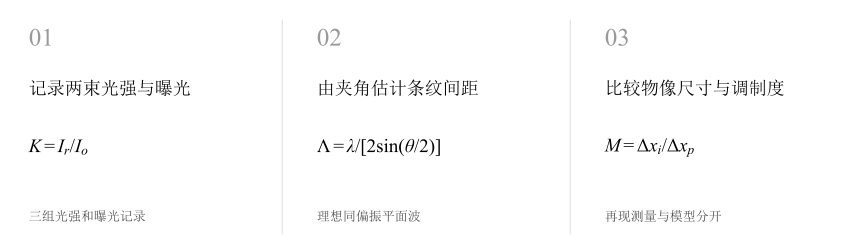
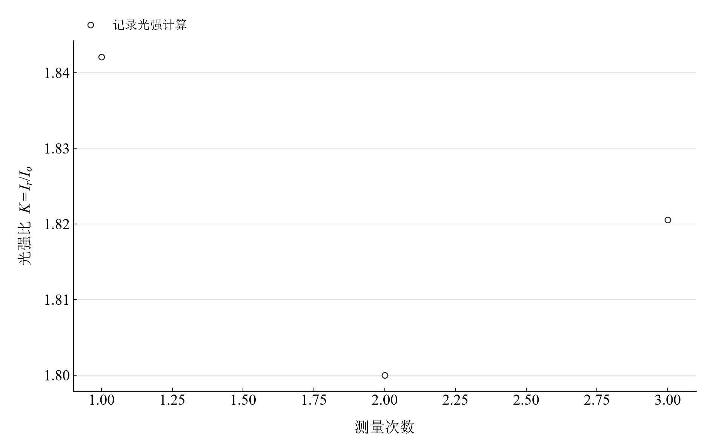
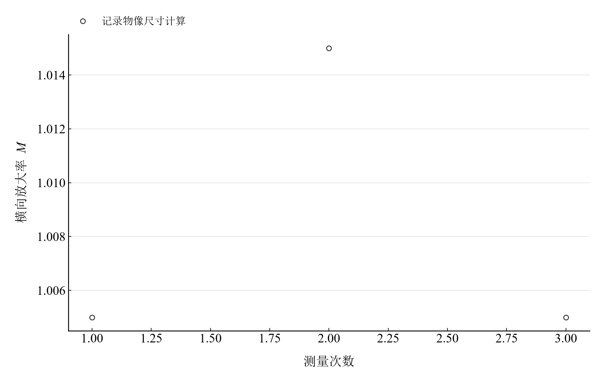

[普通物理实验 4](../README.md) · [项目首页](../../../README.md) · [使用指南](../../../docs/usage.md)

# 全息照相

**把光的相位写进干涉条纹，再由再现像读出尺寸关系。**

物光与参考光在干板上叠加记录，再用照明光再现物体轮廓。光强比、双束夹角和曝光量决定记录条纹的条件，物像宽度给出再现放大率。

[读实验报告](report/report.md) · [HTML 阅读版](notebooks/analysis.html) · [Python 笔记本](notebooks/analysis.ipynb) · [Wolfram 笔记本](../../../notebook/paclets/HolographyLab/Notebooks/HolographyLab.nb)



图 1　全息记录与再现：光强条件、理论条纹尺度和物像尺寸

## 选择你的入口

|用途|入口|打开方式|
|---|---|---|
|阅读原理、测量记录和实验结论|[Markdown 实验报告](report/report.md) · [排版阅读版](report/report.html)|GitHub、Markdown 阅读器或本地浏览器|
|浏览计算图表与操作模型控件|[HTML 阅读版](notebooks/analysis.html)|下载后用浏览器打开|
|逐步运行和修改 Python 计算|[Jupyter Notebook](notebooks/analysis.ipynb)|JupyterLab 或 VS Code|
|运行原生公式与计算图表|[Wolfram Notebook](../../../notebook/paclets/HolographyLab/Notebooks/HolographyLab.nb) · [Paclet 安装包](../../../notebook/paclets/HolographyLab/dist/HolographyLab-0.1.0.paclet)|Wolfram 前端|
|对照原始实验报告|[源报告 PDF](../../../pdf/course-04/14_实验十四_全息照相_实验报告.pdf)|GitHub 或 PDF 阅读器|

## 从读数到物理量

记录包括 **3 组物光、参考光及光路条件**，以及 **3 组物像宽度**。波长取 $632.8\ \mathrm{nm}$、记录夹角约 $30^\circ$，曝光时间每组 $5.0\ \mathrm s$。

核心计算关系为

$$
K=\frac{I_r}{I_o},\qquad V=\frac{2\sqrt K}{1+K},\qquad \Lambda=\frac{\lambda}{2\sin(\theta/2)}.
$$

可见度关系采用完全相干、同偏振、两束平面波模型。条纹间距由波长和夹角计算；再现放大率则来自实际物像宽度之比。

表 1　全息记录条件与再现放大率

|物理量或指标|计算结果|
|---|---:|
|参考光与物光光强比均值|$1.8208727$|
|理想平面波干涉条纹间距|$1.2224757\ \mu\mathrm m$|
|再现横向放大率均值|$1.0083333$|
|两束平均光强的曝光量均值|$5.500000\ \mathrm{mJ}/\mathrm{cm}^2$|

放大率与光强比的 A 类分量分别来自三次重复记录。理论可见度由光强比计算，曝光量由两束总平均光强与时间相乘得到。

## 分别查看光强比与再现像尺寸

<table>
  <tr>
    <td width="50%" align="center" valign="top"><a href="assets/readme-hologram-ratio.png"></a></td>
    <td width="50%" align="center" valign="top"><a href="assets/readme-hologram-magnification.png"></a></td>
  </tr>
  <tr>
    <td align="center" valign="top"><strong>图 2</strong><br>三组记录光强计算的参考光与物光之比</td>
    <td align="center" valign="top"><strong>图 3</strong><br>三组记录物像宽度计算的再现横向放大率</td>
  </tr>
</table>

光强比均值约 1.82，再现横向放大率约 1.008。前者连接理想条纹调制度，后者描述本组物像尺寸关系；记录与再现的两类结果各有对应输入。

## 光强平衡与双束夹角

|操作或计算|观察什么|
|---|---|
|调节光强比比例|从记录均值的 0.25 倍至 2 倍，观察理论调制度|
|调节双束夹角|从 $10^\circ$ 至 $60^\circ$，观察条纹间距与空间分辨要求|
|比较再现放大率|复算三组物像尺寸，查看均值及重复性分量|

两种交互采用理想相干平面波模型，干板横向范围为 $0$ 至 $6\ \mu\mathrm m$。实际记录质量还随曝光振动、相位稳定性和干板响应变化。

在 [Jupyter](notebooks/analysis.ipynb) 或 [Wolfram](../../../notebook/paclets/HolographyLab/Notebooks/HolographyLab.nb) 中从头运行，可沿报告章节查看数据读取、公式代入、计算输出与结果讨论。

## 在本机打开

环境安装见[使用指南](../../../docs/usage.md)。在仓库根目录启动本实验的 Jupyter Notebook：

```powershell
.\.venv\Scripts\python.exe -m jupyterlab experiments/course-04/holography/notebooks/analysis.ipynb
```

Wolfram 安装包包含数据与 Notebook。将仓库路径改为本机路径后运行：

```wolfram
PacletInstall["D:/general-physics-lab/notebook/paclets/HolographyLab/dist/HolographyLab-0.1.0.paclet"];
Needs["HolographyLab`"];
HolographyLab`OpenNotebook[]
```

## 数据与计算实现

|内容|文件|
|---|---|
|规范观测数据|[observations-01.csv](data/observations-01.csv) · [observations-02.csv](data/observations-02.csv)|
|单位、参数与模型条件|[experiment.json](experiment.json)|
|Python 计算模块|[holography.py](../../../src/physicslab/experiments/holography.py)|
|Wolfram 包实现|[HolographyLab.wl](../../../notebook/paclets/HolographyLab/Kernel/HolographyLab.wl)|
|完整计算结果|[python.json](results/python.json)|

[数据来源](data/provenance.json) · [返回课程目录](../README.md)
