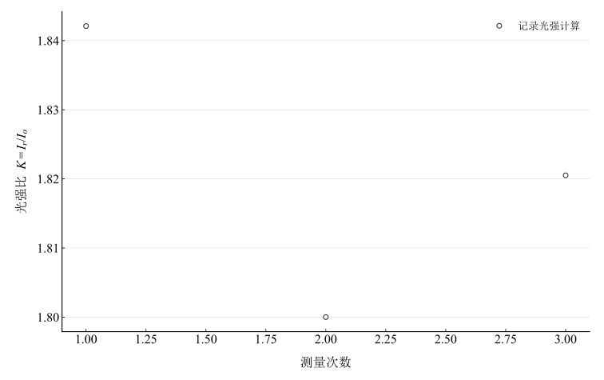
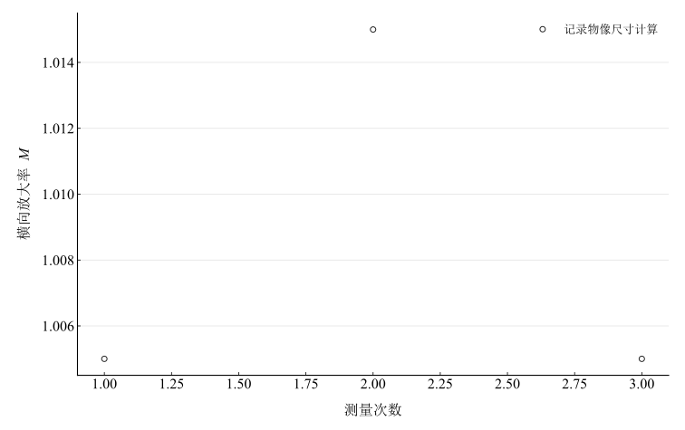

# 全息照相

## 实验名称

实验十四 全息照相

## 实验目的

1.  掌握像面全息图的记录和再现原理。
2.  学习搭建物光与参考光光路并制作全息图。
3.  观察全息再现像，分析光强比、稳定性和几何条件对像质的影响。

## 实验原理

全息记录利用相干物光 $O$ 与参考光 $R$ 在记录介质上的干涉，将物光的振幅和相位信息编码为强度分布：

$$I = \vert O + R\vert ^{2} = \vert O\vert ^{2} + \vert R\vert ^{2} + OR^{*} + O^{*}R.$$

经显影、定影后，全息图成为复杂衍射光栅。用与记录参考光相同或相近的光照明时，衍射光重建原物光波前，从而形成虚像或实像。

若物光与参考光夹角为 $\theta$，干涉条纹间距近似为

$$\Lambda = \frac{\lambda}{2\sin(\theta/2)}.$$

记录时参考光通常略强于物光，以获得较好的条纹调制度。相同波长和几何条件下再现时，像面全息图的横向放大率近似为 $M = \Delta x_{i}/\Delta x_{p}$。

## 主要仪器设备

氦氖激光器、分束镜、反射镜、扩束镜、准直镜、被摄物、全息干板及夹具、减振平台、显影和定影器材。

## 实验步骤

1.  在减振平台上布置激光器和分束镜，将激光分成物光和参考光两路。
2.  调节反射镜、扩束镜和准直镜，使物光均匀照明物体并到达干板，参考光均匀照明同一区域。
3.  调整两路光程差，使其小于激光相干长度；设置两束光夹角约 $30^{\circ}$。
4.  测量物光和参考光光强，调节至参考光略强于物光；遮光静置，待平台稳定后曝光。
5.  按规定时间显影、漂洗、定影和干燥全息干板。
6.  用参考光方向照明全息图，观察再现像并测量像距和像宽。
7.  操作中严禁直视激光束，曝光期间不得触碰平台。

## 原始数据记录

本实验记录像面全息图拍摄时的光路参数、光强比和再现像尺寸。激光波长取 $\lambda=632.8\,\mathrm{nm}$。

表 1　全息记录光路参数

| 次数 | 物光路/cm | 参考光路/cm | 两束光夹角/(°) | 物光强/(mW·cm⁻²) | 参考光强/(mW·cm⁻²) | 曝光时间/s |
| --- | --- | --- | --- | --- | --- | --- |
| 1 | 80.2 | 82.0 | 30.0 | 0.38 | 0.70 | 5.0 |
| 2 | 80.0 | 81.6 | 30.0 | 0.40 | 0.72 | 5.0 |
| 3 | 80.4 | 82.2 | 30.0 | 0.39 | 0.71 | 5.0 |

表 2　再现像尺寸测量记录

| 次数 | 记录时物距 $z_p$/mm | 再现像距 $z_i$/mm | 物宽 $\Delta x_p$/mm | 再现像宽 $\Delta x_i$/mm |
| --- | --- | --- | --- | --- |
| 1 | 300.0 | 302.0 | 20.0 | 20.1 |
| 2 | 300.0 | 304.0 | 20.0 | 20.3 |
| 3 | 300.0 | 301.0 | 20.0 | 20.1 |

## 数据处理

两束平面波夹角 $\theta=30.0^\circ$、波长 $\lambda=0.6328\,\mu\mathrm m$，理论条纹间距为

$$
\Lambda=\frac{\lambda}{2\sin(\theta/2)}=1.222476\,\mu\mathrm m.
$$

该量由几何与波长估算，提示干板需分辨相应空间周期，不是条纹间距的直接测量。

表 3　参考光与物光光强比 $K=I_r/I_o$

| 次数 | $I_r/I_o$ |
| --- | --- |
| 1 | 1.8421053 |
| 2 | 1.8 |
| 3 | 1.8205128 |

均值 $\bar K=1.82087269$，重复性均值 A 类分量为 $0.01215607$。完全相干且偏振相同时，理论可见度为 $V=2\sqrt K/(1+K)$，三组的理论值均值为 $0.956721$；这不是实测条纹可见度。两束总平均光强乘曝光时间的均值为 $5.5000\,\mathrm{mJ}/\mathrm{cm}^2$，未包含干板响应非线性。

表 4　再现像横向放大率 $M=\Delta x_i/\Delta x_p$

| 次数 | $\Delta x_i/\Delta x_p$ |
| --- | --- |
| 1 | 1.005 |
| 2 | 1.015 |
| 3 | 1.005 |

均值 $\bar M=1.00833333$，均值 A 类分量为 $0.00333333$。物像位置和宽度的系统误差未记录，不据此给出完整放大率不确定度。

图 1　参考光与物光光强比

图 2　再现像横向放大率

## 实验结果与讨论

记录夹角约 $30^\circ$ 对应理论条纹间距约 $1.22\,\mu\mathrm m$；平均光强比约 $1.82$，三次曝光时间均为 $5.0\,\mathrm s$。再现像横向放大率约 $1.008$，观察记录表明可获得与物体轮廓一致的再现像；放大率接近 $1$ 只描述本组尺寸关系，不能单独证明全部几何条件一致。

记录的两光路最大差为 $1.800\,\mathrm{cm}$。没有激光相干长度，不能仅凭光路差确定相干条件充分。曝光期间振动和相位漂移会降低调制度；理想相干双束可见度在 $K=1$ 时最大，偏离平衡会降低理论可见度，实际曝光选择还受干板动态范围和两路光强分布影响，不能断言当前比值为最佳。

像质还受干板处理、光束均匀性、物体位置、参考波前及再现方向影响。模型扫描只展示理想平面波的强度条纹，未模拟干板显影或恢复实际物体三维波前。
