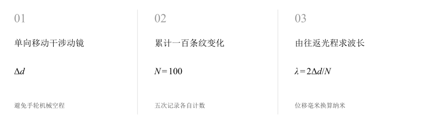
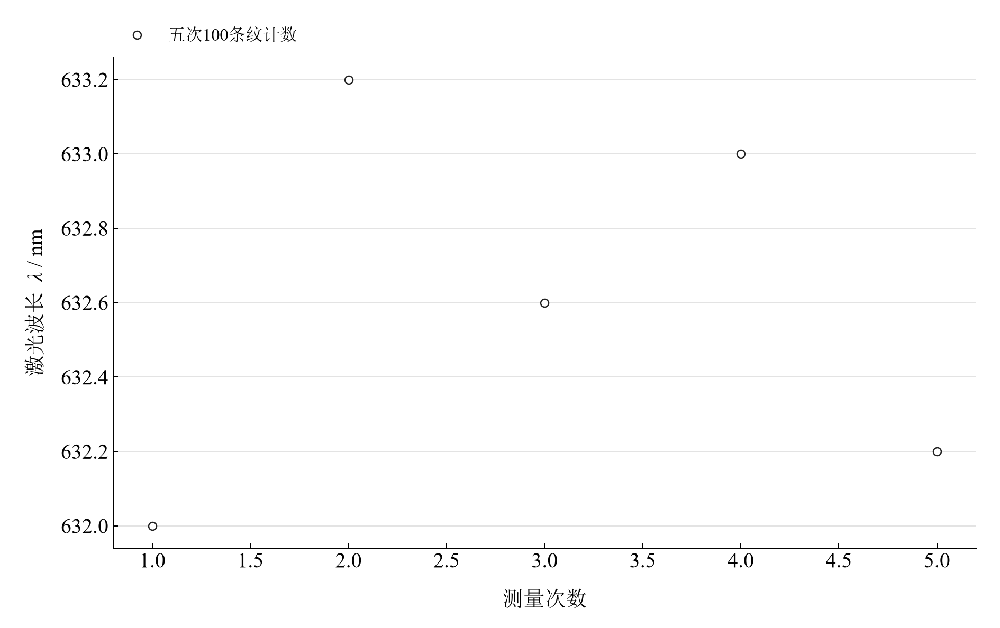

[普通物理实验 4](../README.md) · [项目首页](../../../README.md) · [使用指南](../../../docs/usage.md)

<!-- virtual-laboratory-entry -->
[在线虚拟实验](https://hnnuyuxuan.github.io/general-physics-lab/simulations/michelson-interferometer/) · [模型依据与参数来源](../../../docs/michelson-interferometer-model-evidence.md)

# 迈克尔逊干涉仪的调节和使用

**数过一百条条纹，让动镜位移给出激光波长。**

迈克尔逊干涉仪把动镜的微小位移放大为可计数的条纹变化。光在动镜臂往返传播，位移与光程差之间的二倍关系，是从读数计算波长的关键。

[读实验报告](report/report.md) · [HTML 阅读版](https://hnnuyuxuan.github.io/general-physics-lab/experiments/course-04/michelson-interferometer/notebooks/analysis.html) · [Python 笔记本](notebooks/analysis.ipynb) · [Wolfram 笔记本](../../../notebook/paclets/MichelsonInterferometerLab/Notebooks/MichelsonInterferometerLab.nb)



图 1　迈克尔逊干涉测波长：动镜位移、往返光程差与条纹计数

## 选择你的入口

|用途|入口|打开方式|
|---|---|---|
|阅读原理、测量记录和实验结论|[Markdown 实验报告](report/report.md) · [排版阅读版](https://hnnuyuxuan.github.io/general-physics-lab/experiments/course-04/michelson-interferometer/report/report.html)|GitHub、Markdown 阅读器或本地浏览器|
|浏览逐次计算表与静态图表|[HTML 阅读版](https://hnnuyuxuan.github.io/general-physics-lab/experiments/course-04/michelson-interferometer/notebooks/analysis.html)|直接在线打开，也可下载到本机|
|逐步运行和修改 Python 计算|[Jupyter Notebook](notebooks/analysis.ipynb)|JupyterLab 或 VS Code|
|运行原生公式与计算图表|[Wolfram Notebook](../../../notebook/paclets/MichelsonInterferometerLab/Notebooks/MichelsonInterferometerLab.nb) · [Paclet 安装包](../../../notebook/paclets/MichelsonInterferometerLab/dist/MichelsonInterferometerLab-0.1.0.paclet)|Wolfram 前端|
|对照原始实验报告|[源报告 PDF](../../../pdf/course-04/08_实验八_迈克尔逊干涉仪的调节和使用_实验报告.pdf)|GitHub 或 PDF 阅读器|

## 从读数到物理量

保留 **5 次动镜起止位置，每次累计 100 条条纹**。每组位移由末位置减初位置得到，使用毫米统一计算，再换算为纳米。

核心计算关系为

$$
2\Delta d=N\lambda,\qquad \lambda_i=\frac{2(d_{2i}-d_{1i})}{N}.
$$

系数二来自动镜臂的往返光程。计数时保持手轮沿同一方向转动，条纹圆心稳定有助于持续识别同一条纹变化。

表 1　激光波长均值、重复性与参考比较

|物理量或指标|计算结果|
|---|---:|
|激光波长均值|$632.60000\ \mathrm{nm}$|
|波长均值A类分量|$0.228035\ \mathrm{nm}$|
|相对指定632.8nm的差异|$0.03160556\%$|

A 类分量表示五次波长均值的重复性。相对差以常用参考波长 $632.8\ \mathrm{nm}$ 为分母；该参考值用于量级和结果比较。

## 比较相同条纹数下的五次位移



图 2　每次累计 100 条条纹所得波长；五次位移分别计算

相同计数下，波长结果随动镜位移成正比。图中各次结果约在 $632.0$ 至 $633.2\ \mathrm{nm}$ 之间，可结合原始位置读数检查位移估读和机械回程影响。

## 把光程差的二倍关系算清楚

|操作或计算|观察什么|
|---|---|
|复算起止位移|逐次检查位置相减和毫米到纳米换算|
|对照条纹计数|将每组 $N=100$ 与对应位移一一配对|
|计算均值及重复性|用五次未修约波长求 A 类均值分量|

Notebook 沿调节步骤、原始记录、波长计算和讨论展示静态复算。位移刻度、机械回程与计数误差由相应测量条件另行分析。

在 [Jupyter](notebooks/analysis.ipynb) 或 [Wolfram](../../../notebook/paclets/MichelsonInterferometerLab/Notebooks/MichelsonInterferometerLab.nb) 中从头运行，可沿报告章节查看数据读取、公式代入、计算输出与结果讨论。

## 在本机打开

环境安装见[使用指南](../../../docs/usage.md)。在仓库根目录启动本实验的 Jupyter Notebook：

```powershell
.\.venv\Scripts\python.exe -m jupyterlab experiments/course-04/michelson-interferometer/notebooks/analysis.ipynb
```

Wolfram 安装包包含数据与 Notebook。将仓库路径改为本机路径后运行：

```wolfram
PacletInstall["D:/general-physics-lab/notebook/paclets/MichelsonInterferometerLab/dist/MichelsonInterferometerLab-0.1.0.paclet"];
Needs["MichelsonInterferometerLab`"];
MichelsonInterferometerLab`OpenNotebook[]
```

## 数据与计算实现

|内容|文件|
|---|---|
|规范观测数据|[observations-01.csv](data/observations-01.csv)|
|单位、参数与模型条件|[experiment.json](experiment.json)|
|Python 计算模块|[michelson_interferometer.py](../../../src/physicslab/experiments/michelson_interferometer.py)|
|Wolfram 包实现|[MichelsonInterferometerLab.wl](../../../notebook/paclets/MichelsonInterferometerLab/Kernel/MichelsonInterferometerLab.wl)|
|完整计算结果|[python.json](results/python.json)|

[数据来源](data/provenance.json) · [返回课程目录](../README.md)
