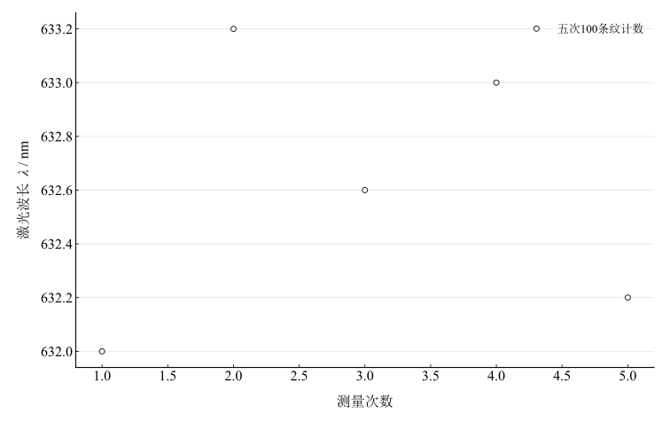

# 迈克尔逊干涉仪的调节和使用

## 实验名称

实验八 迈克尔逊干涉仪的调节和使用

## 实验目的

1.  了解迈克尔逊干涉仪的结构、分光和补偿原理。
2.  掌握等倾干涉圆条纹的调节方法。
3.  利用条纹移动测定单色光波长。

## 实验原理

迈克尔逊干涉仪用分光板将入射光分成两束，分别经固定镜和动镜反射后重新叠加。补偿板使两束光通过相同厚度的玻璃，以减小附加光程差。

当两反射镜的等效像互相平行时，可观察到同心圆形等倾干涉条纹。动镜沿光轴移动 $\Delta d$ 时，往返光程差改变 $2\Delta d$。若有 $N$ 条条纹从视场中心冒出或陷入，则

$$2\Delta d = N\lambda,$$

从而

$$\lambda = \frac{2\Delta d}{N}.$$

测量时应始终沿同一方向转动微调手轮，以避免丝杆回程间隙。

## 主要仪器设备

迈克尔逊干涉仪、氦氖激光器、扩束镜、毛玻璃屏。

## 实验步骤

1.  接通氦氖激光器，粗调两反射镜，使两路返回光斑在观察屏上重合。
2.  加入扩束镜，微调反射镜俯仰，使视场出现清晰、稳定的同心圆条纹。
3.  选择条纹冒出或陷入方向，记录动镜初读数。
4.  缓慢单向转动微调手轮，累计计数 $N = 100$ 条条纹通过中心，记录末读数。
5.  改变动镜起始位置，重复 5 次。
6.  操作时避免敲击光学平台，不得直视激光束。

## 原始数据记录

调出清晰同心圆等倾干涉条纹后，缓慢转动微调手轮，使条纹逐个陷入或冒出中心。每次计数 $N=100$ 条纹，记录动镜移动前后读数。

表 1　动镜位移测量记录

{{tables.table1}}

## 数据处理

动镜移动 $\Delta d$ 时，光程差改变 $2\Delta d$，故

$$\lambda = \frac{2\Delta d}{N}.$$

表 2　激光波长计算

{{tables.table2}}

五次未修约结果的均值与 A 类标准不确定度为

$$
\bar\lambda=632.600000\,\mathrm{nm},\qquad u_A(\bar\lambda)=0.228035\,\mathrm{nm}.
$$

以指定常用参考值 $632.8\,\mathrm{nm}$ 比较，均值相对差为 $0.03161\%$。该值未用本激光器的校准波长替代，不能当成已校准准确度；A 类分量未包含位移刻度、机械回程和计数误差。

图 1　每次累计100条纹对应的激光波长

## 实验结果与讨论

本实验用迈克尔逊干涉仪测得激光波长约为 $632.6\,\mathrm{nm}$，与氦氖激光器常用波长 $632.8\,\mathrm{nm}$ 接近。五次结果的离散反映本组重复性；可见稳定条纹支持已形成干涉，但不能由均值接近参考值单独评价光路调节质量。

误差主要来自条纹计数、微调手轮回程间隙和读数盘估读。计数时应始终沿同一方向转动手轮，避免机械空程；同时条纹应保持圆心稳定，若圆心漂移明显，说明两反射镜未充分垂直或光路未调好。
