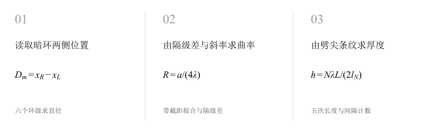
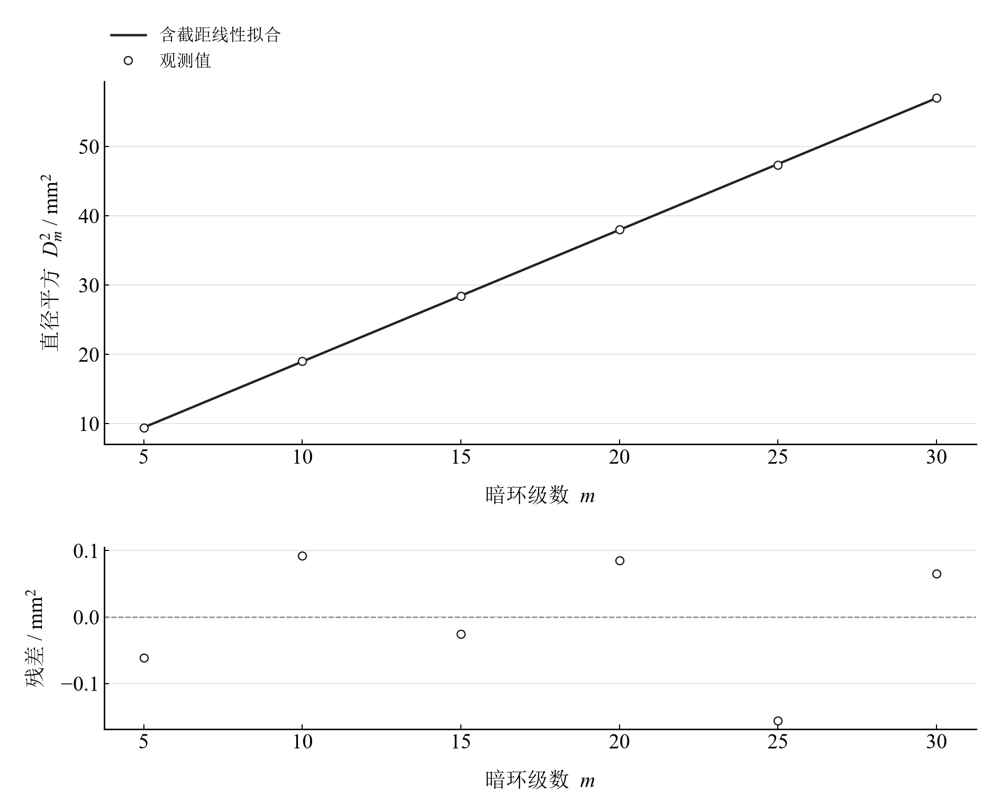
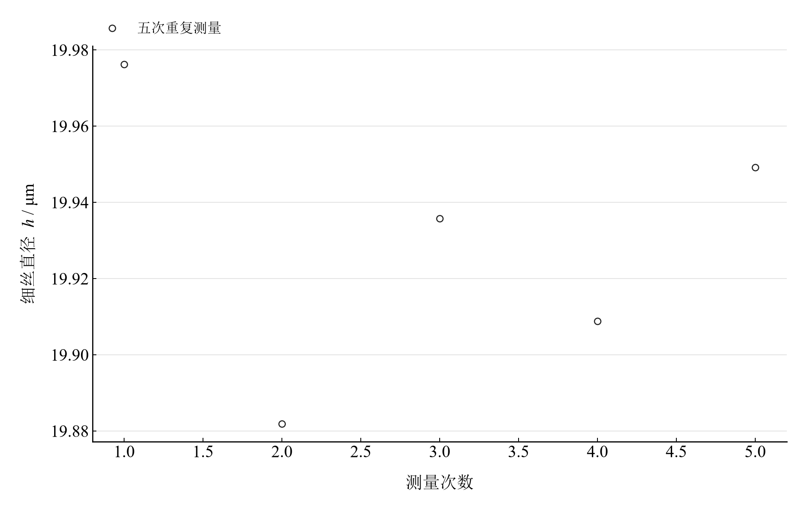

[普通物理实验 4](../README.md) · [项目首页](../../../README.md) · [使用指南](../../../docs/usage.md)

<!-- virtual-laboratory-entry -->
[在线虚拟实验](https://hnnuyuxuan.github.io/general-physics-lab/simulations/newton-rings/) · [模型依据与参数来源](../../../docs/newton-rings-model-evidence.md)

# 牛顿环实验

**用干涉条纹测曲率，也用条纹间隔测细丝厚度。**

牛顿环把平凸透镜的曲率变成暗环直径平方的斜率；空气劈尖把细丝撑起的高度变成条纹间隔。两部分共享薄膜干涉原理，分别从毫米读数推到曲率半径与微米厚度。

[读实验报告](report/report.md) · [HTML 阅读版](https://hnnuyuxuan.github.io/general-physics-lab/experiments/course-04/newton-rings/notebooks/analysis.html) · [Python 笔记本](notebooks/analysis.ipynb) · [Wolfram 笔记本](../../../notebook/paclets/NewtonRingsLab/Notebooks/NewtonRingsLab.nb)



图 1　牛顿环与空气劈尖：用两种薄膜几何连接条纹读数和长度

## 选择你的入口

|用途|入口|打开方式|
|---|---|---|
|阅读原理、测量记录和实验结论|[Markdown 实验报告](report/report.md) · [排版阅读版](https://hnnuyuxuan.github.io/general-physics-lab/experiments/course-04/newton-rings/report/report.html)|GitHub、Markdown 阅读器或本地浏览器|
|浏览计算图表与操作模型控件|[HTML 阅读版](https://hnnuyuxuan.github.io/general-physics-lab/experiments/course-04/newton-rings/notebooks/analysis.html)|直接在线打开，也可下载到本机|
|逐步运行和修改 Python 计算|[Jupyter Notebook](notebooks/analysis.ipynb)|JupyterLab 或 VS Code|
|运行原生公式与计算图表|[Wolfram Notebook](../../../notebook/paclets/NewtonRingsLab/Notebooks/NewtonRingsLab.nb) · [Paclet 安装包](../../../notebook/paclets/NewtonRingsLab/dist/NewtonRingsLab-0.1.0.paclet)|Wolfram 前端|
|对照原始实验报告|[源报告 PDF](../../../pdf/course-04/07_实验七_牛顿环实验_实验报告.pdf)|GitHub 或 PDF 阅读器|

## 从读数到物理量

牛顿环记录包含 **6 个暗环级数及左右位置**；劈尖部分包含 **5 次条纹长度测量**。采用钠黄光 $\lambda=589.3\ \mathrm{nm}$、隔级差 $p=10$，劈尖记录按 $N=20$ 个条纹间隔处理。

核心计算关系为

$$
R=\frac{D_{m+p}^{2}-D_m^{2}}{4p\lambda},\qquad D_m^2=am+b,\qquad h=\frac{N\lambda L}{2l_N}.
$$

反射空气膜存在一次半波损失。隔级差消去固定厚度形成的截距，带截距拟合则保留截距供检查；两种曲率估计使用同一组暗环读数。

表 1　两种曲率半径估计与劈尖细丝直径

|物理量或指标|计算结果|
|---|---:|
|隔级差曲率半径均值|$805.20321\ \mathrm{mm}$|
|拟合曲率半径|$806.49158\ \mathrm{mm}$|
|细丝直径均值|$19.930383\ \mu\mathrm m$|

曲率拟合的标准误差来自六组残差；细丝均值 A 类分量来自五次重复读数。隔级组合共享部分直径，组合离散与独立重复测量分量分别理解。

## 曲率斜率与细丝重复性并排读

<table>
  <tr>
    <td width="50%" align="center" valign="top"><a href="assets/readme-ring-fit.png"></a></td>
    <td width="50%" align="center" valign="top"><a href="assets/readme-wire-repeat.png"></a></td>
  </tr>
  <tr>
    <td align="center" valign="top"><strong>图 2</strong><br>六组暗环直径平方的含截距拟合及残差</td>
    <td align="center" valign="top"><strong>图 3</strong><br>空气劈尖法五次细丝直径；条纹间隔数和劈尖长度按记录采用</td>
  </tr>
</table>

直径平方与环级近似线性，残差显示各环定位的偏离。劈尖部分在相同条纹计数定义下换算细丝厚度，读数离散与条纹计数误差的作用方式不同。

## 环级选择与中心间隙

|操作或计算|观察什么|
|---|---|
|暂排除单个环级|从默认全部六组切换，观察拟合斜率和曲率半径|
|调整理想中心间隙|令 $t_0/\lambda$ 从 0 至 0.5，观察反射环形和中心明暗|
|对照劈尖计数定义|复算 $N=20$ 时的厚度，理解一个间隔造成的比例变化|

中心间隙图采用理想单色、等振幅两束模型，区域为横纵各 $-4$ 至 $4\ \mathrm{mm}$。滑块探索使用拟合曲率半径，间隙参数表示模型条件。

在 [Jupyter](notebooks/analysis.ipynb) 或 [Wolfram](../../../notebook/paclets/NewtonRingsLab/Notebooks/NewtonRingsLab.nb) 中从头运行，可沿报告章节查看数据读取、公式代入、计算输出与结果讨论。

## 在本机打开

环境安装见[使用指南](../../../docs/usage.md)。在仓库根目录启动本实验的 Jupyter Notebook：

```powershell
.\.venv\Scripts\python.exe -m jupyterlab experiments/course-04/newton-rings/notebooks/analysis.ipynb
```

Wolfram 安装包包含数据与 Notebook。将仓库路径改为本机路径后运行：

```wolfram
PacletInstall["D:/general-physics-lab/notebook/paclets/NewtonRingsLab/dist/NewtonRingsLab-0.1.0.paclet"];
Needs["NewtonRingsLab`"];
NewtonRingsLab`OpenNotebook[]
```

## 数据与计算实现

|内容|文件|
|---|---|
|规范观测数据|[rings.csv](data/rings.csv) · [wedge.csv](data/wedge.csv)|
|单位、参数与模型条件|[experiment.json](experiment.json)|
|Python 计算模块|[newton_rings.py](../../../src/physicslab/experiments/newton_rings.py)|
|Wolfram 包实现|[NewtonRingsLab.wl](../../../notebook/paclets/NewtonRingsLab/Kernel/NewtonRingsLab.wl)|
|完整计算结果|[python.json](results/python.json)|

[数据来源](data/provenance.json) · [返回课程目录](../README.md)
