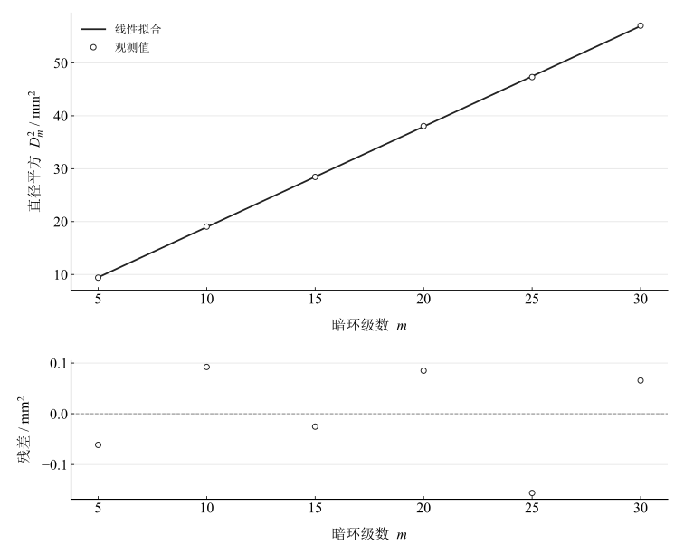
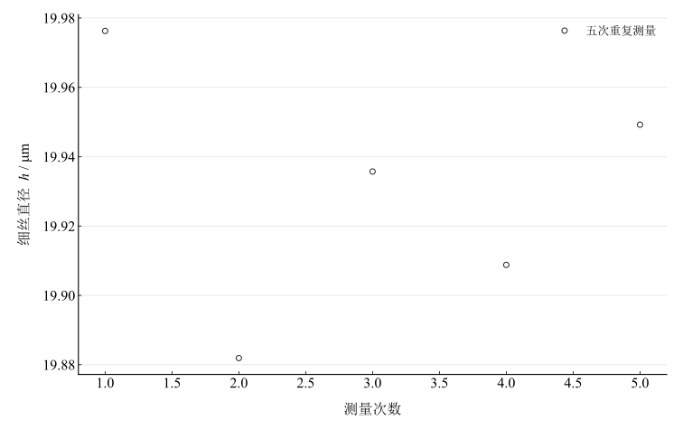

# 牛顿环实验

## 实验名称

实验七　牛顿环实验。

## 实验目的

1. 观察等厚干涉形成的牛顿环和劈尖条纹。
2. 用牛顿环测定平凸透镜的曲率半径。
3. 用劈尖干涉测量细丝直径或微小厚度。

## 实验原理

平凸透镜与平板玻璃之间形成厚度随半径变化的空气薄膜。反射光中，一束光发生半波损失，因而暗纹条件为

$$
2t=m\lambda.
$$

设透镜曲率半径为 $R$，距接触中心的距离为 $r$。在 $r\ll R$ 的近轴条件下，$t\approx r^2/(2R)$，第 $m$ 级暗环的直径 $D_m=2r_m$ 满足

$$
D_m^2=4mR\lambda.
$$

为减弱中心接触不理想和零级位置难判定的影响，采用隔级差法：

$$
R=\frac{D_{m+p}^2-D_m^2}{4p\lambda}.
$$

若存在固定的中心间隙，或所定级数存在固定偏移，可将关系写成 $D_m^2=am+b$。截距 $b$ 不强制为零，斜率给出 $R=a/(4\lambda)$；隔级差同样消去固定截距。截距单独不足以区分接触间隙、定级偏移和读数误差。

劈尖空气膜的等厚条纹近似等间距。长度 $l_N$ 对应 $N$ 个条纹间隔，劈尖长度为 $L$，端部厚度（细丝直径）为

$$
h=\frac{N\lambda L}{2l_N}.
$$

以上公式按空气折射率近似为 $1$、单色光和小角度使用。重复测量的均值 A 类标准不确定度为

$$
u_A(\bar h)=\sqrt{\frac{\sum_{i=1}^{n}(h_i-\bar h)^2}{n(n-1)}}.
$$

## 主要仪器设备

牛顿环仪、劈尖装置、钠灯、读数显微镜（附 $45^\circ$ 反光玻璃片）。钠黄光波长取 $\lambda=589.3\,\mathrm{nm}=0.0005893\,\mathrm{mm}$。

## 实验步骤

1. 调节读数显微镜，使叉丝和牛顿环条纹清晰，且移动方向通过环心。
2. 从一侧依次读取选定暗环位置，再越过中心读取另一侧对应暗环位置，由两侧读数之差求暗环直径。读数时保持单向推进，减小回程误差。
3. 选取相隔 $p=10$ 级的数据计算曲率半径。
4. 换上劈尖装置，使条纹与显微镜移动方向垂直。
5. 计数 $N=20$ 个条纹间隔所对应的长度 $l_N$，测量劈尖长度 $L$，重复 $5$ 次。条纹计数须采用一致的端点约定。
6. 不得用力压紧牛顿环装置，以免玻璃发生弹性形变。

## 原始数据记录

本实验用读数显微镜测量牛顿环暗环直径，并用劈尖干涉法测量细丝直径。每一级暗环只记录一次左右位置；劈尖长度记录为 $50.0\,\mathrm{mm}$。

表 1　牛顿环暗环直径测量记录

{{tables.rings}}

表 2　劈尖干涉测量记录

{{tables.wedge}}

## 数据处理

### 牛顿环隔级差

按 $D_m=x_{\mathrm{right}}-x_{\mathrm{left}}$ 重新计算直径；取 $p=10$，将波长统一为毫米后代入隔级差公式。

表 3　平凸透镜曲率半径计算

{{tables.pairs}}

四组隔级差估计的算术平均值为

$$
\bar R=805.203\,\mathrm{mm}\approx0.805\,\mathrm m.
$$

四组结果的样本标准差为 $3.016\,\mathrm{mm}$，表示不同隔级组合的离散程度。部分组合共享暗环读数，四个估计彼此相关，不能将标准差除以 $\sqrt4$ 直接解释为独立测量均值的不确定度。

### 全部暗环的线性拟合

使用全部六组数据，以 $m$ 为自变量、$D_m^2$ 为因变量，作带截距的等权最小二乘拟合：

$$
D_m^2=am+b,
\qquad a=1.901062\,\mathrm{mm}^2,
\qquad b=-0.049692\,\mathrm{mm}^2.
$$

表 4　暗环直径平方拟合与残差

{{tables.fit}}

图 1　暗环直径平方与级数的拟合及残差

由斜率得到

$$
R_{\mathrm{fit}}=\frac{a}{4\lambda}=806.492\,\mathrm{mm}.
$$

线性拟合的决定系数为 $0.999969$，斜率所对应的曲率半径标准误差为 $2.242\,\mathrm{mm}$。这里的标准误差仅由六组残差估计，依赖等权、独立且同方差残差假设，未包含显微镜校准、波长和模型误差，不能替代完整的合成不确定度。拟合结果与隔级差均值相差约 $1.29\,\mathrm{mm}$，两者均使用同一批暗环读数。

### 劈尖细丝直径

由五次 $l_N$ 及相应 $N,L$ 分别计算 $h_i$。

表 5　劈尖法细丝直径计算

{{tables.thickness}}

图 2　劈尖法细丝直径的重复测量

平均值及其重复性分量为

$$
\bar h=0.01993038\,\mathrm{mm}=19.93038\,\mu\mathrm m,
\qquad u_A(\bar h)=0.01629\,\mu\mathrm m.
$$

按测量信息展示细丝直径为 $19.9\,\mu\mathrm m$。该 A 类分量只反映重复读数的离散；没有记录显微镜及劈尖长度的仪器误差，不能合成完整不确定度。$N$ 按记录对应的 $20$ 个条纹间隔使用，原始记录未另附端点计数说明。

## 实验结果与讨论

由牛顿环隔级差得到平凸透镜曲率半径约 $R=0.805\,\mathrm m$；全数据带截距拟合给出 $R_{\mathrm{fit}}=0.80649\,\mathrm m$。劈尖条纹计算得到细丝直径约 $h=19.9\,\mu\mathrm m$。这些结果由记录中的长度和指定波长直接算得；由于缺少样品标称值，不能据此给出准确度或相对误差。

牛顿环的低级暗环中心位置较难判定，高级环亮度逐渐减弱。相隔 $10$ 级的直径平方差可消去固定的截距，但不能消除每次定位误差、跨级变化的形变或显微镜标尺误差。残差有正有负，只有六个点，不足以确认更复杂的系统变化。选点敏感性用于观察单个环级对拟合的影响；正式结果使用全部六组记录。

劈尖误差主要来自条纹长度读数、条纹间隔计数、劈尖长度和细丝未严格垂直于劈尖边缘。计数差一个间隔会引入约 $1/20=5\%$ 的比例变化，远大于本组重复读数的离散，应首先保证计数定义一致。还应避免过度压紧牛顿环装置，以免透镜或玻璃片发生弹性形变。
