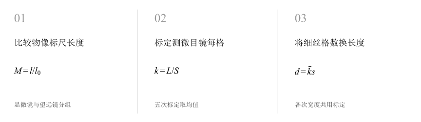
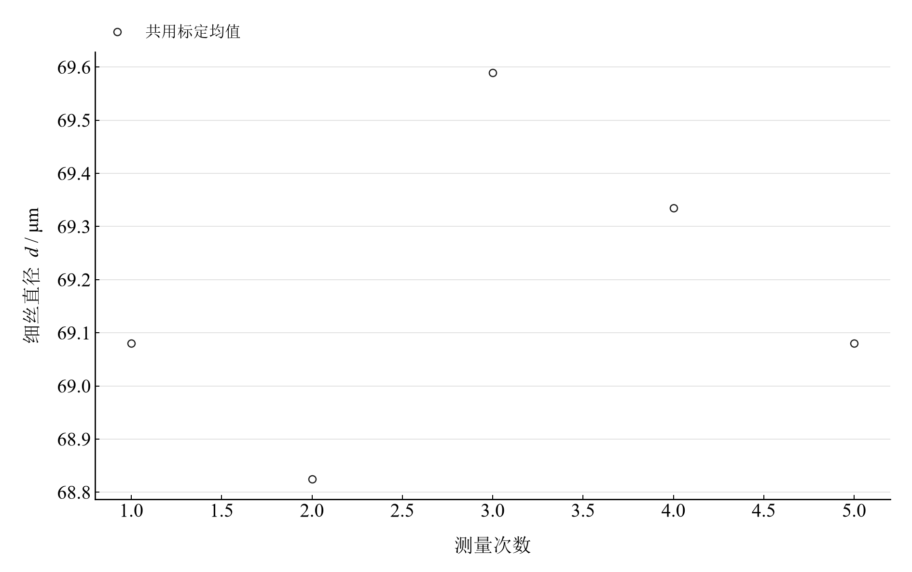

[普通物理实验 4](../README.md) · [项目首页](../../../README.md) · [使用指南](../../../docs/usage.md)

<!-- virtual-laboratory-entry -->
[在线虚拟实验](https://hnnuyuxuan.github.io/general-physics-lab/simulations/optical-magnification/) · [模型依据与参数来源](../../../docs/optical-magnification-model-evidence.md)

# 用光学仪器测量放大率和微小长度

**把看得见的标尺比值，变成测量微小长度的刻度。**

先比较物体与像的标尺长度，测量显微镜和望远镜的放大率；再标定测微目镜每格值，利用同一标定因子计算细丝直径。

[读实验报告](report/report.md) · [HTML 阅读版](https://hnnuyuxuan.github.io/general-physics-lab/experiments/course-04/optical-magnification/notebooks/analysis.html) · [Python 笔记本](notebooks/analysis.ipynb) · [Wolfram 笔记本](../../../notebook/paclets/OpticalMagnificationLab/Notebooks/OpticalMagnificationLab.nb)



图 1　从放大率测量、目镜标定到细丝直径的长度传递

## 选择你的入口

|用途|入口|打开方式|
|---|---|---|
|阅读原理、测量记录和实验结论|[Markdown 实验报告](report/report.md) · [排版阅读版](https://hnnuyuxuan.github.io/general-physics-lab/experiments/course-04/optical-magnification/report/report.html)|GitHub、Markdown 阅读器或本地浏览器|
|浏览逐次计算表与静态图表|[HTML 阅读版](https://hnnuyuxuan.github.io/general-physics-lab/experiments/course-04/optical-magnification/notebooks/analysis.html)|直接在线打开，也可下载到本机|
|逐步运行和修改 Python 计算|[Jupyter Notebook](notebooks/analysis.ipynb)|JupyterLab 或 VS Code|
|运行原生公式与计算图表|[Wolfram Notebook](../../../notebook/paclets/OpticalMagnificationLab/Notebooks/OpticalMagnificationLab.nb) · [Paclet 安装包](../../../notebook/paclets/OpticalMagnificationLab/dist/OpticalMagnificationLab-0.1.0.paclet)|Wolfram 前端|
|对照原始实验报告|[源报告 PDF](../../../pdf/course-04/06_实验六_用光学仪器测量放大率和微小长度_实验报告.pdf)|GitHub 或 PDF 阅读器|

## 从读数到物理量

显微镜放大率、望远镜放大率、测微目镜标定和细丝宽度分别记录，每类 **5 次测量**。五次每格值 $k_i=L_i/S_i$ 的均值用于全部细丝宽度。

核心计算关系为

$$
M_m=\frac{l}{l_0},\qquad |M_t|=\frac{l_1}{l_2},\qquad d_i=\bar k s_i.
$$

投影放大率由物像长度之比计算；望远镜结果采用绝对值。细丝直径的标定因子为每格长度，因此它对每次宽度测量产生共同的比例影响。

表 1　两种放大率、目镜每格值与细丝直径

|物理量或指标|计算结果|
|---|---:|
|显微镜投影放大率|$24.988000$|
|望远镜放大率绝对值|$4.8925251$|
|测微目镜每格值|$0.002549074\ \mathrm{mm}/\text{格}$|
|细丝直径均值|$69.181866\ \mu\mathrm m$|

细丝直径的标定与宽度重复性传播分量为 $0.13754\ \mu\mathrm m$，采用两组重复观测独立的条件；标尺校准、像差和边缘定位属于另外的影响因素。

## 同一标定刻度下的五次细丝宽度



图 2　共用测微目镜标定均值后的五次细丝直径

图中的直径差别来自细丝宽度读数，共用标定因子将全部结果统一到微米尺度。先对标定求均值、再换算长度，可清楚区分标定重复性与宽度重复性。

## 沿着长度传递逐步复算

|操作或计算|观察什么|
|---|---|
|计算两种放大率|分别核对显微镜和望远镜的长度比值|
|重算测微目镜标定|查看每格值及五次均值|
|传播标定与宽度重复性|检查共同标定因子如何进入直径均值|

Notebook 提供静态表格与误差传播。保持物镜倍率和调焦状态一致，是将标定刻度用于细丝测量的实验条件。

在 [Jupyter](notebooks/analysis.ipynb) 或 [Wolfram](../../../notebook/paclets/OpticalMagnificationLab/Notebooks/OpticalMagnificationLab.nb) 中从头运行，可沿报告章节查看数据读取、公式代入、计算输出与结果讨论。

## 在本机打开

环境安装见[使用指南](../../../docs/usage.md)。在仓库根目录启动本实验的 Jupyter Notebook：

```powershell
.\.venv\Scripts\python.exe -m jupyterlab experiments/course-04/optical-magnification/notebooks/analysis.ipynb
```

Wolfram 安装包包含数据与 Notebook。将仓库路径改为本机路径后运行：

```wolfram
PacletInstall["D:/general-physics-lab/notebook/paclets/OpticalMagnificationLab/dist/OpticalMagnificationLab-0.1.0.paclet"];
Needs["OpticalMagnificationLab`"];
OpticalMagnificationLab`OpenNotebook[]
```

## 数据与计算实现

|内容|文件|
|---|---|
|规范观测数据|[observations-01.csv](data/observations-01.csv) · [observations-02.csv](data/observations-02.csv) · [observations-03.csv](data/observations-03.csv) · [observations-04.csv](data/observations-04.csv)|
|单位、参数与模型条件|[experiment.json](experiment.json)|
|Python 计算模块|[optical_magnification.py](../../../src/physicslab/experiments/optical_magnification.py)|
|Wolfram 包实现|[OpticalMagnificationLab.wl](../../../notebook/paclets/OpticalMagnificationLab/Kernel/OpticalMagnificationLab.wl)|
|完整计算结果|[python.json](results/python.json)|

[数据来源](data/provenance.json) · [返回课程目录](../README.md)
