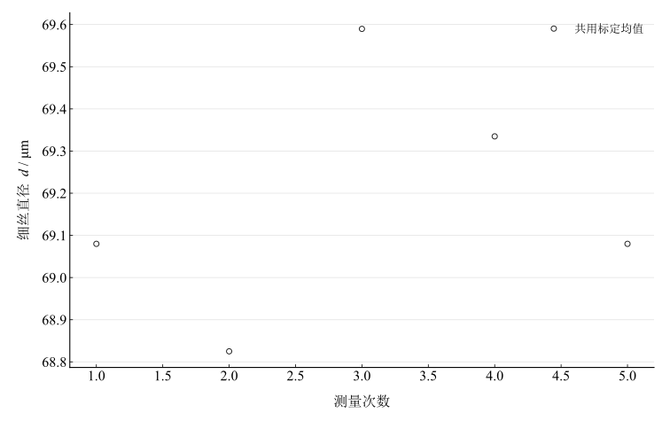

# 用光学仪器测量放大率和微小长度

## 实验名称

实验六 用光学仪器测量放大率和微小长度

## 实验目的

1.  熟悉显微镜和望远镜的构造、成像原理与调焦方法。
2.  掌握显微镜、望远镜放大率的实验测量方法。
3.  学会标定测微目镜，并利用显微镜测量微小长度。

## 实验原理

本实验分别测显微镜的投影横向放大率与望远镜的角放大率绝对值，两者按各自测量定义计算。用投影法测显微镜放大率时，若标尺物长为 $l_{0}$，像长为 $l$，则

$$M_{m} = \frac{l}{l_{0}}.$$

对调焦到无穷远的望远镜，角放大率绝对值可由物长和经望远镜形成的像长之比求得：

$$\left\vert  M_{t} \right\vert  = \frac{l_{1}}{l_{2}} = \left\vert  \frac{f_{o}}{f_{e}} \right\vert .$$

测微目镜使用前必须用物台测微尺标定。若物台测微尺长度 $L$ 对应目镜测微鼓轮 $S$ 格，则每格值为

$$k = \frac{L}{S}.$$

待测细丝跨越 $s$ 格时，其直径为 $d = ks$。

## 主要仪器设备

读数显微镜、望远镜、测微目镜、物台测微尺、标准石英尺、十字叉丝光阑、辅助显微镜、米尺和待测细丝。

## 实验步骤

## （一）测显微镜放大率**

1.  将标准标尺置于显微镜物镜前，调焦得到清晰像。
2.  将像投影到规定距离的屏上，测量物长 $l_{0}$ 和投影像长 $l$。
3.  重复测量 5 次。

## **（二）测望远镜放大率**

1.  将望远镜调焦到无穷远，消除像与叉丝之间的视差。
2.  用辅助光学系统测量物长 $l_{1}$ 与望远镜中对应像长 $l_{2}$。
3.  重复测量 5 次。

## **（三）测微小长度**

1.  放置物台测微尺，读取已知长度对应的目镜格数并求每格值 $k$。
2.  换上待测细丝，使其边缘与测微刻线平行。
3.  读取细丝宽度所跨格数，重复 5 次并计算直径。

## **原始数据记录

本实验分三部分记录：投影法测显微镜放大率、像长法测望远镜放大率、用测微目镜标定后测量细丝直径。

表 1　投影法测显微镜放大率

| 次数 | $l_0$ / mm | $l$ / mm | $M_m$ |
| --- | --- | --- | --- |
| 1 | 5 | 124.6 | 24.92 |
| 2 | 5 | 125.1 | 25.02 |
| 3 | 5 | 124.8 | 24.96 |
| 4 | 5 | 125.3 | 25.06 |
| 5 | 5 | 124.9 | 24.98 |

表 2　像长法测望远镜放大率

| 次数 | $l_1$ / mm | $l_2$ / mm | $\vert M_t\vert $ |
| --- | --- | --- | --- |
| 1 | 20 | 4.05 | 4.9382716 |
| 2 | 20 | 4.1 | 4.8780488 |
| 3 | 20 | 4.08 | 4.9019608 |
| 4 | 20 | 4.12 | 4.8543689 |
| 5 | 20 | 4.09 | 4.8899755 |

表 3　测微目镜标定记录

| 次数 | $L$ / mm | $S$ / 格 | $k$ / (mm/格) |
| --- | --- | --- | --- |
| 1 | 0.2 | 78.5 | 0.00254777 |
| 2 | 0.2 | 78.3 | 0.00255428 |
| 3 | 0.2 | 78.6 | 0.00254453 |
| 4 | 0.2 | 78.4 | 0.00255102 |
| 5 | 0.2 | 78.5 | 0.00254777 |

表 4　细丝直径测量记录

| 次数 | 宽度 $s$ / 格 | 直径 $d$ / mm |
| --- | --- | --- |
| 1 | 27.1 | 0.0690799 |
| 2 | 27 | 0.068825 |
| 3 | 27.3 | 0.06958972 |
| 4 | 27.2 | 0.06933481 |
| 5 | 27.1 | 0.0690799 |

## 数据处理

逐组计算 $M_m=l/l_0$、$\vert M_t\vert =l_1/l_2$；标定每格值 $k_i=L_i/S_i$，以未修约均值 $\bar k$ 乘细丝各次宽度 $s_i$。

$$
\bar M_m=24.988000,\qquad\overline{\vert M_t\vert }=4.892525,\qquad\bar k=0.002549074\,\mathrm{mm}/\text{格}.
$$

五次均值的 A 类分量分别为 $0.024166$、$0.013881$、$0.0000016572\,\mathrm{mm}/\text{格}$。细丝直径均值为 $\bar d=\bar k\bar s=69.18187\,\mu\mathrm m$。固定 $\bar k$ 时，宽度重复性所给均值 A 类分量为 $0.12998\,\mu\mathrm m$。

标定均值是所有细丝读数共用的因子；若标定与细丝宽度重复观测独立，随机分量传播为

$$
u_{\mathrm{random}}(\bar d)=\sqrt{\bar s^2u_A^2(\bar k)+\bar k^2u_A^2(\bar s)}=0.13754\,\mu\mathrm m.
$$

该分量尚未包含标尺校准、定位、像差和倾斜等系统影响，不作为完整合成不确定度。

图 1　共用测微目镜标定均值后的细丝直径

## 实验结果与讨论

显微镜投影放大率约 $24.99$，望远镜角放大率绝对值约 $4.89$，细丝直径约 $69.2\,\mu\mathrm m$。使用未修约标定值可避免先将每格值写成 $0.00255\,\mathrm{mm}/\text{格}$ 再参与计算造成的额外舍入。

显微镜投影放大率受像端点判读、物距与屏位置影响；望远镜放大率受无穷远调焦状态、像长读数和视差影响。微小长度测量中，标定误差会共同传递到全部直径；应保持物镜倍率和焦距调节状态一致，使细丝边缘与刻线平行以避免倾斜导致宽度偏大。缺少标称倍率和细丝参考直径，不评价准确度。
