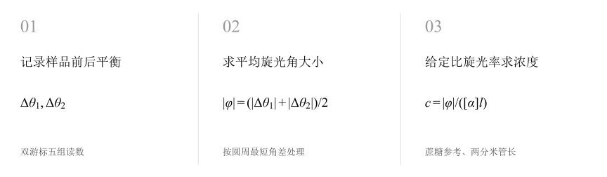
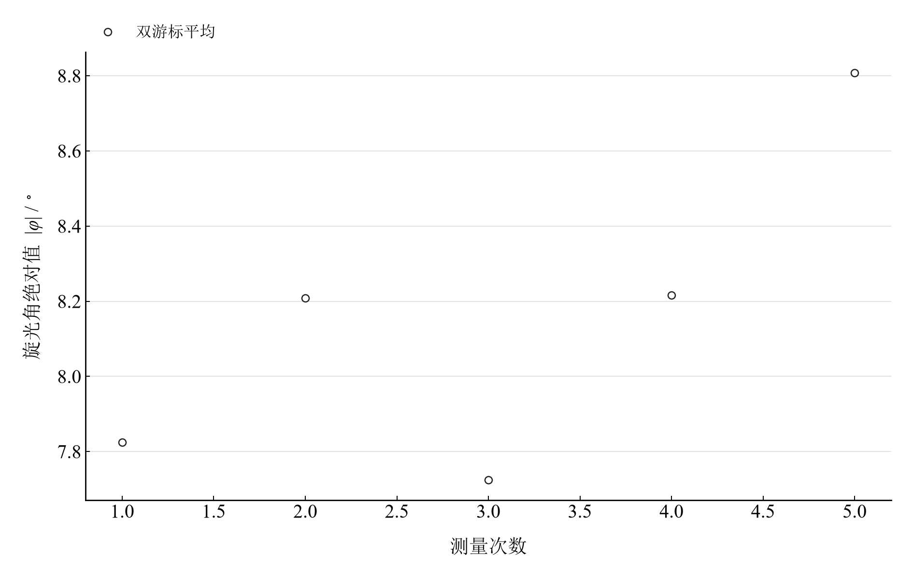

[普通物理实验 4](../README.md) · [项目首页](../../../README.md) · [使用指南](../../../docs/usage.md)

<!-- virtual-laboratory-entry -->
[在线虚拟实验](https://hnnuyuxuan.github.io/general-physics-lab/simulations/optical-rotation/) · [模型依据与参数来源](../../../docs/optical-rotation-model-evidence.md)

# 用旋光仪测定旋光性溶液的旋光率和浓度

**从明暗平衡的转角，走到给定样品模型下的浓度。**

旋光仪以两半视场的明暗平衡定位读数。样品前后方向相减，得到旋光角的大小；结合液柱长度和比旋光率，可以计算与这些输入条件对应的溶液浓度。

[读实验报告](report/report.md) · [HTML 阅读版](https://hnnuyuxuan.github.io/general-physics-lab/experiments/course-04/optical-rotation/notebooks/analysis.html) · [Python 笔记本](notebooks/analysis.ipynb) · [Wolfram 笔记本](../../../notebook/paclets/OpticalRotationLab/Notebooks/OpticalRotationLab.nb)



图 1　旋光角大小与条件浓度的计算链；样品关系与管长作为给定输入

## 选择你的入口

|用途|入口|打开方式|
|---|---|---|
|阅读原理、测量记录和实验结论|[Markdown 实验报告](report/report.md) · [排版阅读版](https://hnnuyuxuan.github.io/general-physics-lab/experiments/course-04/optical-rotation/report/report.html)|GitHub、Markdown 阅读器或本地浏览器|
|浏览逐次计算表与静态图表|[HTML 阅读版](https://hnnuyuxuan.github.io/general-physics-lab/experiments/course-04/optical-rotation/notebooks/analysis.html)|直接在线打开，也可下载到本机|
|逐步运行和修改 Python 计算|[Jupyter Notebook](notebooks/analysis.ipynb)|JupyterLab 或 VS Code|
|运行原生公式与计算图表|[Wolfram Notebook](../../../notebook/paclets/OpticalRotationLab/Notebooks/OpticalRotationLab.nb) · [Paclet 安装包](../../../notebook/paclets/OpticalRotationLab/dist/OpticalRotationLab-0.1.0.paclet)|Wolfram 前端|
|对照原始实验报告|[源报告 PDF](../../../pdf/course-04/11_实验十一_用旋光仪测定旋光性溶液的旋光率和浓度_实验报告_A3双面示范格式版.pdf)|GitHub 或 PDF 阅读器|

## 从读数到物理量

记录包含 **5 组双游标零位与样品平衡位置**。浓度换算采用蔗糖参考比旋光率 $[\alpha]=66.46^\circ\ \mathrm{dm}^{-1}(\mathrm{g/mL})^{-1}$、液柱长度 $l=2.00\ \mathrm{dm}$。

核心计算关系为

$$
c=\frac{|\bar\varphi|}{[\alpha]l}.
$$

计算对两游标的最短角差取绝对值后平均，结果表示旋光大小。所给浓度对应上述蔗糖参考关系和管长条件；旋向需要带方向的记录另行判断。

表 1　旋光角大小与给定条件下的浓度

|物理量或指标|计算结果|
|---|---:|
|旋光角绝对值均值|$8.1566667^\circ$|
|指定蔗糖比旋光率及管长下浓度|$0.061365232\ \mathrm{g/mL}$|
|只传播旋光角重复性分量|$0.001434646\ \mathrm{g/mL}$|

浓度 A 类分量仅传播旋光角重复性；管长、温度、波长和比旋光率属于额外输入分量。两游标角差的最大不一致为 $59^\prime$，应与明暗平衡判断及读数检查一起考虑。

## 先查看旋光角，再代入浓度关系



图 2　五次双游标旋光角绝对值；从样品前后的方向差计算

五次旋光角约分布在 $7.725^\circ$ 至 $8.808^\circ$。用未修约结果平均，可保留半分读数带来的信息；所有角度共用相同的比旋光率和管长换算因子。

## 角度平均与条件浓度复算

|操作或计算|观察什么|
|---|---|
|复算双游标旋光角|逐组比较两游标角差及其平均绝对值|
|代入给定管长和比旋光率|检查浓度从角度到质量体积单位的换算|
|查看重复性传播|分清旋光角离散与浓度输入参数的作用|

Notebook 以静态读数表、角度重算和条件浓度展开。改变给定参数后重新运行，可比较相同旋光读数对应的浓度变化。

在 [Jupyter](notebooks/analysis.ipynb) 或 [Wolfram](../../../notebook/paclets/OpticalRotationLab/Notebooks/OpticalRotationLab.nb) 中从头运行，可沿报告章节查看数据读取、公式代入、计算输出与结果讨论。

## 在本机打开

环境安装见[使用指南](../../../docs/usage.md)。在仓库根目录启动本实验的 Jupyter Notebook：

```powershell
.\.venv\Scripts\python.exe -m jupyterlab experiments/course-04/optical-rotation/notebooks/analysis.ipynb
```

Wolfram 安装包包含数据与 Notebook。将仓库路径改为本机路径后运行：

```wolfram
PacletInstall["D:/general-physics-lab/notebook/paclets/OpticalRotationLab/dist/OpticalRotationLab-0.1.0.paclet"];
Needs["OpticalRotationLab`"];
OpticalRotationLab`OpenNotebook[]
```

## 数据与计算实现

|内容|文件|
|---|---|
|规范观测数据|[observations-01.csv](data/observations-01.csv)|
|单位、参数与模型条件|[experiment.json](experiment.json)|
|Python 计算模块|[optical_rotation.py](../../../src/physicslab/experiments/optical_rotation.py)|
|Wolfram 包实现|[OpticalRotationLab.wl](../../../notebook/paclets/OpticalRotationLab/Kernel/OpticalRotationLab.wl)|
|完整计算结果|[python.json](results/python.json)|

[数据来源](data/provenance.json) · [返回课程目录](../README.md)
