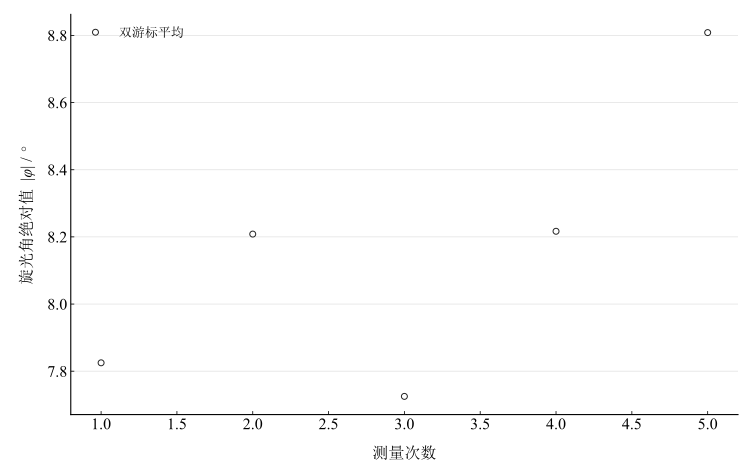

# 用旋光仪测定旋光性溶液的旋光率和浓度

## 实验名称

实验十一 用旋光仪测定旋光性溶液的旋光率和浓度

## 实验目的

1.  观察线偏振光通过旋光性溶液后的旋光现象。
2.  掌握半暗视场旋光仪的调节和读数方法。
3.  利用旋光角与液柱长度、浓度的关系测定比旋光率或未知浓度。

## 实验原理

某些含不对称结构的物质能使线偏振光的振动面旋转。旋转角 $\varphi$ 与旋光物质浓度 $c$ 和液柱长度 $l$ 成正比：

$$\varphi = \lbrack\alpha\rbrack_{\lambda}^{T}cl,$$

其中 $\lbrack\alpha\rbrack_{\lambda}^{T}$ 为指定温度和波长下的比旋光率。若 $c$ 以 $\mathrm{g/mL}$、$l$ 以 $\mathrm{dm}$ 表示，则蔗糖在钠黄光 D 线附近的参考比旋光率可取 $66.46^{\circ}\,\mathrm{dm}^{-1}(\mathrm{g/mL})^{-1}$。

半暗视场装置把视场分成亮度略有差异的区域。转动检偏器使各区域等亮时，主观判断比直接寻找完全消光位置更灵敏。样品前后读数之差即为旋光角。

## 主要仪器设备

旋光仪、钠灯、样品管、蔗糖标准溶液或待测溶液、温度计。

## 实验步骤

1.  接通钠灯并预热，调节目镜使半暗视场分界清晰。
2.  放入空样品管或纯溶剂，排除气泡，转动检偏器使两半视场等亮，记录零点读数。
3.  向样品管注入待测溶液，擦净外壁并再次排除气泡。
4.  调到等亮位置，记录两游标读数；取出样品后再次检查零点。
5.  重复测量 5 次，由平均旋光角计算浓度；同时记录样品管长度和实验温度。

## 原始数据记录

本实验记录旋光仪在未放入样品与放入样品后的刻度读数。液柱长度按常用样品管取 $l=2.00\,\mathrm{dm}$，并非独立长度测量；采用钠黄光 D 线附近蔗糖参考比旋光率 $[\alpha]=66.46^\circ\,\mathrm{dm}^{-1}(\mathrm{g/mL})^{-1}$。

表 1　旋光仪原始读数

| 次数 | $\theta_1$ | $\theta_2$ | $\theta_3$ | $\theta_4$ |
| --- | --- | --- | --- | --- |
| 1 | $128^{\circ}19^{\prime}$ | $308^{\circ}15^{\prime}$ | $120^{\circ}30^{\prime}$ | $300^{\circ}25^{\prime}$ |
| 2 | $133^{\circ}18^{\prime}$ | $314^{\circ}15^{\prime}$ | $125^{\circ}35^{\prime}$ | $305^{\circ}33^{\prime}$ |
| 3 | $134^{\circ}30^{\prime}$ | $314^{\circ}29^{\prime}$ | $126^{\circ}51^{\prime}$ | $306^{\circ}41^{\prime}$ |
| 4 | $130^{\circ}30^{\prime}$ | $310^{\circ}24^{\prime}$ | $122^{\circ}15^{\prime}$ | $302^{\circ}13^{\prime}$ |
| 5 | $137^{\circ}55^{\prime}$ | $317^{\circ}45^{\prime}$ | $128^{\circ}55^{\prime}$ | $309^{\circ}08^{\prime}$ |

## 数据处理

两游标旋光角差先求圆周最短差，再取绝对值平均。保留半分读数，不用已修约的源计算表求均值。

表 2　旋光角逐次计算

| 次数 | 左游标角差 / ° | 右游标角差 / ° | 旋光角绝对值 / ° |
| --- | --- | --- | --- |
| 1 | 7.8166667 | 7.8333333 | 7.825 |
| 2 | 7.7166667 | 8.7 | 8.2083333 |
| 3 | 7.65 | 7.8 | 7.725 |
| 4 | 8.25 | 8.1833333 | 8.2166667 |
| 5 | 9 | 8.6166667 | 8.8083333 |

旋光角绝对值均值为 $8.15666667^\circ$，A 类均值分量为 $11.44159^\prime$。按给定的 $l=2.00\,\mathrm{dm}$、蔗糖参考比旋光率 $[\alpha]=66.46^\circ\,\mathrm{dm}^{-1}(\mathrm{g/mL})^{-1}$，得到条件浓度

$$
c=\frac{\vert \bar\varphi\vert }{[\alpha]l}=0.0613652\,\mathrm{g/mL}.
$$

即 $6.13652\,\mathrm{g}/(100\,\mathrm{mL})$。仅传播角度重复性的分量为 $0.0014346\,\mathrm{g/mL}$，未包括管长、温度、波长和比旋光率输入的不确定度。

图 1　双游标旋光角绝对值的重复测量

## 实验结果与讨论

若样品满足所采用的蔗糖参考关系且液柱长度为 $2.00\,\mathrm{dm}$，反推浓度约 $6.14\,\mathrm{g}/(100\,\mathrm{mL})$。样品温度、明确身份及实测管长未另附记录，结论限于这些输入假设。取绝对角差只能计算旋光大小，不能据此独立判断左旋或右旋。

五组观测中，两游标角差最大不一致 $59.00^\prime$，提示对准或读数记录存在额外影响，不能用重复性分量覆盖所有误差。未提供完整标准溶液系列，不能建立实测标定曲线。提高精度时需记录温度、检查零点及气泡，并实测管长和标准系列。
