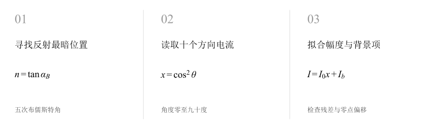
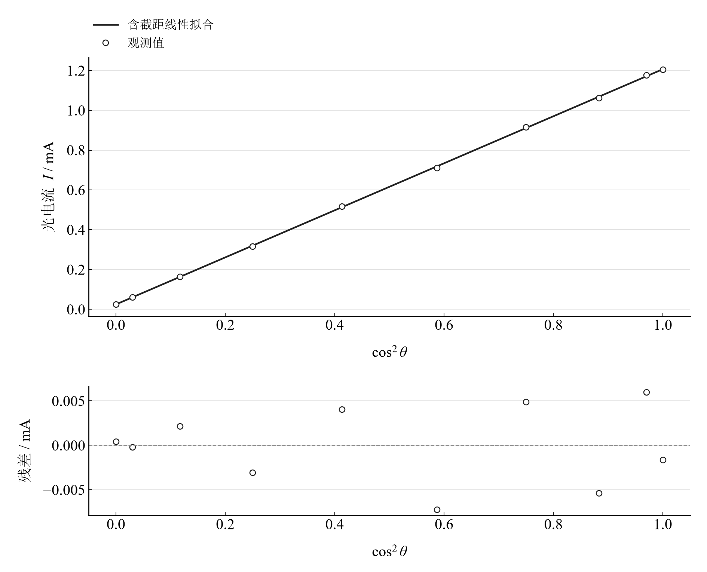

[普通物理实验 4](../README.md) · [项目首页](../../../README.md) · [使用指南](../../../docs/usage.md)

# 偏振光的观察与分析

**转动检偏器，用余弦平方读出偏振光强。**

最暗反射位置给出布儒斯特角，旋转检偏器的光电流记录检验马吕斯关系。拟合保留恒定背景项，再通过零点扫描观察检偏器方向偏差的作用。

[读实验报告](report/report.md) · [HTML 阅读版](notebooks/analysis.html) · [Python 笔记本](notebooks/analysis.ipynb) · [Wolfram 笔记本](../../../notebook/paclets/PolarizationLab/Notebooks/PolarizationLab.nb)



图 1　偏振实验的两条数据线：布儒斯特角折射率与马吕斯光强拟合

## 选择你的入口

|用途|入口|打开方式|
|---|---|---|
|阅读原理、测量记录和实验结论|[Markdown 实验报告](report/report.md) · [排版阅读版](report/report.html)|GitHub、Markdown 阅读器或本地浏览器|
|浏览计算图表与操作模型控件|[HTML 阅读版](notebooks/analysis.html)|下载后用浏览器打开|
|逐步运行和修改 Python 计算|[Jupyter Notebook](notebooks/analysis.ipynb)|JupyterLab 或 VS Code|
|运行原生公式与计算图表|[Wolfram Notebook](../../../notebook/paclets/PolarizationLab/Notebooks/PolarizationLab.nb) · [Paclet 安装包](../../../notebook/paclets/PolarizationLab/dist/PolarizationLab-0.1.0.paclet)|Wolfram 前端|
|对照原始实验报告|[源报告 PDF](../../../pdf/course-04/10_实验十_偏振光的观察与分析.pdf)|GitHub 或 PDF 阅读器|

## 从读数到物理量

记录包含 **5 次布儒斯特角**，以及检偏器 $0^\circ$ 至 $90^\circ$、每隔 $10^\circ$ 的 **10 组光电流**。光电流以毫安计，带截距拟合保留暗电流与漏光的合并背景。

核心计算关系为

$$
n=\tan\bar\alpha_B,\qquad I=I_0\cos^2\theta+I_b.
$$

折射率模型取空气折射率约为一。马吕斯拟合采用全部十组观测、等权最小二乘与近似线性探测器假设，三角函数角度以弧度进入计算。

表 1　布儒斯特角折射率与马吕斯关系拟合

|物理量或指标|计算结果|
|---|---:|
|玻璃折射率|$1.4900288$|
|马吕斯拟合幅度|$1.1820845\ \mathrm{mA}$|
|拟合背景|$0.024557761\ \mathrm{mA}$|
|马吕斯拟合决定系数|$0.99990929$|

折射率 A 类分量由布儒斯特角重复性传播；拟合背景同时描述暗电流和漏光的恒定部分。二者的物理身份分别保留在计算表中。

## 把光强关系变成直线，再查看残差



图 2　光电流对方向余弦平方的带背景拟合及残差；十组数据共同求幅度和背景

以 $\cos^2\theta$ 为横轴后，马吕斯关系变为直线。靠近正交方向的非零光电流支持保留背景项；残差用于观察真实读数与该两参数关系之间的差异。

## 移动检偏器零点，观察整条光强曲线

|操作或计算|观察什么|
|---|---|
|调节零点 $\theta_0$|从 $-10^\circ$ 至 $10^\circ$，比较偏移模型和观测点|
|保持拟合幅度与背景|观察 $I_0\cos^2(\theta-\theta_0)+I_b$ 的横向移动|
|复算布儒斯特角分量|从五次角度求折射率和重复性传播分量|

零点扫描采用固定拟合系数，默认 $\theta_0=0^\circ$；滑块表示模型偏移，便于理解角度对准对光强的影响。

在 [Jupyter](notebooks/analysis.ipynb) 或 [Wolfram](../../../notebook/paclets/PolarizationLab/Notebooks/PolarizationLab.nb) 中从头运行，可沿报告章节查看数据读取、公式代入、计算输出与结果讨论。

## 在本机打开

环境安装见[使用指南](../../../docs/usage.md)。在仓库根目录启动本实验的 Jupyter Notebook：

```powershell
.\.venv\Scripts\python.exe -m jupyterlab experiments/course-04/polarization/notebooks/analysis.ipynb
```

Wolfram 安装包包含数据与 Notebook。将仓库路径改为本机路径后运行：

```wolfram
PacletInstall["D:/general-physics-lab/notebook/paclets/PolarizationLab/dist/PolarizationLab-0.1.0.paclet"];
Needs["PolarizationLab`"];
PolarizationLab`OpenNotebook[]
```

## 数据与计算实现

|内容|文件|
|---|---|
|规范观测数据|[observations-01.csv](data/observations-01.csv) · [observations-02.csv](data/observations-02.csv)|
|单位、参数与模型条件|[experiment.json](experiment.json)|
|Python 计算模块|[polarization.py](../../../src/physicslab/experiments/polarization.py)|
|Wolfram 包实现|[PolarizationLab.wl](../../../notebook/paclets/PolarizationLab/Kernel/PolarizationLab.wl)|
|完整计算结果|[python.json](results/python.json)|

[数据来源](data/provenance.json) · [返回课程目录](../README.md)
