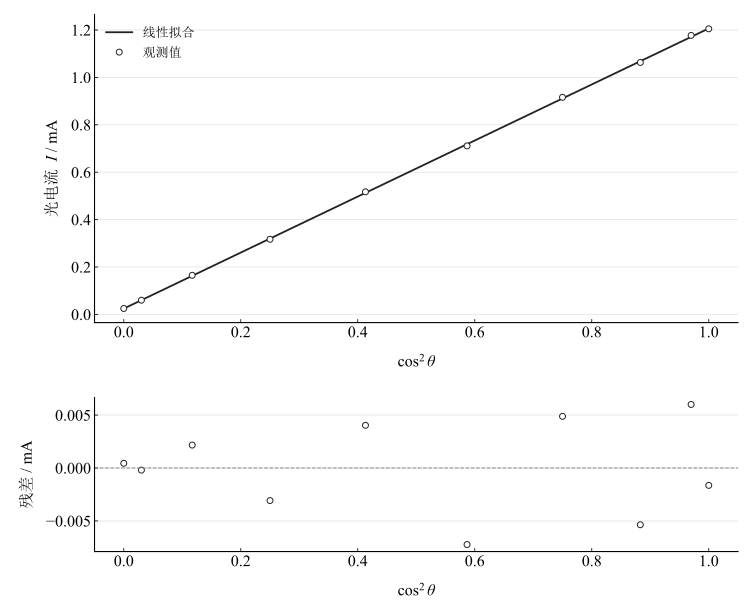

# 偏振光的观察与分析

## 实验名称

实验十 偏振光的观察与分析

## 实验目的

1.  观察光的偏振现象，理解起偏器、检偏器和波片的作用。
2.  测量玻璃表面的布儒斯特角并估算折射率。
3.  测量线偏振光通过检偏器后的光强变化，验证马吕斯定律。

## 实验原理

自然光的振动方向在垂直于传播方向的平面内随机分布，线偏振光则只沿固定方向振动。起偏器产生线偏振光，检偏器用于分析其振动方向。

光由空气入射玻璃，在某一入射角 $\alpha_{B}$ 处反射光成为完全线偏振光，该角为布儒斯特角，满足

$$\tan\alpha_{B} = \frac{n_{2}}{n_{1}}.$$

空气入射玻璃时近似有 $n = \tan\alpha_{B}$。

线偏振光通过检偏器后，若起偏器与检偏器透振方向夹角为 $\theta$，马吕斯定律给出

$$I = I_{0}\cos^{2}\theta.$$

考虑探测器暗电流和环境漏光，实验拟合式写为 $I = I_{0}\cos^{2}\theta + I_{b}$。

## 主要仪器设备

氦氖激光器、偏振片、检偏片、波片、玻璃片、光电探测器及支架。

## 实验步骤

1.  调整激光器、偏振片、检偏片和探测器共轴；严禁直视激光束。
2.  转动检偏器，观察透射光强由最大到最小的周期变化；插入波片观察消光状态的改变。
3.  将玻璃片置于转台上，改变入射角并转动检偏器，寻找反射光最暗位置，记录布儒斯特角，重复 5 次。
4.  固定起偏器，以 $10^{\circ}$ 为步长转动检偏器，从 $0^{\circ}$ 测到 $90^{\circ}$，记录光电流。
5.  以 $\cos^{2}\theta$ 为自变量作线性拟合，检验马吕斯定律。

## 原始数据记录

本实验记录布儒斯特角测量数据，并用光电探测器记录检偏器转角改变时的相对光强。

表 1　布儒斯特角测量记录

| 次数 | 反射光最暗时入射角 $\alpha_B$ |
| --- | --- |
| 1 | $55^{\circ}50^{\prime}$ |
| 2 | $56^{\circ}10^{\prime}$ |
| 3 | $56^{\circ}20^{\prime}$ |
| 4 | $56^{\circ}05^{\prime}$ |
| 5 | $56^{\circ}15^{\prime}$ |

表 2　马吕斯定律验证原始数据

| 检偏器角 $\theta$ / ° | 光电流 $I$ / mA |
| --- | --- |
| 0 | 1.205 |
| 10 | 1.177 |
| 20 | 1.063 |
| 30 | 0.916 |
| 40 | 0.711 |
| 50 | 0.517 |
| 60 | 0.317 |
| 70 | 0.165 |
| 80 | 0.06 |
| 90 | 0.025 |

## 数据处理

五次布儒斯特角均值为 $56.13333333^\circ=56^\circ08^\prime$。按空气折射率近似为 $1$，有 $n=\tan\bar\alpha_B=1.4900288$。角度均值 A 类分量为 $5.14782^\prime$，经导数 $1+\tan^2\bar\alpha_B$ 传播，折射率随机分量为 $0.0048220$；未包括其他系统分量。

使用十组光电流，以 $x=\cos^2\theta$ 为自变量进行带截距的等权最小二乘拟合：

$$
I=I_0\cos^2\theta+I_b,\qquad I_0=1.1820845\,\mathrm{mA},\qquad I_b=0.0245578\,\mathrm{mA}.
$$

决定系数为 $R^2=0.99990929$。

表 3　马吕斯定律线性拟合结果

| $\theta$ / ° | $\cos^2\theta$ | 实测 $I$ / mA | 拟合 $I$ / mA |
| --- | --- | --- | --- |
| 0 | 1 | 1.205 | 1.2066422 |
| 10 | 0.96984631 | 1.177 | 1.170998 |
| 20 | 0.88302222 | 1.063 | 1.0683646 |
| 30 | 0.75 | 0.916 | 0.91112112 |
| 40 | 0.58682409 | 0.711 | 0.71823341 |
| 50 | 0.41317591 | 0.517 | 0.51296659 |
| 60 | 0.25 | 0.317 | 0.32007888 |
| 70 | 0.11697778 | 0.165 | 0.16283538 |
| 80 | 0.03015369 | 0.06 | 0.06020197 |
| 90 | 0 | 0.025 | 0.02455776 |

图 1　光电流与检偏器方向余弦平方的拟合及残差

## 实验结果与讨论

玻璃折射率约 $1.490$，十组光电流与带背景的马吕斯关系具有较好一致性。拟合优度只描述这些点与模型的吻合程度，不单独证明角度零点或探测器已经校准。

$90^\circ$ 附近光电流仍非零，保留背景项可描述暗电流和漏光等影响；仅凭当前数据不能区分两者。主要误差还包括最暗位置判断、表面反射不均匀和检偏器零点。波片插入后的定量状态未记录，因此不构造实测偏振椭圆。模型零点扫描用于说明角度偏移影响，并非额外观测。
