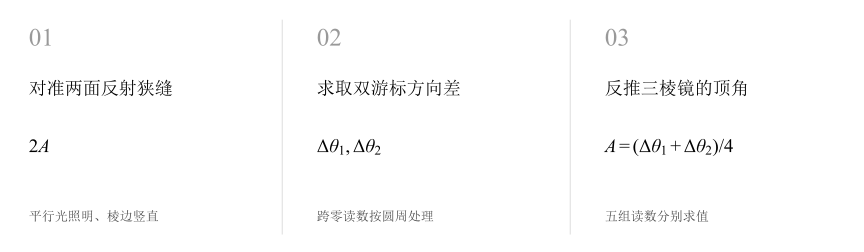
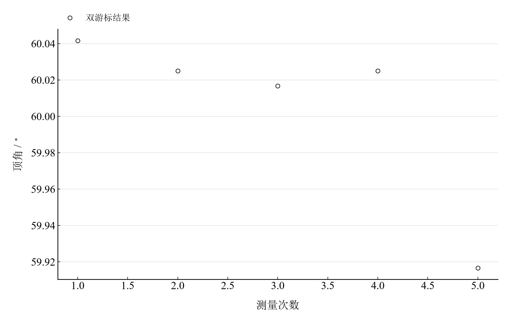

[普通物理实验 4](../README.md) · [项目首页](../../../README.md) · [使用指南](../../../docs/usage.md)

# 用分光计测三棱镜的顶角

**用两面反射光的夹角，读出三棱镜的几何顶角。**

平行光分别照到三棱镜的两面，望远镜依次寻找反射狭缝像。两方向之间的夹角是顶角的两倍；双游标和多次测量将这条几何关系落实为可复算的数据。

[读实验报告](report/report.md) · [HTML 阅读版](notebooks/analysis.html) · [Python 笔记本](notebooks/analysis.ipynb) · [Wolfram 笔记本](../../../notebook/paclets/PrismApexLab/Notebooks/PrismApexLab.nb)



图 1　反射法顶角测量：反射方向夹角为顶角的两倍

## 选择你的入口

|用途|入口|打开方式|
|---|---|---|
|阅读原理、测量记录和实验结论|[Markdown 实验报告](report/report.md) · [排版阅读版](report/report.html)|GitHub、Markdown 阅读器或本地浏览器|
|浏览逐次计算表与静态图表|[HTML 阅读版](notebooks/analysis.html)|下载后用浏览器打开|
|逐步运行和修改 Python 计算|[Jupyter Notebook](notebooks/analysis.ipynb)|JupyterLab 或 VS Code|
|运行原生公式与计算图表|[Wolfram Notebook](../../../notebook/paclets/PrismApexLab/Notebooks/PrismApexLab.nb) · [Paclet 安装包](../../../notebook/paclets/PrismApexLab/dist/PrismApexLab-0.1.0.paclet)|Wolfram 前端|
|对照原始实验报告|[源报告 PDF](../../../pdf/course-04/02_实验二_用分光计测三棱镜的顶角_实验报告_A3双面示范格式版.pdf)|GitHub 或 PDF 阅读器|

## 从读数到物理量

记录包含 **5 组、每组 4 个游标读数**。每组先对准一个面的反射像，再转向另一个面的反射像。第 5 组左游标跨过 $0^\circ$，需要按圆周角差处理。

核心计算关系为

$$
A_i=\frac{\Delta\theta_{1i}+\Delta\theta_{2i}}{4},\qquad \bar A=\frac{1}{5}\sum_{i=1}^{5}A_i.
$$

两游标各自测得反射光夹角，对其取平均后再除以二。运算保留原始读数精度，度分形式用于最后展示。

表 1　反射法顶角均值与标准分量

|物理量或指标|计算结果|
|---|---:|
|顶角均值|$60.005000^\circ$|
|角度均值A类分量|$1.34722^\prime$|
|两分量合成标准不确定度|$1.46572^\prime$|

合成值使用角度误差限 $1^\prime$ 的均匀分布约定；A 类分量表示五次顶角均值的重复性。

## 观察环形刻度上的五次测量



图 2　反射法五次顶角估计；左右游标角差平均后换算为顶角

前四组结果在 $60^\circ$ 附近，第五组约 $59^\circ55^\prime$，对离散程度有明显贡献。对照该组左右读数和两面反射像的对准过程，可以定位影响结果的操作环节。

## 把几何关系落实到读数

|操作或计算|观察什么|
|---|---|
|逐组计算反射夹角|比较两游标测得的转角是否一致|
|核查跨零读数|使用圆周最短差处理第 5 组左游标|
|重新统计顶角结果|查看全部五组对均值和重复性分量的贡献|

Notebook 按反射法原理、原始记录、逐次顶角与结果讨论展开静态复算；计算代码保留所有五组观测。

在 [Jupyter](notebooks/analysis.ipynb) 或 [Wolfram](../../../notebook/paclets/PrismApexLab/Notebooks/PrismApexLab.nb) 中从头运行，可沿报告章节查看数据读取、公式代入、计算输出与结果讨论。

## 在本机打开

环境安装见[使用指南](../../../docs/usage.md)。在仓库根目录启动本实验的 Jupyter Notebook：

```powershell
.\.venv\Scripts\python.exe -m jupyterlab experiments/course-04/prism-apex/notebooks/analysis.ipynb
```

Wolfram 安装包包含数据与 Notebook。将仓库路径改为本机路径后运行：

```wolfram
PacletInstall["D:/general-physics-lab/notebook/paclets/PrismApexLab/dist/PrismApexLab-0.1.0.paclet"];
Needs["PrismApexLab`"];
PrismApexLab`OpenNotebook[]
```

## 数据与计算实现

|内容|文件|
|---|---|
|规范观测数据|[observations-01.csv](data/observations-01.csv)|
|单位、参数与模型条件|[experiment.json](experiment.json)|
|Python 计算模块|[prism_apex.py](../../../src/physicslab/experiments/prism_apex.py)|
|Wolfram 包实现|[PrismApexLab.wl](../../../notebook/paclets/PrismApexLab/Kernel/PrismApexLab.wl)|
|完整计算结果|[python.json](results/python.json)|

[数据来源](data/provenance.json) · [返回课程目录](../README.md)
