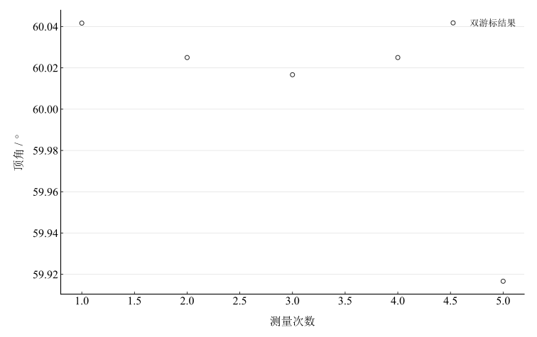

# 用分光计测三棱镜的顶角

## 实验名称

实验二 用分光计测三棱镜的顶角

## 实验目的

1.  进一步熟悉分光计的调节与双游标读数方法。
2.  掌握反射法测量三棱镜顶角的原理和操作。
3.  分析反射像对准、棱边姿态和仪器读数对测量结果的影响。

## 实验原理

平行光分别照射三棱镜的两个折射面时，两表面的反射光方向之间夹角为棱镜顶角的两倍。用望远镜先后对准两个反射像，设对应的两组游标读数为 $\left( \theta_{1},\theta_{2} \right)$ 和 $\left( \theta_{3},\theta_{4} \right)$，则

$$2A = \frac{1}{2}\left( \left\vert  \theta_{3} - \theta_{1} \right\vert  + \left\vert  \theta_{4} - \theta_{2} \right\vert  \right),$$

因此

$$A = \frac{1}{4}\left( \left\vert  \theta_{3} - \theta_{1} \right\vert  + \left\vert  \theta_{4} - \theta_{2} \right\vert  \right).$$

两个游标相差约 $180^{\circ}$，对其角度改变量取平均，可减小刻度盘偏心误差。测量时应使三棱镜棱边与仪器转轴平行，并使两个反射像都清晰地落在望远镜视场内。

## 主要仪器设备

JYY 型分光计、钠灯或汞灯、三棱镜、平面反射镜。

## 实验步骤

1.  调节目镜、用平面镜完成望远镜自准直，使平行光管出射平行光，并调平载物台。
2.  将三棱镜置于载物台中央，使顶角朝向平行光管，调节棱镜使其棱边近似平行于分光计转轴。
3.  转动望远镜找到一个折射面的反射狭缝像，使叉丝竖线与其重合，记录 $\theta_{1},\theta_{2}$。
4.  转动望远镜寻找另一折射面的反射像，记录 $\theta_{3},\theta_{4}$。
5.  改变载物台起始方位，重复测量 5 次。

## 原始数据记录

测量方法采用反射法。两游标读数分别记为 $\theta_1,\theta_2$；望远镜转到另一反射面后，两游标读数记为 $\theta_3,\theta_4$。

表 1　反射法测顶角原始读数

| 次数 | $\theta_1$（左） | $\theta_2$（右） | $\theta_3$（左） | $\theta_4$（右） |
| --- | --- | --- | --- | --- |
| 1 | $15^{\circ}20^{\prime}$ | $195^{\circ}18^{\prime}$ | $135^{\circ}25^{\prime}$ | $315^{\circ}23^{\prime}$ |
| 2 | $86^{\circ}45^{\prime}$ | $266^{\circ}43^{\prime}$ | $206^{\circ}48^{\prime}$ | $26^{\circ}46^{\prime}$ |
| 3 | $92^{\circ}18^{\prime}$ | $272^{\circ}16^{\prime}$ | $212^{\circ}20^{\prime}$ | $32^{\circ}18^{\prime}$ |
| 4 | $121^{\circ}16^{\prime}$ | $301^{\circ}14^{\prime}$ | $241^{\circ}19^{\prime}$ | $61^{\circ}17^{\prime}$ |
| 5 | $139^{\circ}52^{\prime}$ | $319^{\circ}54^{\prime}$ | $20^{\circ}02^{\prime}$ | $200^{\circ}04^{\prime}$ |

## 数据处理

每组先计算两游标的角度改变量。遇到读数跨越 $0^\circ$ 时，以圆周模 $360^\circ$ 的最短角差计算；不将跨零读数直接相减。计算保留半分等未修约信息，最后才修约显示。

表 2　顶角逐次计算（角度以小数度列出）

| 次数 | 左游标角差 / ° | 右游标角差 / ° | 顶角 / ° |
| --- | --- | --- | --- |
| 1 | 120.08333 | 120.08333 | 60.041667 |
| 2 | 120.05 | 120.05 | 60.025 |
| 3 | 120.03333 | 120.03333 | 60.016667 |
| 4 | 120.05 | 120.05 | 60.025 |
| 5 | 119.83333 | 119.83333 | 59.916667 |

未修约均值为 $\bar A=60.00500000^\circ$，即 $60^\circ0.3000^\prime$。A 类分量由五次结果计算：

$$
u_A=\sqrt{\frac{\sum_i(x_i-\bar x)^2}{n(n-1)}}=1.34722^\prime.
$$

沿用记录的角度误差限 $\Delta=1^\prime$，将其作为最终角度估计的均匀分布限值，得到 $u_B=\Delta/\sqrt3=0.57735^\prime$，两项独立合成为 $u_c=1.46572^\prime$。该处理采用指定误差限的约定，未另行包含分光计校准与其他系统分量。

图 1　顶角重复测量

## 实验结果与讨论

反射法顶角未修约均值为 $60.00500000^\circ$，约 $60^\circ00^\prime$。重复性分量为 $1.3472^\prime$，指定误差限下两项合成值为 $1.4657^\prime$；给出的是标准不确定度，不能将其任意修约为 $1^\prime$。

反射像对准、游标估读和棱边未与转轴平行是主要影响因素。五组原始数据全部保留，最后一组得到约 $59^\circ55^\prime$，对均值离散有明显贡献；没有独立依据将其排除。
