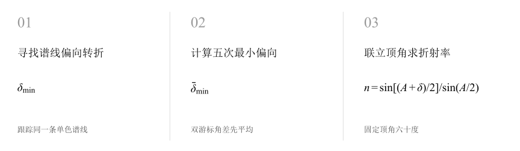
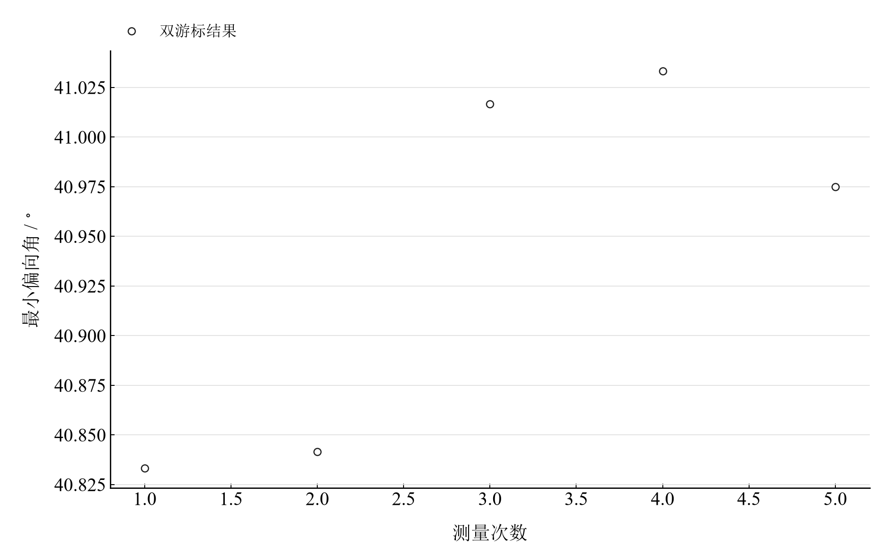

[普通物理实验 4](../README.md) · [项目首页](../../../README.md) · [使用指南](../../../docs/usage.md)

# 三棱镜折射率的测定

**寻找谱线运动的转折点，把最小偏向角换成折射率。**

缓慢转动三棱镜并跟踪谱线，在谱线运动反向的位置测量最小偏向角。对称光路将顶角、最小偏向角与折射率联系起来，并使角度输入的影响能够定量传播。

[读实验报告](report/report.md) · [HTML 阅读版](notebooks/analysis.html) · [Python 笔记本](notebooks/analysis.ipynb) · [Wolfram 笔记本](../../../notebook/paclets/PrismRefractiveIndexLab/Notebooks/PrismRefractiveIndexLab.nb)



图 1　从最小偏向位置的双游标读数计算三棱镜折射率

## 选择你的入口

|用途|入口|打开方式|
|---|---|---|
|阅读原理、测量记录和实验结论|[Markdown 实验报告](report/report.md) · [排版阅读版](report/report.html)|GitHub、Markdown 阅读器或本地浏览器|
|浏览逐次计算表与静态图表|[HTML 阅读版](notebooks/analysis.html)|下载后用浏览器打开|
|逐步运行和修改 Python 计算|[Jupyter Notebook](notebooks/analysis.ipynb)|JupyterLab 或 VS Code|
|运行原生公式与计算图表|[Wolfram Notebook](../../../notebook/paclets/PrismRefractiveIndexLab/Notebooks/PrismRefractiveIndexLab.nb) · [Paclet 安装包](../../../notebook/paclets/PrismRefractiveIndexLab/dist/PrismRefractiveIndexLab-0.1.0.paclet)|Wolfram 前端|
|对照原始实验报告|[源报告 PDF](../../../pdf/course-04/03_实验三_三棱镜折射率的测定_实验报告.pdf)|GitHub 或 PDF 阅读器|

## 从读数到物理量

使用 **5 组最小偏向角读数**。顶角输入为 $A=60^\circ$，顶角标准分量为 $1.47^\prime$；偏向角均值来自左右游标的圆周角差。

核心计算关系为

$$
n=\frac{\sin[(A+\bar\delta_{\min})/2]}{\sin(A/2)}.
$$

最小偏向状态下，棱镜内的两个折射角均为 $A/2$。计算采用空气至棱镜的对称光路，求导与角度误差传播时将角分换算为弧度。

表 1　最小偏向角与棱镜折射率

|物理量或指标|计算结果|
|---|---:|
|最小偏向角均值|$40.940000^\circ$|
|棱镜折射率|$1.5425829$|
|指定角度分量传播不确定度|$0.0005730$|

折射率标准分量由指定顶角分量和偏向角重复性、角度误差限两项合成分量传播得到；对应所测谱线及输入顶角条件。

## 先看角度的离散，再看折射率



图 2　五次最小偏向角；两游标结果平均后用于折射率计算

前两组偏向角略低于后三组。查看每组左右游标差，可以区分谱线转折位置判断与游标读数本身的变化；两者都通过三角函数传递到最终折射率。

## 从角分到折射率误差传播

|操作或计算|观察什么|
|---|---|
|重新计算五组偏向角|跟踪度分读数、左右角差和偏向角均值|
|代入最小偏向公式|使用固定顶角与未修约偏向角求折射率|
|查看角度分量传播|比较顶角输入与偏向角分量对折射率的贡献|

Notebook 保留逐组角度表和静态计算过程。改变顶角或其标准分量后重新运行，可以复算相应折射率及传播结果。

在 [Jupyter](notebooks/analysis.ipynb) 或 [Wolfram](../../../notebook/paclets/PrismRefractiveIndexLab/Notebooks/PrismRefractiveIndexLab.nb) 中从头运行，可沿报告章节查看数据读取、公式代入、计算输出与结果讨论。

## 在本机打开

环境安装见[使用指南](../../../docs/usage.md)。在仓库根目录启动本实验的 Jupyter Notebook：

```powershell
.\.venv\Scripts\python.exe -m jupyterlab experiments/course-04/prism-refractive-index/notebooks/analysis.ipynb
```

Wolfram 安装包包含数据与 Notebook。将仓库路径改为本机路径后运行：

```wolfram
PacletInstall["D:/general-physics-lab/notebook/paclets/PrismRefractiveIndexLab/dist/PrismRefractiveIndexLab-0.1.0.paclet"];
Needs["PrismRefractiveIndexLab`"];
PrismRefractiveIndexLab`OpenNotebook[]
```

## 数据与计算实现

|内容|文件|
|---|---|
|规范观测数据|[observations-01.csv](data/observations-01.csv)|
|单位、参数与模型条件|[experiment.json](experiment.json)|
|Python 计算模块|[prism_refractive_index.py](../../../src/physicslab/experiments/prism_refractive_index.py)|
|Wolfram 包实现|[PrismRefractiveIndexLab.wl](../../../notebook/paclets/PrismRefractiveIndexLab/Kernel/PrismRefractiveIndexLab.wl)|
|完整计算结果|[python.json](results/python.json)|

[数据来源](data/provenance.json) · [返回课程目录](../README.md)
