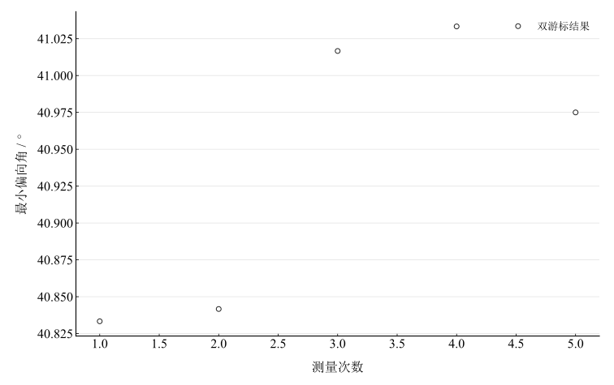

# 三棱镜折射率的测定

## 实验名称

实验三 三棱镜折射率的测定

## 实验目的

1.  掌握最小偏向角法测量三棱镜折射率的原理。
2.  熟练使用分光计观察棱镜色散并寻找最小偏向位置。
3.  用给定顶角计算棱镜对单色光的折射率。

## 实验原理

单色光经三棱镜两次折射后，入射光与出射光之间的夹角称为偏向角。固定棱镜顶角 $A$，转动棱镜时偏向角随入射角变化；当光路关于棱镜角平分线对称，即两次折射角相等时，偏向角取得最小值 $\delta_{\min}$。

在最小偏向状态下，棱镜内部两折射角均为 $A/2$，入射角为 $\left( A + \delta_{\min} \right)/2$。由折射定律得

$$n = \frac{\sin\left( \frac{A + \delta_{\min}}{2} \right)}{\sin\left( \frac{A}{2} \right)}.$$

寻找最小偏向位置时，应缓慢转动载物台并同步跟踪谱线；当棱镜继续转动而谱线改变运动方向时，转折点即为最小偏向位置。

## 主要仪器设备

JYY 型分光计、钠灯或汞灯、三棱镜、平面反射镜。

## 实验步骤

1.  调好分光计，记录所采用的三棱镜顶角 $A=60^\circ00^\prime$。
2.  将三棱镜置于载物台上，观察经棱镜色散后的谱线。
3.  选择规定单色谱线，缓慢转动载物台，同时转动望远镜跟踪谱线。
4.  在谱线出现运动转折的位置用叉丝对准，记录两游标读数。
5.  记录未偏折入射方向，按对称读数法重复测量 5 次。

## 原始数据记录

本实验使用分光计测量三棱镜最小偏向角。采用顶角 $A=60^\circ00^\prime$，其指定标准不确定度为 $1.47^\prime$，作为本次计算的固定输入。

表 1　最小偏向角测量原始读数

{{tables.table1}}

## 数据处理

每组先计算两游标的角度改变量。遇到读数跨越 $0^\circ$ 时，以圆周模 $360^\circ$ 的最短角差计算；不将跨零读数直接相减。计算保留半分等未修约信息，最后才修约显示。

表 2　最小偏向角逐次计算（角度以小数度列出）

{{tables.table2}}

未修约均值为 $\bar\delta_{\min}=40.94000000^\circ$，即 $40^\circ56.4000^\prime$。A 类分量由五次结果计算：

$$
u_A=\sqrt{\frac{\sum_i(x_i-\bar x)^2}{n(n-1)}}=2.57585^\prime.
$$

沿用记录的角度误差限 $\Delta=1^\prime$，将其作为最终角度估计的均匀分布限值，得到 $u_B=\Delta/\sqrt3=0.57735^\prime$，两项独立合成为 $u_c=2.63976^\prime$。该处理采用指定误差限的约定，未另行包含分光计校准与其他系统分量。

图 1　最小偏向角重复测量

由 $A=60^\circ$ 和未修约偏向角代入

$$
n=\frac{\sin[(A+\bar\delta_{\min})/2]}{\sin(A/2)}=1.5425829.
$$

将顶角指定标准不确定度 $1.47^\prime$ 与偏向角上述两项合成分量按独立输入传播，得到 $u_n=0.0005730$。角度导数按弧度求取，角分转换为弧度后传播；未加入未记录的温度及谱线分量。

## 实验结果与讨论

全部五组读数给出最小偏向角均值 $40.94000000^\circ$，按规定顶角计算棱镜折射率 $n=1.5425829$。指定角度分量传播给出 $u_n=0.0005730$。两游标差先平均，原表半分读数保留到求均值结束，因此与先修约的显示值略有区别。

误差主要来自最小偏向位置判断、谱线与叉丝对准、顶角输入误差和棱镜表面清洁。全部五组原始读数均参与计算；没有另附预调记录，不能据未提供的记录说明已实施排除。光源谱线波长及样品标称折射率未记录，不评价色散或准确度。
