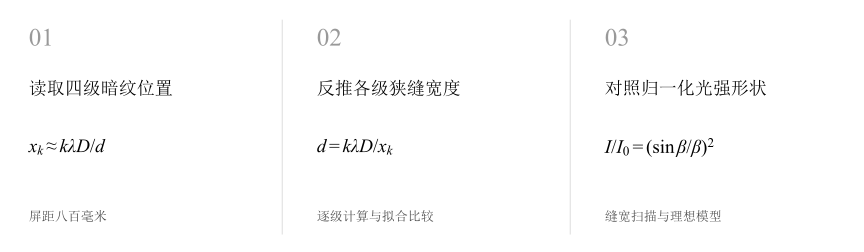
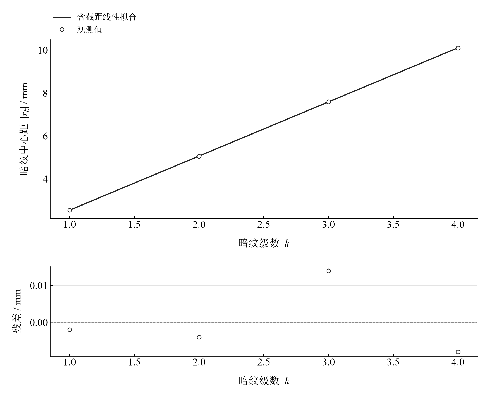
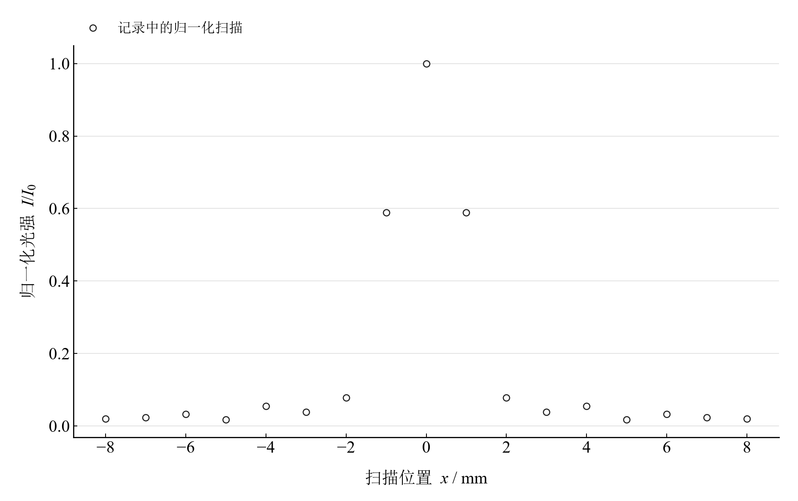
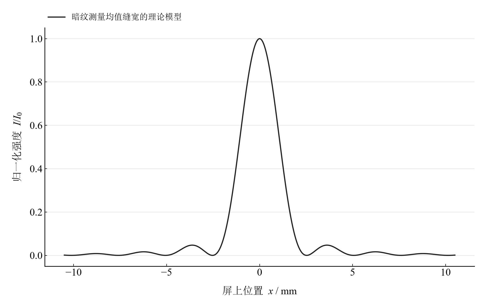

[普通物理实验 4](../README.md) · [项目首页](../../../README.md) · [使用指南](../../../docs/usage.md)

# 单缝衍射光强分布研究

**用暗纹确定缝宽，再用整条光强曲线理解衍射。**

暗纹的位置给出狭缝宽度，归一化光强扫描保留主极大与旁瓣的形状。将两条数据线并列，既能检查近轴几何，也能观察缝宽如何控制衍射展开。

[读实验报告](report/report.md) · [HTML 阅读版](https://hnnuyuxuan.github.io/general-physics-lab/experiments/course-04/single-slit-diffraction/notebooks/analysis.html) · [Python 笔记本](notebooks/analysis.ipynb) · [Wolfram 笔记本](../../../notebook/paclets/SingleSlitDiffractionLab/Notebooks/SingleSlitDiffractionLab.nb)



图 1　单缝衍射的两条证据：暗纹几何与归一化光强扫描

## 选择你的入口

|用途|入口|打开方式|
|---|---|---|
|阅读原理、测量记录和实验结论|[Markdown 实验报告](report/report.md) · [排版阅读版](https://hnnuyuxuan.github.io/general-physics-lab/experiments/course-04/single-slit-diffraction/report/report.html)|GitHub、Markdown 阅读器或本地浏览器|
|浏览计算图表与操作模型控件|[HTML 阅读版](https://hnnuyuxuan.github.io/general-physics-lab/experiments/course-04/single-slit-diffraction/notebooks/analysis.html)|直接在线打开，也可下载到本机|
|逐步运行和修改 Python 计算|[Jupyter Notebook](notebooks/analysis.ipynb)|JupyterLab 或 VS Code|
|运行原生公式与计算图表|[Wolfram Notebook](../../../notebook/paclets/SingleSlitDiffractionLab/Notebooks/SingleSlitDiffractionLab.nb) · [Paclet 安装包](../../../notebook/paclets/SingleSlitDiffractionLab/dist/SingleSlitDiffractionLab-0.1.0.paclet)|Wolfram 前端|
|对照原始实验报告|[源报告 PDF](../../../pdf/course-04/12_实验十二_单缝衍射光强分布研究.pdf)|GitHub 或 PDF 阅读器|

## 从读数到物理量

采用 **4 级暗纹位置**与归一化光强扫描。固定波长 $\lambda=632.8\ \mathrm{nm}$、屏距 $D=800.0\ \mathrm{mm}$；暗纹中心距由左右位置求得。

核心计算关系为

$$
d=\frac{k\lambda D}{|x_k|},\qquad \frac{I}{I_0}=\left(\frac{\sin\beta}{\beta}\right)^2,\qquad \beta=\frac{\pi d\sin\theta}{\lambda}.
$$

暗纹反演使用夫琅禾费与小角度关系。精确几何检查采用 $\sin\theta=x/\sqrt{D^2+x^2}$；中心光强用 $\beta\to0$ 的连续极限一处理。

表 1　暗纹法缝宽与光强形状比较

|物理量或指标|计算结果|
|---|---:|
|各暗纹级次缝宽均值|$0.19993115\ \mathrm{mm}$|
|暗纹位置过原点拟合缝宽|$0.20020037\ \mathrm{mm}$|
|扫描与固定理论曲线均方根差|$0.01608620$|

逐级估计共享波长、屏距和中心定位；级次之间的离散表示缝宽估计差别。归一化扫描与固定模型的均方根差描述形状吻合程度。

## 从暗纹直线到主极大与旁瓣



图 2　暗纹中心距对级数的带截距拟合及残差，用于检查中心定位

<table>
  <tr>
    <td width="50%" align="center" valign="top"><a href="assets/readme-scan-observed.png"></a></td>
    <td width="50%" align="center" valign="top"><a href="assets/readme-scan-model.png"></a></td>
  </tr>
  <tr>
    <td align="center" valign="top"><strong>图 3</strong><br>记录中的归一化光强扫描</td>
    <td align="center" valign="top"><strong>图 4</strong><br>由暗纹平均缝宽生成的理想单缝衍射曲线</td>
  </tr>
</table>

暗纹关系提供长度估计，光强扫描提供分布形状。主极大宽度与缝宽成反比，旁瓣迅速减弱；图中的观测扫描和理论模型分别标注，便于按相同位置尺度比较。

## 改变缝宽，观察衍射展开

|操作或计算|观察什么|
|---|---|
|调节缝宽比例|以暗纹均值为基准，从 0.5 至 1.5，查看中央主极大宽度|
|对照归一化观测扫描|保持波长与屏距固定，比较理论曲线和记录点|
|检查近轴几何|比较逐级小角度缝宽与精确正弦几何修正|

交互模型采用单色平面波、夫琅禾费衍射和理想狭缝。扫描数据为归一化记录；背景电流和探测器空间平均属于测量条件。

在 [Jupyter](notebooks/analysis.ipynb) 或 [Wolfram](../../../notebook/paclets/SingleSlitDiffractionLab/Notebooks/SingleSlitDiffractionLab.nb) 中从头运行，可沿报告章节查看数据读取、公式代入、计算输出与结果讨论。

## 在本机打开

环境安装见[使用指南](../../../docs/usage.md)。在仓库根目录启动本实验的 Jupyter Notebook：

```powershell
.\.venv\Scripts\python.exe -m jupyterlab experiments/course-04/single-slit-diffraction/notebooks/analysis.ipynb
```

Wolfram 安装包包含数据与 Notebook。将仓库路径改为本机路径后运行：

```wolfram
PacletInstall["D:/general-physics-lab/notebook/paclets/SingleSlitDiffractionLab/dist/SingleSlitDiffractionLab-0.1.0.paclet"];
Needs["SingleSlitDiffractionLab`"];
SingleSlitDiffractionLab`OpenNotebook[]
```

## 数据与计算实现

|内容|文件|
|---|---|
|规范观测数据|[observations-01.csv](data/observations-01.csv) · [observations-02.csv](data/observations-02.csv)|
|单位、参数与模型条件|[experiment.json](experiment.json)|
|Python 计算模块|[single_slit_diffraction.py](../../../src/physicslab/experiments/single_slit_diffraction.py)|
|Wolfram 包实现|[SingleSlitDiffractionLab.wl](../../../notebook/paclets/SingleSlitDiffractionLab/Kernel/SingleSlitDiffractionLab.wl)|
|完整计算结果|[python.json](results/python.json)|

[数据来源](data/provenance.json) · [返回课程目录](../README.md)
