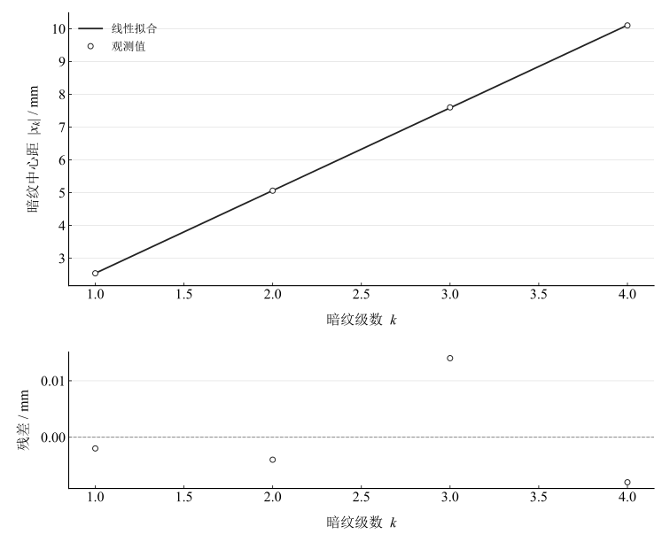
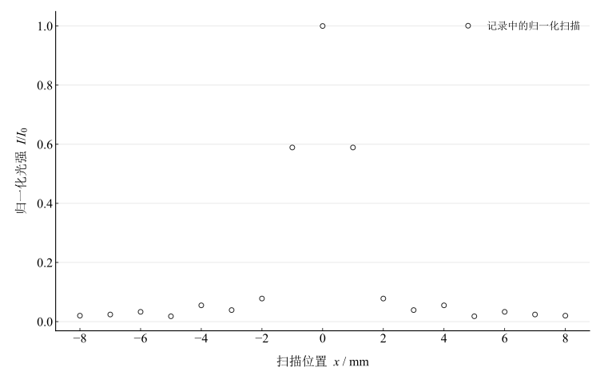
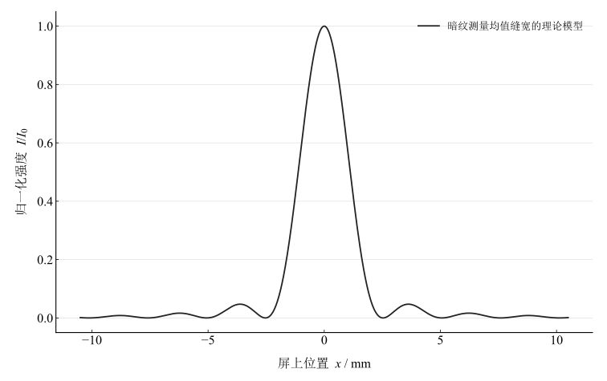

# 单缝衍射光强分布研究

## 实验名称

实验十二 单缝衍射光强分布研究

## 实验目的

1.  观察单缝夫琅禾费衍射图样及其光强分布。
2.  使用光电探测器测量衍射光强的相对变化。
3.  由暗纹位置测定单缝宽度。

## 实验原理

单色平面光垂直照射宽度为 $d$ 的单缝，在远场形成夫琅禾费衍射。光强分布为

$$I = I_{0}\left( \frac{\sin\beta}{\beta} \right)^{2},\quad\quad\beta = \frac{\pi d\sin\theta}{\lambda}.$$

暗纹条件为

$$d\sin\theta = k\lambda,\quad\quad k = \pm 1, \pm 2,\ldots$$

若屏距 $D \gg d$，小角度下 $\sin\theta \approx x/D$，第 $k$ 级暗纹中心距满足

$$x_{k} \approx \frac{k\lambda D}{d},$$

因此

$$d = \frac{k\lambda D}{x_{k}}.$$

## 主要仪器设备

氦氖激光器、可调单缝、光具座、光电探测器及扫描装置、光电流计或数字采集仪。

## 实验步骤

1.  调整激光器、单缝和探测器共轴，使激光垂直照射单缝；不得直视激光束。
2.  测量单缝到探测器的距离 $D$，调节缝宽使衍射图样清晰。
3.  以中央主极大中心为 $x = 0$，按固定步长扫描探测器并记录光电流。
4.  扣除暗电流并以中央最大值归一化，得到 $I/I_{0}$。
5.  精确记录左右各级暗纹中心位置，取对称平均得到 $\left\vert  x_{k} \right\vert $。
6.  利用多个级次分别计算缝宽并求平均。

## 原始数据记录

本实验用激光照射单缝，在距离 $D=800.0\,\mathrm{mm}$ 处用光电探测器扫描衍射光强分布。激光波长取 $\lambda=632.8\,\mathrm{nm}$。

表 1　单缝衍射归一化光强扫描记录

| 位置 $x$ / mm | 归一化光强 $I/I_0$ |
| --- | --- |
| -8 | 0.02 |
| -7 | 0.024 |
| -6 | 0.033 |
| -5 | 0.018 |
| -4 | 0.055 |
| -3 | 0.039 |
| -2 | 0.078 |
| -1 | 0.589 |
| 0 | 1 |
| 1 | 0.589 |
| 2 | 0.078 |
| 3 | 0.039 |
| 4 | 0.055 |
| 5 | 0.018 |
| 6 | 0.033 |
| 7 | 0.024 |
| 8 | 0.02 |

表 2　暗纹中心位置测量记录

| 暗纹级数 $k$ | 中心距 $\vert x_k\vert $ / mm |
| --- | --- |
| 1 | 2.54 |
| 2 | 5.06 |
| 3 | 7.6 |
| 4 | 10.1 |

## 数据处理

单缝衍射光强分布为

$$I = I_{0}\left( \frac{\sin\beta}{\beta} \right)^{2},\quad\quad\beta = \frac{\pi d\sin\theta}{\lambda}.$$

暗纹位置满足

$$d\sin\theta = k\lambda,\quad\quad x_{k} \approx \frac{k\lambda D}{d}.$$

因此

$$d = \frac{k\lambda D}{x_{k}}.$$

表 3　由暗纹位置计算狭缝宽度

| $k$ | $\vert x_k\vert $ / mm | $d$ / mm |
| --- | --- | --- |
| 1 | 2.54 | 0.19930709 |
| 2 | 5.06 | 0.20009486 |
| 3 | 7.6 | 0.19983158 |
| 4 | 10.1 | 0.20049109 |

由四级暗纹分别得到缝宽，平均值为 $\bar d=0.19993115\,\mathrm{mm}$。四个值的形式均值标准误为 $0.00024828\,\mathrm{mm}$；不同级次共享同一距离、波长和中心定位，不能把它解释为完整标准不确定度。暗纹位置过原点最小二乘得到 $d=0.20020037\,\mathrm{mm}$。图 1 采用带截距拟合检查中心偏移，其直线与此处的过原点估计分别处理。

用精确几何 $\sin\theta=x/\sqrt{D^2+x^2}$ 代替 $x/D$，四级中最大缝宽修正为 $0.00001598\,\mathrm{mm}$，小于跨级估计的离散。归一化扫描与固定缝宽理想模型的均方根差为 $0.016086$，仅表示形状差异，不作为电流不确定度。

图 1　暗纹位置与级数的带截距拟合及残差（用于检查中心偏移）

图 2　记录中的归一化光强扫描

图 3　由暗纹估计缝宽生成的理想衍射曲线

## 实验结果与讨论

本实验暗纹法缝宽均值为 $0.199931\,\mathrm{mm}$。光强分布呈中央主极大最强、两侧次级极大迅速减弱的特征，暗纹位置与 $k\lambda D/d$ 的线性关系基本一致。

误差主要来自暗纹中心位置不够锐利、探测器狭缝宽度导致的空间平均、屏距 $D$ 的读数误差和激光束未严格垂直照射单缝。中央主极大附近光强变化陡峭，若扫描步长过大，会使理论曲线与实测点之间出现偏差。

原始材料只保留归一化光强，未保留暗电流和原始电流，不能重新核查背景扣除。两侧扫描完全对称的记录按原样保留，不将对称点当独立重复观测缩减误差。距离、波长与中心定位误差未给出，无法合成完整不确定度。
