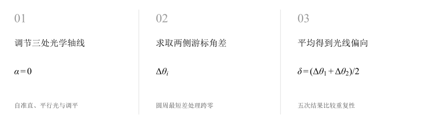
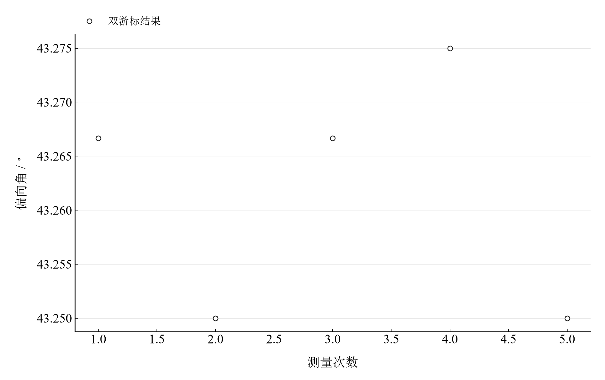

[普通物理实验 4](../README.md) · [项目首页](../../../README.md) · [使用指南](../../../docs/usage.md)

# 分光计的调节与使用

**先让光轴与转轴各就其位，再用双游标读出光线的转向。**

望远镜自准直、平行光管出射平行光、载物台调平，是角度测量的三个准备环节。以五组双游标记录为线索，从度分读数走到偏向角及重复性分析。

[读实验报告](report/report.md) · [HTML 阅读版](https://hnnuyuxuan.github.io/general-physics-lab/experiments/course-04/spectrometer/notebooks/analysis.html) · [Python 笔记本](notebooks/analysis.ipynb) · [Wolfram 笔记本](../../../notebook/paclets/SpectrometerLab/Notebooks/SpectrometerLab.nb)



图 1　分光计从光路调节到双游标角度测量的流程；首步表示理想对准状态

## 选择你的入口

|用途|入口|打开方式|
|---|---|---|
|阅读原理、测量记录和实验结论|[Markdown 实验报告](report/report.md) · [排版阅读版](https://hnnuyuxuan.github.io/general-physics-lab/experiments/course-04/spectrometer/report/report.html)|GitHub、Markdown 阅读器或本地浏览器|
|浏览逐次计算表与静态图表|[HTML 阅读版](https://hnnuyuxuan.github.io/general-physics-lab/experiments/course-04/spectrometer/notebooks/analysis.html)|直接在线打开，也可下载到本机|
|逐步运行和修改 Python 计算|[Jupyter Notebook](notebooks/analysis.ipynb)|JupyterLab 或 VS Code|
|运行原生公式与计算图表|[Wolfram Notebook](../../../notebook/paclets/SpectrometerLab/Notebooks/SpectrometerLab.nb) · [Paclet 安装包](../../../notebook/paclets/SpectrometerLab/dist/SpectrometerLab-0.1.0.paclet)|Wolfram 前端|
|对照原始实验报告|[源报告 PDF](../../../pdf/course-04/01_实验一_分光计的调节与使用_实验报告.pdf)|GitHub 或 PDF 阅读器|

## 从读数到物理量

记录包含 3 项调节与检验结果，以及 **5 组偏向角测量**。每组分别读取入射方向和偏折方向的左右游标；角度按度、分录入，运算时保留半分读数。

核心计算关系为

$$
\delta_i=\frac{\Delta\theta_{1i}+\Delta\theta_{2i}}{2},\qquad \bar\delta=\frac{1}{5}\sum_{i=1}^{5}\delta_i.
$$

其中两项角差采用模 $360^\circ$ 的圆周最短差。先求同一游标转过的角度，再对两游标平均，可减小刻度盘偏心影响。

表 1　双游标偏向角均值与标准分量

|物理量或指标|计算结果|
|---|---:|
|偏向角均值|$43.261667^\circ$|
|角度均值A类分量|$0.30000^\prime$|
|两分量合成标准不确定度|$0.65064^\prime$|

合成标准分量采用最终角度误差限 $1^\prime$ 的均匀分布约定，与五次均值的 A 类分量独立合成。校准误差与光路调整质量另由仪器和操作条件判断。

## 在五次读数之间看重复性



图 2　五次双游标偏向角；各点由同组入射与偏折方向读数计算

五次结果集中在约 $43.25^\circ$ 至 $43.275^\circ$ 之间。将原始游标角差与最终偏向角并列阅读，可以区分两游标的不一致和测量次数之间的离散。

## 逐组复算与跨零角差

|操作或计算|观察什么|
|---|---|
|复算五组游标角差|逐组比较左右游标，再对照平均后的偏向角|
|检查圆周角差|在代码中核查跨零处理和度分到小数度的转换|
|查看重复性分量|用未修约结果计算均值与 A 类标准分量|

本实验的 Notebook 以静态表格和计算输出展开调节记录、角差处理与误差分量。修改规范输入后重新运行全部单元，即可更新结果。

在 [Jupyter](notebooks/analysis.ipynb) 或 [Wolfram](../../../notebook/paclets/SpectrometerLab/Notebooks/SpectrometerLab.nb) 中从头运行，可沿报告章节查看数据读取、公式代入、计算输出与结果讨论。

## 在本机打开

环境安装见[使用指南](../../../docs/usage.md)。在仓库根目录启动本实验的 Jupyter Notebook：

```powershell
.\.venv\Scripts\python.exe -m jupyterlab experiments/course-04/spectrometer/notebooks/analysis.ipynb
```

Wolfram 安装包包含数据与 Notebook。将仓库路径改为本机路径后运行：

```wolfram
PacletInstall["D:/general-physics-lab/notebook/paclets/SpectrometerLab/dist/SpectrometerLab-0.1.0.paclet"];
Needs["SpectrometerLab`"];
SpectrometerLab`OpenNotebook[]
```

## 数据与计算实现

|内容|文件|
|---|---|
|规范观测数据|[observations-01.csv](data/observations-01.csv) · [observations-02.csv](data/observations-02.csv)|
|单位、参数与模型条件|[experiment.json](experiment.json)|
|Python 计算模块|[spectrometer.py](../../../src/physicslab/experiments/spectrometer.py)|
|Wolfram 包实现|[SpectrometerLab.wl](../../../notebook/paclets/SpectrometerLab/Kernel/SpectrometerLab.wl)|
|完整计算结果|[python.json](results/python.json)|

[数据来源](data/provenance.json) · [返回课程目录](../README.md)
