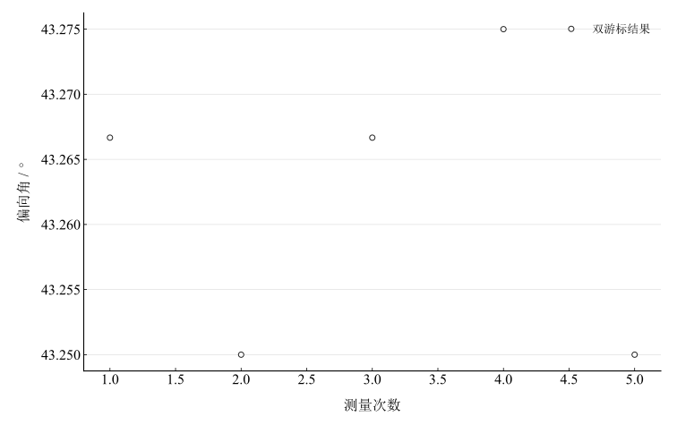

# 分光计的调节与使用

## 实验名称

实验一 分光计的调节与使用

## 实验目的

1.  掌握分光计的基本结构、读数方法及各调节螺钉的作用。
2.  掌握望远镜自准直、平行光管出射平行光以及载物台水平调节的方法。
3.  学习使用双游标读数测量三棱镜对单色光的偏向角。

## 实验原理

分光计由望远镜、平行光管、载物台和读数圆盘组成。为保证角度测量可靠，应使望远镜对无穷远聚焦且光轴垂直于仪器转轴；平行光管狭缝位于其物镜焦平面上，使出射光为平行光；载物台平面应与转轴垂直。

分光计圆盘设置两个相差约 $180^{\circ}$ 的游标。对同一方向同时读取两游标并取平均，可削弱刻度盘偏心对角度测量的影响。设入射光方向的两游标读数为 $\theta_{1},\theta_{2}$，偏折后方向为 $\theta_{3},\theta_{4}$，则偏向角为

$$\delta = \frac{1}{2}\left( \left\vert  \theta_{3} - \theta_{1} \right\vert  + \left\vert  \theta_{4} - \theta_{2} \right\vert  \right).$$

调节顺序遵循“先目镜、后物镜；先望远镜、后平行光管；最后调载物台”的原则。自准直时，平面镜反射回来的十字像与分划板叉丝重合，表明望远镜光轴与反射面法线一致。

## 主要仪器设备

JYY 型分光计、钠灯或汞灯、三棱镜、平面反射镜。

## 实验步骤

## （一）望远镜调节**

1.  调节目镜，使分划板叉丝清晰且无视差。
2.  将平面镜置于载物台上，用自准直法调节望远镜物镜，使反射十字像清晰。
3.  将平面镜转动约 $180^{\circ}$，交替调节望远镜水平螺钉和载物台螺钉，使两位置的反射像均与叉丝中心重合。

## **（二）平行光管和载物台调节**

1.  打开光源，调节狭缝宽度和焦距，使狭缝像窄、亮、清晰。
2.  调节平行光管俯仰，使狭缝像中心与叉丝中心等高。
3.  检查载物台水平状态，必要时用二分法反复微调。

## **（三）偏向角测量**

1.  记录入射光方向的两游标读数 $\theta_{1},\theta_{2}$。
2.  放置三棱镜，转动载物台和望远镜，使叉丝对准偏折谱线，记录 $\theta_{3},\theta_{4}$。
3.  改变起始方位重复测量 5 次。

## **原始数据记录

分光计经望远镜自准直、平行光管狭缝成像和载物台水平调节后，选取三棱镜一条谱线测量偏向角。读数盘有左右两个游标，先记入射方向 $\theta_1,\theta_2$，再记经三棱镜偏折后的方向 $\theta_3,\theta_4$。

表 1　分光计调节与检验记录

| 序号 | 调节或检验项目 | 读数位置 | 读数一 | 读数二 | 检验结果 |
| --- | --- | --- | --- | --- | --- |
| 1 | 望远镜自准直 | 左游标 | $12^{\circ}16^{\prime}$ | $192^{\circ}17^{\prime}$ | $180^{\circ}01^{\prime}$ |
| 2 | 平行光管狭缝成像 | 右游标 | $103^{\circ}42^{\prime}$ | $283^{\circ}41^{\prime}$ | $179^{\circ}59^{\prime}$ |
| 3 | 载物台水平检验 | 双游标平均 | — | — | 反射像高低差≤半格 |

表 2　偏向角测量原始读数

| 次数 | $\theta_1$（左） | $\theta_2$（右） | $\theta_3$（左） | $\theta_4$（右） |
| --- | --- | --- | --- | --- |
| 1 | $100^{\circ}12^{\prime}$ | $280^{\circ}11^{\prime}$ | $143^{\circ}28^{\prime}$ | $323^{\circ}27^{\prime}$ |
| 2 | $96^{\circ}34^{\prime}$ | $276^{\circ}33^{\prime}$ | $139^{\circ}48^{\prime}$ | $319^{\circ}49^{\prime}$ |
| 3 | $118^{\circ}20^{\prime}$ | $298^{\circ}21^{\prime}$ | $161^{\circ}37^{\prime}$ | $341^{\circ}36^{\prime}$ |
| 4 | $85^{\circ}05^{\prime}$ | $265^{\circ}04^{\prime}$ | $128^{\circ}22^{\prime}$ | $308^{\circ}20^{\prime}$ |
| 5 | $130^{\circ}40^{\prime}$ | $310^{\circ}39^{\prime}$ | $173^{\circ}55^{\prime}$ | $353^{\circ}54^{\prime}$ |

## 数据处理

每组先计算两游标的角度改变量。遇到读数跨越 $0^\circ$ 时，以圆周模 $360^\circ$ 的最短角差计算；不将跨零读数直接相减。计算保留半分等未修约信息，最后才修约显示。

表 3　偏向角逐次计算（角度以小数度列出）

| 次数 | 左游标角差 / ° | 右游标角差 / ° | 偏向角 / ° |
| --- | --- | --- | --- |
| 1 | 43.266667 | 43.266667 | 43.266667 |
| 2 | 43.233333 | 43.266667 | 43.25 |
| 3 | 43.283333 | 43.25 | 43.266667 |
| 4 | 43.283333 | 43.266667 | 43.275 |
| 5 | 43.25 | 43.25 | 43.25 |

未修约均值为 $\bar\delta=43.26166667^\circ$，即 $43^\circ15.7000^\prime$。A 类分量由五次结果计算：

$$
u_A=\sqrt{\frac{\sum_i(x_i-\bar x)^2}{n(n-1)}}=0.30000^\prime.
$$

沿用记录的角度误差限 $\Delta=1^\prime$，将其作为最终角度估计的均匀分布限值，得到 $u_B=\Delta/\sqrt3=0.57735^\prime$，两项独立合成为 $u_c=0.65064^\prime$。该处理采用指定误差限的约定，未另行包含分光计校准与其他系统分量。

图 1　偏向角重复测量

## 实验结果与讨论

完成望远镜自准直、平行光管狭缝成像和载物台水平调节后，五次双游标偏向角均值为 $43^\circ15.7^\prime$，按角分展示为 $43^\circ16^\prime$。重复性 A 类分量为 $0.30^\prime$，采用指定误差限后的两项合成值约 $0.65^\prime$。读数集中表明本组重复性较好，未据此评定仪器准确度。

误差主要来自狭缝像与叉丝重合的主观判断、游标估读、转动时三棱镜位置变化和狭缝过宽。应先调目镜和望远镜清晰成像，再调平行光管出射平行光，最后调载物台水平。
