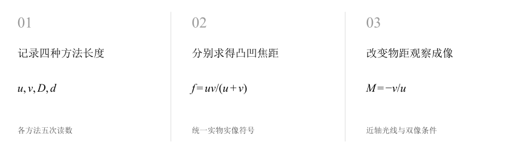
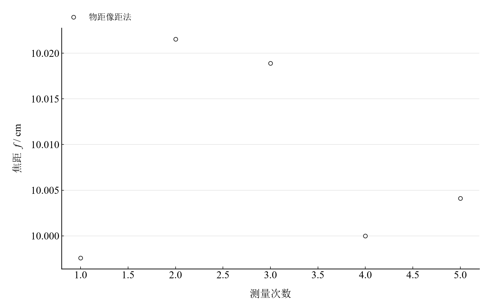
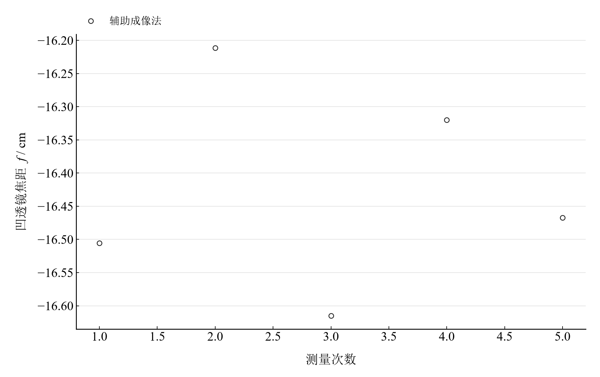

[普通物理实验 4](../README.md) · [项目首页](../../../README.md) · [使用指南](../../../docs/usage.md)

<!-- virtual-laboratory-entry -->
[在线虚拟实验](https://hnnuyuxuan.github.io/general-physics-lab/simulations/thin-lens/) · [模型依据与参数来源](../../../docs/thin-lens-model-evidence.md)

# 薄透镜焦距的测定

**用四种成像方法测焦距，再把物像关系画成会变化的光路。**

自准直、物距像距和二次成像三种方法测凸透镜，辅助成像法测凹透镜。通过逐次复算与近轴光线探索，把焦距数值、像的位置、放大率和实像条件连接起来。

[读实验报告](report/report.md) · [HTML 阅读版](https://hnnuyuxuan.github.io/general-physics-lab/experiments/course-04/thin-lens/notebooks/analysis.html) · [Python 笔记本](notebooks/analysis.ipynb) · [Wolfram 笔记本](../../../notebook/paclets/ThinLensLab/Notebooks/ThinLensLab.nb)



图 1　四种测量方法与近轴成像模型的关系；凸凹透镜分别计算

## 选择你的入口

|用途|入口|打开方式|
|---|---|---|
|阅读原理、测量记录和实验结论|[Markdown 实验报告](report/report.md) · [排版阅读版](https://hnnuyuxuan.github.io/general-physics-lab/experiments/course-04/thin-lens/report/report.html)|GitHub、Markdown 阅读器或本地浏览器|
|浏览计算图表与操作模型控件|[HTML 阅读版](https://hnnuyuxuan.github.io/general-physics-lab/experiments/course-04/thin-lens/notebooks/analysis.html)|直接在线打开，也可下载到本机|
|逐步运行和修改 Python 计算|[Jupyter Notebook](notebooks/analysis.ipynb)|JupyterLab 或 VS Code|
|运行原生公式与计算图表|[Wolfram Notebook](../../../notebook/paclets/ThinLensLab/Notebooks/ThinLensLab.nb) · [Paclet 安装包](../../../notebook/paclets/ThinLensLab/dist/ThinLensLab-0.1.0.paclet)|Wolfram 前端|
|对照原始实验报告|[源报告 PDF](../../../pdf/course-04/09_实验九_薄透镜焦距的测定_实验报告.pdf)|GitHub 或 PDF 阅读器|

## 从读数到物理量

四种方法各记录 **5 次长度测量**。物距像距法取实物距 $u>0$、实像距 $v>0$；凹透镜辅助成像采用虚物距 $u=-a$、实像距 $v=b$。

核心计算关系为

$$
f=\frac{uv}{u+v},\qquad f_{\mathrm{Bessel}}=\frac{D^2-d^2}{4D},\qquad f_{\mathrm{concave}}=-\frac{ab}{b-a}.
$$

自准直法的物与返回像重合时，物至透镜距离即焦距。二次成像法以物屏距离 $D$ 和两清晰像透镜位置差 $d$ 计算，两个不同实成像位置满足 $D>4f$。

表 1　四种测量方法的焦距均值

|物理量或指标|计算结果|
|---|---:|
|自准直法焦距均值|$10.020000\ \mathrm{cm}$|
|物距像距法焦距均值|$10.008428\ \mathrm{cm}$|
|二次成像法焦距均值|$9.9952271\ \mathrm{cm}$|
|辅助成像法（凹透镜）焦距均值|$-16.423821\ \mathrm{cm}$|

各方法的 A 类分量分别由五次焦距求得。不同方法共用透镜和标尺，方法间一致性与重复性是两个层次的问题。

## 分别观察凸透镜与凹透镜的五次结果

<table>
  <tr>
    <td width="50%" align="center" valign="top"><a href="assets/readme-conjugates-repeat.png"></a></td>
    <td width="50%" align="center" valign="top"><a href="assets/readme-concave-repeat.png"></a></td>
  </tr>
  <tr>
    <td align="center" valign="top"><strong>图 2</strong><br>物距像距法逐次凸透镜焦距；不同物像距离代入同一近轴公式</td>
    <td align="center" valign="top"><strong>图 3</strong><br>辅助成像法逐次凹透镜焦距；虚物距约定使焦距为负</td>
  </tr>
</table>

四种方法的均值表用于比较方法间差别，两幅图则保留逐次变化。凹透镜关系中 $b-a$ 位于分母，中间像及新像位置判读会通过这个差值放大。

## 物距、放大率与二次成像分支

|操作或计算|观察什么|
|---|---|
|改变物距比例 $u/f$|从 1.2 至 4，查看三条近轴光线、像距与倒立放大率|
|改变物屏距离 $D/f$|从 4 至 8，观察两透镜位置分支及 $D=4f$ 的重合点|
|对照四种方法均值|以原始长度逐次求焦距，再检查重复性分量|

交互图固定物距像距法的焦距均值，采用薄透镜、空气和近轴假设；光线高度以任意单位示意，长度轴使用实验焦距尺度。

在 [Jupyter](notebooks/analysis.ipynb) 或 [Wolfram](../../../notebook/paclets/ThinLensLab/Notebooks/ThinLensLab.nb) 中从头运行，可沿报告章节查看数据读取、公式代入、计算输出与结果讨论。

## 在本机打开

环境安装见[使用指南](../../../docs/usage.md)。在仓库根目录启动本实验的 Jupyter Notebook：

```powershell
.\.venv\Scripts\python.exe -m jupyterlab experiments/course-04/thin-lens/notebooks/analysis.ipynb
```

Wolfram 安装包包含数据与 Notebook。将仓库路径改为本机路径后运行：

```wolfram
PacletInstall["D:/general-physics-lab/notebook/paclets/ThinLensLab/dist/ThinLensLab-0.1.0.paclet"];
Needs["ThinLensLab`"];
ThinLensLab`OpenNotebook[]
```

## 数据与计算实现

|内容|文件|
|---|---|
|规范观测数据|[autocollimation.csv](data/autocollimation.csv) · [bessel.csv](data/bessel.csv) · [concave.csv](data/concave.csv) · [conjugates.csv](data/conjugates.csv)|
|单位、参数与模型条件|[experiment.json](experiment.json)|
|Python 计算模块|[thin_lens.py](../../../src/physicslab/experiments/thin_lens.py)|
|Wolfram 包实现|[ThinLensLab.wl](../../../notebook/paclets/ThinLensLab/Kernel/ThinLensLab.wl)|
|完整计算结果|[python.json](results/python.json)|

[数据来源](data/provenance.json) · [返回课程目录](../README.md)
