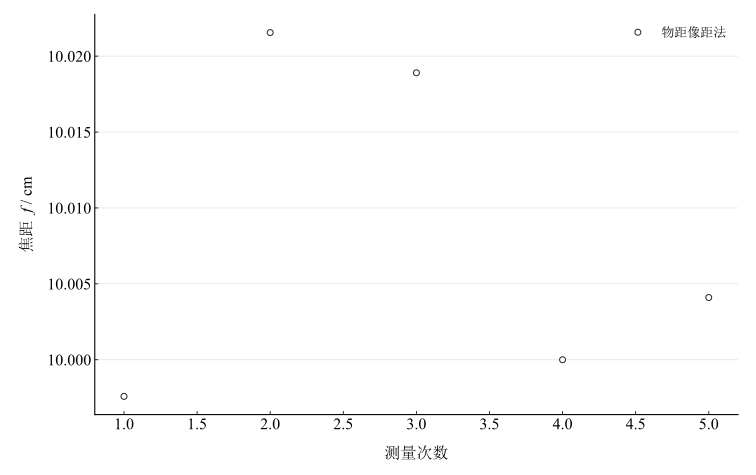
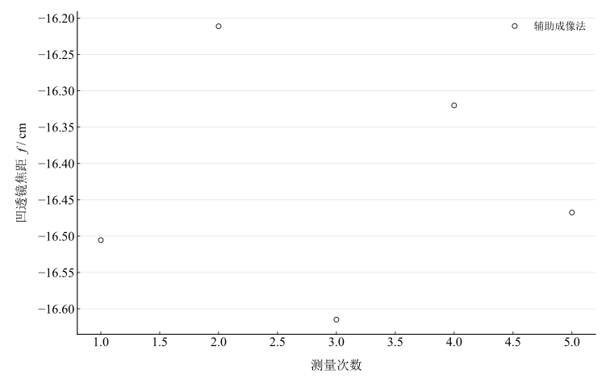

# 薄透镜焦距的测定

## 实验名称

实验九 薄透镜焦距的测定

## 实验目的

1.  掌握光具座上各光学元件的等高共轴调节方法。
2.  掌握自准直法、物距像距法和二次成像法测量凸透镜焦距。
3.  掌握辅助成像法测量凹透镜焦距，并比较各方法特点。

## 实验原理

薄透镜在近轴条件下满足

$$\frac{1}{f} = \frac{1}{u} + \frac{1}{v},\quad\quad f = \frac{uv}{u + v}.$$

自准直法中，物位于凸透镜焦平面时，透过透镜的光成为平行光，经平面镜反射后沿原路返回并在物面成倒立等大像，因此物到透镜光心的距离近似等于焦距。

二次成像法中，物屏距离 $D > 4f$ 时，凸透镜有两个位置可在屏上成清晰实像，若两位置间距为 $d$，则

$$f = \frac{D^{2} - d^{2}}{4D}.$$

测凹透镜时先用凸透镜形成会聚光束。设凹透镜到原会聚点距离为 $a$，到新像点距离为 $b$，按本实验符号约定

$$f_{\mathrm{concave}} = - \frac{ab}{b - a}.$$

## 主要仪器设备

光具座、凸透镜、凹透镜、钠光灯、平面反射镜、物屏和像屏。

## 实验步骤

1.  在光具座上调节光源、物屏、透镜和像屏等高共轴。
2.  自准直法：在凸透镜后放置平面镜，移动透镜直至物屏上的返回像清晰且与物重合，读取焦距。
3.  物距像距法：选取多组 $u > f$ 的物距，移动像屏得到清晰实像，记录 $u,v$。
4.  二次成像法：固定物屏距离 $D > 4f$，寻找两个清晰成像位置并测量间距 $d$。
5.  凹透镜辅助成像法：先用凸透镜形成清晰像，记录原会聚点；插入凹透镜后重新寻找像点，测量 $a,b$。
6.  每种方法重复测量 5 次，成像位置均从同一方向逼近以减小机械空程。

## 原始数据记录

本实验分别用自准直法、物距像距法和二次成像法测凸透镜焦距，并用辅助成像法测凹透镜焦距。长度单位均为 cm。

表 1　自准直法测凸透镜焦距

| 次数 | $f$ / cm |
| --- | --- |
| 1 | 10.02 |
| 2 | 10 |
| 3 | 10.04 |
| 4 | 10.01 |
| 5 | 10.03 |

表 2　物距像距法原始记录

| 次数 | $u$ / cm | $v$ / cm |
| --- | --- | --- |
| 1 | 14.95 | 30.18 |
| 2 | 15.12 | 29.72 |
| 3 | 16.08 | 26.58 |
| 4 | 18 | 22.5 |
| 5 | 20.2 | 19.82 |

表 3　二次成像法原始记录

| 次数 | $D$ / cm | $d$ / cm |
| --- | --- | --- |
| 1 | 50 | 22.4 |
| 2 | 50 | 22.35 |
| 3 | 50 | 22.42 |
| 4 | 50 | 22.38 |
| 5 | 50 | 22.36 |

表 4　辅助成像法测凹透镜原始记录

| 次数 | $a$ / cm | $b$ / cm |
| --- | --- | --- |
| 1 | 10.2 | 26.7 |
| 2 | 10 | 26.1 |
| 3 | 10.3 | 27.1 |
| 4 | 10.1 | 26.5 |
| 5 | 10.2 | 26.8 |

## 数据处理

自准直法中，物屏与返回像重合时

$$f_{1} = x,$$

平均值为 ${\bar{f}}_{1} = 10.02\,\mathrm{cm}$。

物距像距法采用

$$f = \frac{uv}{u + v}.$$

表 5　物距像距法焦距计算

| 次数 | $u$ / cm | $v$ / cm | $f$ / cm |
| --- | --- | --- | --- |
| 1 | 14.95 | 30.18 | 9.997585 |
| 2 | 15.12 | 29.72 | 10.021552 |
| 3 | 16.08 | 26.58 | 10.018903 |
| 4 | 18 | 22.5 | 10 |
| 5 | 20.2 | 19.82 | 10.004098 |

平均值 ${\bar{f}}_{2} = 10.01\,\mathrm{cm}$。

二次成像法采用

$$f = \frac{D^{2} - d^{2}}{4D}.$$

表 6　二次成像法焦距计算

| 次数 | $D$ / cm | $d$ / cm | $f$ / cm |
| --- | --- | --- | --- |
| 1 | 50 | 22.4 | 9.9912 |
| 2 | 50 | 22.35 | 10.002387 |
| 3 | 50 | 22.42 | 9.986718 |
| 4 | 50 | 22.38 | 9.995678 |
| 5 | 50 | 22.36 | 10.000152 |

平均值 ${\bar{f}}_{3} = 10.00\,\mathrm{cm}$。

凹透镜辅助成像法采用

$$f_{\mathrm{concave}} = - \frac{ab}{b - a}.$$

表 7　凹透镜焦距计算

| 次数 | $a$ / cm | $b$ / cm | $f$ / cm |
| --- | --- | --- | --- |
| 1 | 10.2 | 26.7 | -16.505455 |
| 2 | 10 | 26.1 | -16.21118 |
| 3 | 10.3 | 27.1 | -16.614881 |
| 4 | 10.1 | 26.5 | -16.320122 |
| 5 | 10.2 | 26.8 | -16.46747 |

各方法先以未修约的逐次计算值求平均，再统一展示。凹透镜采用虚物距 $u=-a$、实像距 $v=b$，焦距为负。

表 8　四种方法的焦距均值与重复性分量

| 方法 | 焦距均值 / cm | 均值A类分量 / cm |
| --- | --- | --- |
| 自准直法 | 10.02 | 0.007071 |
| 物距像距法 | 10.008428 | 0.004946 |
| 二次成像法 | 9.995227 | 0.002867 |
| 辅助成像法（凹透镜） | -16.423821 | 0.071078 |

同种方法的五次重复值计算

$$
u_A(\bar f)=\sqrt{\frac{\sum_{i=1}^n(f_i-\bar f)^2}{n(n-1)}},\qquad n=5.
$$

三种凸透镜方法均值的等权平均为 $10.007885\,\mathrm{cm}$，仅用于描述三种方法的总体水平。共用透镜和标尺使其可能具有共同系统误差，不能以方法数量缩减系统不确定度。各方法的 A 类分量仅反映重复测量离散；仪器刻度、成像位置判定及光心定位误差未记录，不能给出完整合成不确定度。

图 1　物距像距法逐次焦距

图 2　辅助成像法逐次凹透镜焦距

## 实验结果与讨论

自准直法、物距像距法和二次成像法的凸透镜焦距均值分别为 $10.02000\,\mathrm{cm}$、$10.00843\,\mathrm{cm}$ 和 $9.99523\,\mathrm{cm}$；辅助成像法凹透镜焦距均值为 $-16.42382\,\mathrm{cm}$。可概括为凸透镜约 $10.01\,\mathrm{cm}$、凹透镜约 $-16.42\,\mathrm{cm}$。三种凸透镜方法结果接近，表现出本组数据的方法间一致性；缺少标称值或校准值，尚不能评价准确度。

自准直法操作简便，但透镜光心位置不易确定。物距像距法直观，其敏感性由 $\partial f/\partial u=v^2/(u+v)^2$、$\partial f/\partial v=u^2/(u+v)^2$ 描述；物距接近焦距时，清晰实像位置远离透镜，寻找像位置更困难。

二次成像法无需直接确定光心到物或屏的距离。当 $D>4f$ 时两成像位置分离，$D=4f$ 时重合，$D<4f$ 时无法得到两处清晰实像。本组固定 $D=50.00\,\mathrm{cm}$，满足双像条件。其重复性与自准直法、物距像距法处于相近量级，不能仅凭方法名称认定更准确。

凹透镜测量依赖辅助凸透镜形成的中间像，原会聚点及新像点判定误差均会传入 $a,b$。本组凹透镜焦距重复值离散较大，应检查成像判定与共轴调节；还须注意 $b-a$ 进入分母，几何位置误差会被放大。
