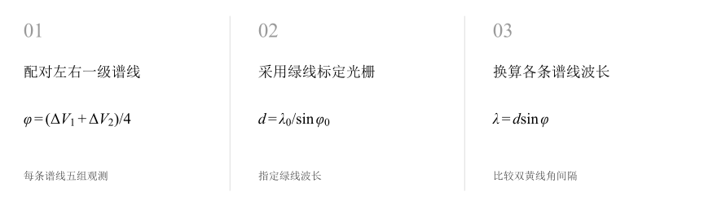
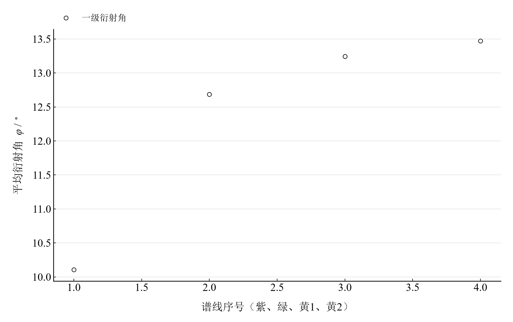

[普通物理实验 4](../README.md) · [项目首页](../../../README.md) · [使用指南](../../../docs/usage.md)

# 用透射光栅测定光波波长

**先用绿线标定光栅，再让衍射角给出其他谱线的波长。**

在光栅两侧寻找同一级谱线，以双游标读数形成衍射角。绿线提供光栅常数，紫线和双黄线用于波长计算；双侧配对与两游标一致性共同决定读数的物理含义。

[读实验报告](report/report.md) · [HTML 阅读版](notebooks/analysis.html) · [Python 笔记本](notebooks/analysis.ipynb) · [Wolfram 笔记本](../../../notebook/paclets/TransmissionGratingLab/Notebooks/TransmissionGratingLab.nb)



图 1　透射光栅的两阶段处理：绿线标定与其他谱线的波长计算

## 选择你的入口

|用途|入口|打开方式|
|---|---|---|
|阅读原理、测量记录和实验结论|[Markdown 实验报告](report/report.md) · [排版阅读版](report/report.html)|GitHub、Markdown 阅读器或本地浏览器|
|浏览逐次计算表与静态图表|[HTML 阅读版](notebooks/analysis.html)|下载后用浏览器打开|
|逐步运行和修改 Python 计算|[Jupyter Notebook](notebooks/analysis.ipynb)|JupyterLab 或 VS Code|
|运行原生公式与计算图表|[Wolfram Notebook](../../../notebook/paclets/TransmissionGratingLab/Notebooks/TransmissionGratingLab.nb) · [Paclet 安装包](../../../notebook/paclets/TransmissionGratingLab/dist/TransmissionGratingLab-0.1.0.paclet)|Wolfram 前端|
|对照原始实验报告|[源报告 PDF](../../../pdf/course-04/05_实验五_用透射光栅测定光波波长_实验报告.pdf)|GitHub 或 PDF 阅读器|

## 从读数到物理量

紫、绿、黄 1、黄 2 四条谱线各有 **5 组双侧游标读数**。采用一级衍射 $k=1$，标定绿线波长 $\lambda_0=546.1\ \mathrm{nm}$。

核心计算关系为

$$
d\sin\varphi=k\lambda,\qquad d=\frac{\lambda_0}{\sin\bar\varphi_0},\qquad k=1.
$$

同一游标在左右两侧谱线间的最短圆周角差约为 $2\varphi$；两个游标角差相加后除以四。绿线回代给出标定恒等式，紫线与黄线形成另外的波长计算。

表 1　光栅标定与其他谱线波长

|物理量或指标|计算结果|
|---|---:|
|光栅常数|$2486.4163\ \mathrm{nm}$|
|紫线波长|$436.35512\ \mathrm{nm}$|
|黄线1波长|$569.64119\ \mathrm{nm}$|
|黄线2波长|$579.28188\ \mathrm{nm}$|

波长的重复性传播分量由绿线标定和相应谱线角度计算。两游标双侧角差的最大不一致为 $121^\prime$，应与谱线配对、对准和录入记录一起分析。

## 把四条谱线放在同一角度尺度上



图 2　紫、绿、黄 1、黄 2 的平均一级衍射角；绿线承担光栅标定

波长越长，一级衍射角越大。双黄线角间隔还可用于计算实验角度色散，并与光栅方程的局部导数比较；此处的标准双黄线间隔采用 $2.06\ \mathrm{nm}$。

## 标定、回代与读数一致性

|操作或计算|观察什么|
|---|---|
|重算四条谱线的角度|从原始双侧游标读数逐组求值|
|比较独立谱线波长|固定绿线标定后计算紫线及两条黄线|
|比较色散与游标一致性|检查黄线角间隔、局部理论色散和角差冲突|

Notebook 以静态计算展开四条谱线、光栅常数和色散关系；各条谱线的身份、标定作用及重复性分量分别列出。

在 [Jupyter](notebooks/analysis.ipynb) 或 [Wolfram](../../../notebook/paclets/TransmissionGratingLab/Notebooks/TransmissionGratingLab.nb) 中从头运行，可沿报告章节查看数据读取、公式代入、计算输出与结果讨论。

## 在本机打开

环境安装见[使用指南](../../../docs/usage.md)。在仓库根目录启动本实验的 Jupyter Notebook：

```powershell
.\.venv\Scripts\python.exe -m jupyterlab experiments/course-04/transmission-grating/notebooks/analysis.ipynb
```

Wolfram 安装包包含数据与 Notebook。将仓库路径改为本机路径后运行：

```wolfram
PacletInstall["D:/general-physics-lab/notebook/paclets/TransmissionGratingLab/dist/TransmissionGratingLab-0.1.0.paclet"];
Needs["TransmissionGratingLab`"];
TransmissionGratingLab`OpenNotebook[]
```

## 数据与计算实现

|内容|文件|
|---|---|
|规范观测数据|[observations-01.csv](data/observations-01.csv) · [observations-02.csv](data/observations-02.csv) · [observations-03.csv](data/observations-03.csv) · [observations-04.csv](data/observations-04.csv)|
|单位、参数与模型条件|[experiment.json](experiment.json)|
|Python 计算模块|[transmission_grating.py](../../../src/physicslab/experiments/transmission_grating.py)|
|Wolfram 包实现|[TransmissionGratingLab.wl](../../../notebook/paclets/TransmissionGratingLab/Kernel/TransmissionGratingLab.wl)|
|完整计算结果|[python.json](results/python.json)|

[数据来源](data/provenance.json) · [返回课程目录](../README.md)
