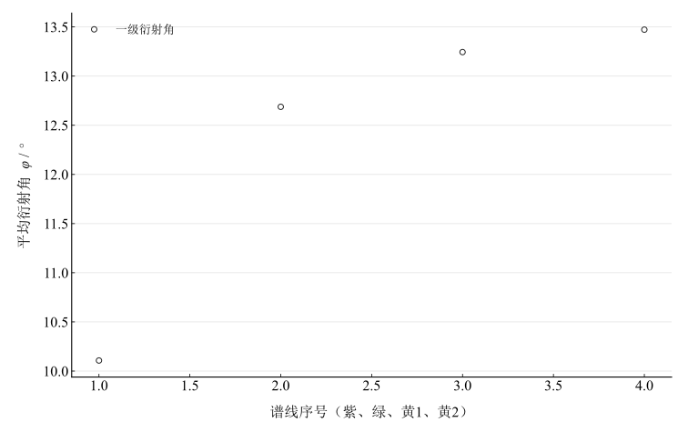

# 用透射光栅测定光波波长

## 实验名称

实验五 用透射光栅测定光波波长

## 实验目的

1.  进一步熟悉分光计的调节和对称测角方法。
2.  观察复色光通过透射光栅后的衍射光谱。
3.  测定光栅常数、可见谱线波长及光栅的角度色散。

## 实验原理

透射光栅由大量等间距平行狭缝组成。垂直入射时，第 $k$ 级主极大满足光栅方程

$$d\sin\varphi_{k} = k\lambda,\quad\quad k = 0, \pm 1, \pm 2,\ldots$$

其中 $d$ 为光栅常数，$\varphi_{k}$ 为第 $k$ 级谱线的衍射角。测量左右两侧同级谱线并取半角，可减小零级方向和安装偏差的影响。

若已知标准谱线波长 $\lambda_{0}$，可由

$$d = \frac{k\lambda_{0}}{\sin\varphi_{0}}$$

标定光栅常数，再求其他谱线波长。光栅角度色散为

$$D = \frac{d\varphi}{d\lambda} = \frac{k}{d\cos\varphi},$$

它反映单位波长差对应的角间隔。

## 主要仪器设备

分光计、透射光栅、汞灯、钠灯及电源。

## 实验步骤

1.  调好分光计，使平行光管狭缝竖直且成像清晰。
2.  将光栅置于载物台上，调节光栅面与转轴平行，并使光栅面近似垂直于入射光。
3.  观察零级和两侧各级光谱，确认同级谱线关于零级对称。
4.  先测量一级汞绿线，重复 5 次，用标准波长 $546.1\, nm$ 标定光栅常数。
5.  测量紫线及黄双线的左右一级谱线读数，各重复 5 次。
6.  计算各谱线波长及黄双线角间隔。

## 原始数据记录

本实验使用分光计测定透射光栅各色谱线的衍射角。$V_1,V_1^{\prime}$ 为同一游标对左右同级谱线的读数，$V_2,V_2^{\prime}$ 为另一游标的对应读数。

表 1　紫色线光谱

| 次数 | $V_1$ | $V_1^{\prime}$ | $V_2$ | $V_2^{\prime}$ | $\varphi_i$ / ° |
| --- | --- | --- | --- | --- | --- |
| 1 | $75^{\circ}15^{\prime}$ | $55^{\circ}12^{\prime}$ | $258^{\circ}45^{\prime}$ | $238^{\circ}06^{\prime}$ | 10.175 |
| 2 | $50^{\circ}20^{\prime}$ | $30^{\circ}19^{\prime}$ | $230^{\circ}21^{\prime}$ | $210^{\circ}09^{\prime}$ | 10.054167 |
| 3 | $50^{\circ}30^{\prime}$ | $30^{\circ}29^{\prime}$ | $230^{\circ}35^{\prime}$ | $210^{\circ}24^{\prime}$ | 10.05 |
| 4 | $82^{\circ}13^{\prime}$ | $61^{\circ}56^{\prime}$ | $262^{\circ}20^{\prime}$ | $241^{\circ}56^{\prime}$ | 10.170833 |
| 5 | $144^{\circ}41^{\prime}$ | $124^{\circ}31^{\prime}$ | $324^{\circ}42^{\prime}$ | $304^{\circ}31^{\prime}$ | 10.0875 |

表 2　绿色线光谱（标准，$\lambda_{0} = 546.1\, nm$）

| 次数 | $V_1$ | $V_1^{\prime}$ | $V_2$ | $V_2^{\prime}$ | $\varphi_i$ / ° |
| --- | --- | --- | --- | --- | --- |
| 1 | $77^{\circ}52^{\prime}$ | $52^{\circ}40^{\prime}$ | $257^{\circ}52^{\prime}$ | $232^{\circ}35^{\prime}$ | 12.620833 |
| 2 | $52^{\circ}55^{\prime}$ | $27^{\circ}41^{\prime}$ | $232^{\circ}54^{\prime}$ | $207^{\circ}35^{\prime}$ | 12.6375 |
| 3 | $53^{\circ}14^{\prime}$ | $27^{\circ}50^{\prime}$ | $233^{\circ}10^{\prime}$ | $207^{\circ}49^{\prime}$ | 12.6875 |
| 4 | $81^{\circ}47^{\prime}$ | $56^{\circ}05^{\prime}$ | $261^{\circ}44^{\prime}$ | $236^{\circ}02^{\prime}$ | 12.85 |
| 5 | $147^{\circ}20^{\prime}$ | $122^{\circ}02^{\prime}$ | $327^{\circ}21^{\prime}$ | $302^{\circ}05^{\prime}$ | 12.641667 |

表 3　黄色线1

| 次数 | $V_1$ | $V_1^{\prime}$ | $V_2$ | $V_2^{\prime}$ | $\varphi_i$ / ° |
| --- | --- | --- | --- | --- | --- |
| 1 | $78^{\circ}34^{\prime}$ | $53^{\circ}55^{\prime}$ | $258^{\circ}30^{\prime}$ | $231^{\circ}50^{\prime}$ | 12.829167 |
| 2 | $53^{\circ}40^{\prime}$ | $26^{\circ}49^{\prime}$ | $233^{\circ}35^{\prime}$ | $206^{\circ}51^{\prime}$ | 13.395833 |
| 3 | $54^{\circ}27^{\prime}$ | $27^{\circ}04^{\prime}$ | $233^{\circ}57^{\prime}$ | $207^{\circ}05^{\prime}$ | 13.5625 |
| 4 | $82^{\circ}19^{\prime}$ | $56^{\circ}15^{\prime}$ | $262^{\circ}17^{\prime}$ | $235^{\circ}57^{\prime}$ | 13.1 |
| 5 | $148^{\circ}08^{\prime}$ | $121^{\circ}24^{\prime}$ | $328^{\circ}01^{\prime}$ | $301^{\circ}25^{\prime}$ | 13.333333 |

表 4　黄色线2

| 次数 | $V_1$ | $V_1^{\prime}$ | $V_2$ | $V_2^{\prime}$ | $\varphi_i$ / ° |
| --- | --- | --- | --- | --- | --- |
| 1 | $78^{\circ}40^{\prime}$ | $51^{\circ}45^{\prime}$ | $258^{\circ}41^{\prime}$ | $231^{\circ}40^{\prime}$ | 13.483333 |
| 2 | $55^{\circ}42^{\prime}$ | $26^{\circ}53^{\prime}$ | $233^{\circ}37^{\prime}$ | $206^{\circ}49^{\prime}$ | 13.904167 |
| 3 | $54^{\circ}29^{\prime}$ | $26^{\circ}45^{\prime}$ | $233^{\circ}59^{\prime}$ | $207^{\circ}01^{\prime}$ | 13.675 |
| 4 | $80^{\circ}36^{\prime}$ | $55^{\circ}50^{\prime}$ | $260^{\circ}34^{\prime}$ | $233^{\circ}50^{\prime}$ | 12.875 |
| 5 | $148^{\circ}10^{\prime}$ | $121^{\circ}20^{\prime}$ | $328^{\circ}12^{\prime}$ | $301^{\circ}20^{\prime}$ | 13.425 |

## 数据处理

从四个游标原始读数重新求角差，不使用记录表中已修约的角度列。按光栅表的成对约定，$V_1,V_1^\prime$ 为同一游标的两侧谱线位置，$V_2,V_2^\prime$ 为另一游标的对应位置；取圆周最短角差后

$$
\varphi_i=\frac{\Delta V_{1i}+\Delta V_{2i}}{4},\qquad d=\frac{\lambda_0}{\sin\bar\varphi_{\mathrm{green}}},\qquad\lambda=d\sin\bar\varphi.
$$

标准绿线波长 $\lambda_0=546.1\,\mathrm{nm}$ 按指定常量采用。五次角度的均值 A 类分量以样本标准差除以 $\sqrt5$ 计算，先传播到 $d$，再与其他谱线的角度分量独立合成；未包含波长标准或仪器系统分量。绿线的回代波长恒等于标定值，不能把其回代结果当独立验证或重复传播自身标定误差。

表 5　光栅标定与谱线波长重算

| 谱线 | 平均衍射角 / ° | 角度均值A类 / ′ | 波长 / nm | 指定A类传播分量 / nm |
| --- | --- | --- | --- | --- |
| 紫线 | 10.1075 | 1.64962 | 436.35512 | 1.84612 |
| 绿线（标定） | 12.6875 | 2.52611 | 546.1 | 0 |
| 黄线1 | 13.244167 | 7.65204 | 569.64119 | 5.6991 |
| 黄线2 | 13.4725 | 10.27667 | 579.28188 | 7.47146 |

得到 $d=2486.4163\,\mathrm{nm}$，约 $402.185\,\mathrm{mm}^{-1}$。黄线平均角间隔为 $13.7000^\prime$，用指定的标准间隔 $2.06\,\mathrm{nm}$ 得到实验角度色散 $0.0019345\,\mathrm{rad}\,\mathrm{nm}^{-1}$；光栅方程在黄线平均角处给出的一级局部色散为 $0.0004134\,\mathrm{rad}\,\mathrm{nm}^{-1}$。

图 1　四条谱线的平均一级衍射角

## 实验结果与讨论

重算波长为紫线 $436.355\,\mathrm{nm}$、黄线1 $569.641\,\mathrm{nm}$、黄线2 $579.282\,\mathrm{nm}$。保留了全部主记录，没有把两条黄线强行修正到标准值。

原始记录中，两游标测得的双侧角差最大不一致达 $121.00^\prime$，明显大于通常的角分级读数分辨率。黄线分离量及据标准波长差计算的实验色散与局部理论色散存在差别；谱线混淆、对准误差或记录错误均可能造成这种情况，现有材料不能唯一判断原因。故重复性传播分量不能代表全部误差，也不能据波长处于可见光量级判定测量准确。

光栅面应垂直入射光、刻线与转轴平行，狭缝像应窄而清晰；同级左右谱线须正确配对。绿线只用于标定，其他谱线才提供独立于标定恒等式的计算检查。
